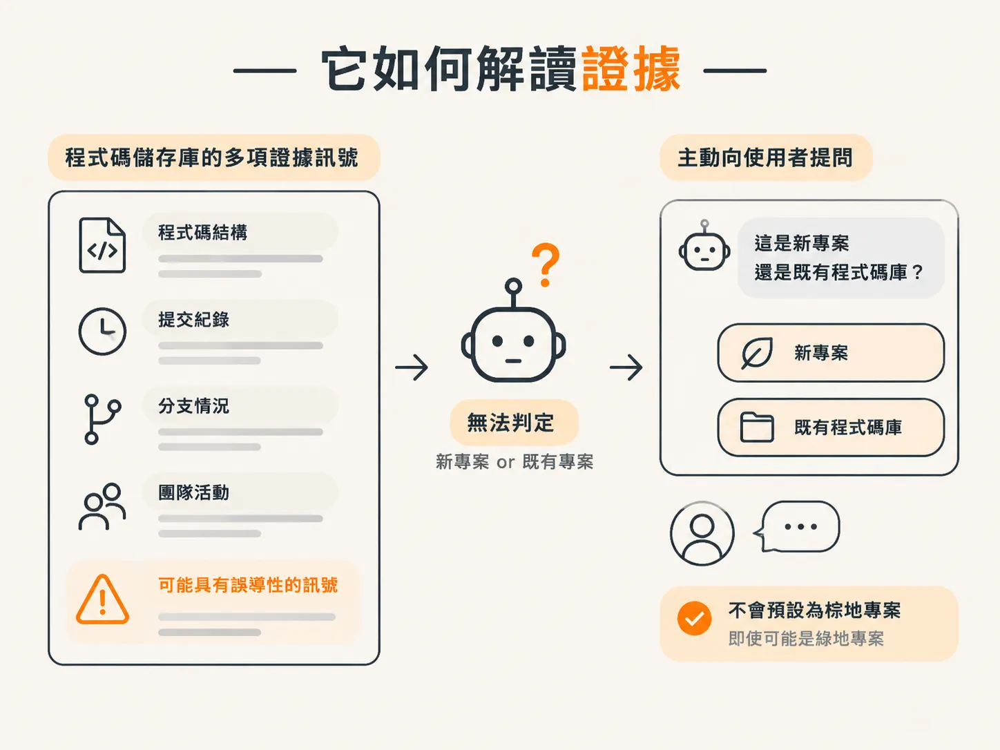
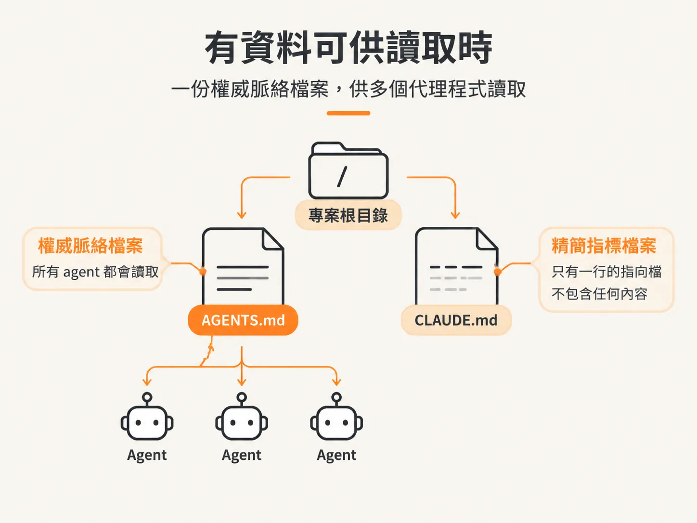

# Why /audit Moves：證據在哪，它就排在哪

上一篇文章最後留下兩種可能，答案是後者：你手上的證據會改變檔案放置的位置。

## 為什麼排第四，而不是第一

`/audit` 會將內容寫入 AGENTS.md，也就是所有其他 skill 都會讀取的 context 檔案。但它不會套用範本來撰寫。

它會先讀取專案中實際存在的內容，再據此撰寫。

這就是它在流程中排在不同位置的原因。既有程式碼庫裡有內容可供參考，`/audit` 就先執行。新專案必須先選定技術堆疊、建立專案架構，才有內容可讀，所以排在第四。

## 如果它改用別的方式撰寫

如果讓 `/audit` 指向空資料夾，它就沒有任何內容可讀，只能根據自己對類似專案的想像，憑空訂出你的慣例。

這正是整套工作流程要避免的問題。猜出來的慣例比沒有慣例更糟，因為它看起來像是已經做好的決定。

所以，你要先決定技術堆疊，再建立專案架構。等這些都完成後，`/audit` 才會記錄專案中實際存在的內容。

## 兩種順序背後的同一條規則

`/audit` 描述的是證據，絕不是假設，所以它在流程中的位置，取決於證據何時出現。

## 它如何讀取證據

判斷依據不是檔案數量：專案架構範本會讓檔案數暴增，不熟悉的語言則可能讓檔案數變成零。

因此，`/audit` 會先蒐集幾種訊號，再決定如何處理：根目錄是否已有 AGENTS.md；常見副檔名的原始碼數量，例如 `.ts`、`.py`、`.go` 和 `.rs`（不包括 vendor 和產生內容的資料夾）；提交記錄的深度，以及是否有實際的專案清單檔；repo 是否為 monorepo。還有一個優先於原始檔案數量的訊號：工作流程是否已經決定技術堆疊？

最後這個訊號之所以重要，是因為剛建立好的專案雖然已有專案清單檔和初始檔案，仍然屬於綠地專案。只看檔案數量的簡單判斷，可能會把它歸為棕地專案，進而跳過詢問標準的步驟。這個 skill 的指示說得很清楚：絕對不要把剛建立好的工作流程專案當成棕地專案。

如果這些訊號仍不足以判定，`/audit` 就會直接詢問你。當它無法分辨這是新專案還是既有專案時，會提供「新專案」和「既有程式碼庫」兩個選項，而且絕不會在專案可能是綠地專案時，逕自預設為棕地專案。

## 沒有內容可讀時該怎麼做

綠地專案仍然需要慣例，只是這些慣例要由你提供，而不是從程式碼中讀取。`/audit` 會詢問架構風格、型別嚴格程度、模組與資料夾結構，以及程式碼標準。接著，它會詢問工具設定，包括 lint 和格式化、提交前檢查、測試門檻、CI，以及 git 整合。

每個選項面板都只會有一個建議選項，最後還會提供自由輸入欄位。指示要求它逐一確認你的選擇，而不是擅自套用預設值，因為這是設定慣例的唯一機會。每個問題都會先依據實際建立好的專案調整：如果技術堆疊已經決定了答案，就會跳過該問題；如果某項工具已經安裝，就會將它列為第一個建議選項。

這裡有一條重要界線：`/audit` 只記錄你的選擇，不會安裝任何東西。安裝套件、設定檔、pre-commit hooks 和 CI，則屬於接下來 `/develop` 的 tooling 子任務。

## 有內容可讀時該怎麼做

面對沒有文件說明的程式碼庫，`/audit` 會掃描整個專案，不必提問就直接處理。它會建立根目錄的 AGENTS.md，以及各個子區域的 `<area>/AGENTS.md`，並判斷哪些內容適用於整個專案，哪些只適用於特定區域。

如果根目錄已經有 AGENTS.md，處理方式就會不同。它會將現有文件與整個程式碼庫比對，只補上缺少的內容；如果要修改非由它撰寫的內容，則會先徵求同意。已經整理好的內容絕不會被覆蓋。

AGENTS.md 是標準檔案，所有 agent 都會讀取。CLAUDE.md 則是只有一行的指向檔，用來載入 AGENTS.md，不會在兩個檔案中重複內容。

## 從第一天起，這份文件就符合實際情況

這些做法能確保你在 AGENTS.md 寫好的那一天，就有一份可靠的文件。但到了第三十天，問題就不一樣了：如果沒有人再打開這份文件，接下來會怎麼樣？

下一篇文章會談這個問題。
