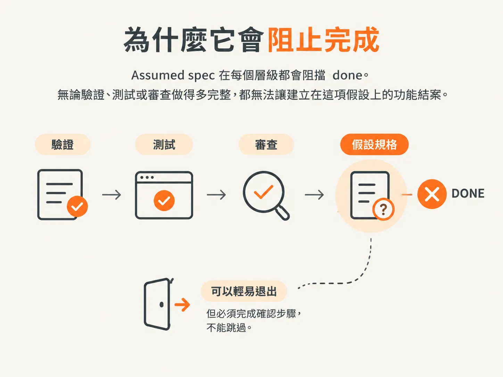
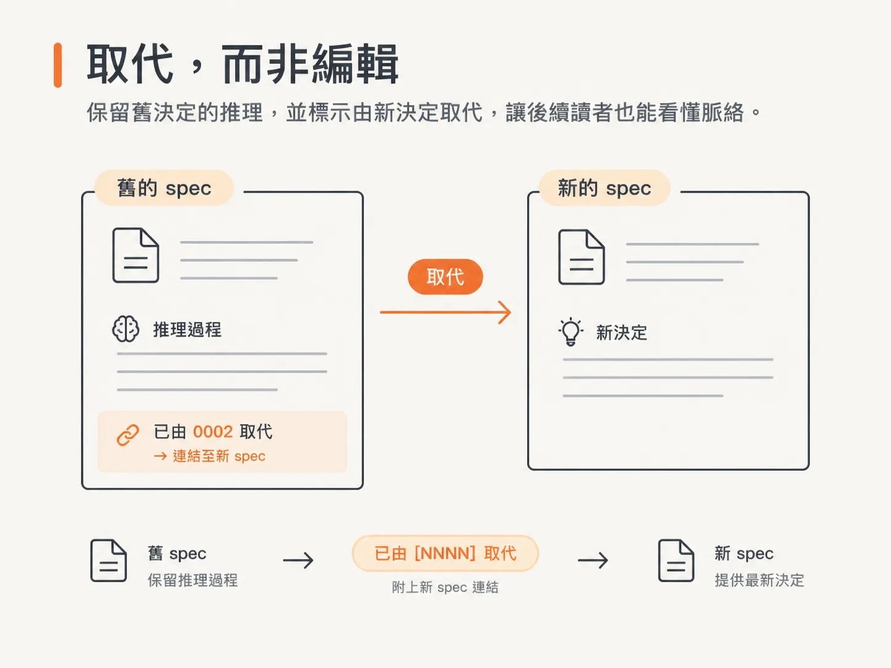

# Assumed spec 為什麼擋住 done

## 第四種狀態

上一篇文章最後提到一種不會自行往前推進的狀態。這種狀態是怎麼產生的？

`/develop` 建置過程中可能會遇到尚未決定的事項。建置模型很擅長說服自己跨過這道關卡，因此要實際檢查：列出建置必須產出的每個值，再確認 spec 是否說明了每個值的來源。

只要有任何必要值沒有指定來源，就代表還有一項決策尚未完成。provider、library、資料模型、整個畫面，或 spec 從未定義過的行為，也都一樣。

## 三種處理方式，其中一種會寫入檔案

遇到尚未決定的事項時，`/develop` 不會自行猜測，也不會默默停下來，而是會詢問你要如何處理，並提供三個選項。

`Architect it first` 會結束這次執行，並引導你前往 `/architect`。`No, not needed` 表示你判斷這裡其實沒有需要決定的事項，建置便會繼續。`Build now, record it as an assumed spec` 則表示現在就建置，但會先記錄採用的假設，讓這項決策留在 repo 裡，而不只是留在這段對話中。

第三個選項就是 `Assumed` spec 的由來。這是 `/develop` 唯一可以建立的 spec，而且狀態只能是 `**Status**: Assumed`。

## 刻意精簡的四個區塊

`Assumed` spec 刻意保持簡短。它記錄的是假設，而不是經過討論的決策，因此只包含下一位接手的人需要知道的內容。

| 欄位 | 記錄內容 |
| --- | --- |
| `## Owed decision` | 尚未做出的具體關鍵決定 |
| `## Assumption built on` | 這次建置將採用的具體假設 |
| `## Code area` | 這次建置會修改的路徑 |
| `## Requirements` | 從範圍的 `Done when` 沿用的驗收條件草稿 |

這裡不會列出理由或曾考慮過的選項，因為這些內容根本沒有經過討論。這份檔案記錄的是採用了哪些假設，而不是為什麼這些假設是對的。

## 是誰決定繼續進行

這份紀錄也會寫明是誰做了決定。教學文章稱之為 git 作者；這個 skill 則會在狀態下方加上一行 `**Authorized by**`。

不論採用哪種寫法，重點都一樣：repo 會記錄是誰決定在沒有真正決策的情況下繼續進行。署名的假設仍是一份紀錄；沒有署名的假設，則只是日後不知道該怪誰的傳聞。

## 為什麼它會擋住 done

`Assumed` spec 在每個層級都會阻擋 `done`。無論驗證、測試或審查做得多完整，都無法讓建立在這項假設上的功能結案。

這就是這條例外通道的代價，也是它能安全提供的原因。你永遠可以繼續往前做；但只要還有真正的決策尚未完成，就不能把它稱為完成。

請把這看成一種交換，而不是懲罰。這道關卡讓你不必開會也能繼續建置，同時確保該開的會最後還是得開。

## 兩份文件說法不一致的地方

教學文章和 skill 檔案在這一點上的說法不同。閱讀這個標記之前，先了解這項差異會比較好。

skill 本身的說法是，`Assumed` spec 會持續標示為尚待核准，但這不會妨礙將功能標記為 `done`。教學文章則指出，它在每個層級都會阻擋 `done`。

有一種解讀可以同時涵蓋兩種說法：功能的狀態和決策的狀態，是兩條不同的紀錄。無論採用哪種說法，這項假設依然有待處理，也不會自行變成真正的決策。

## 只有 /architect 能解除標記

若要解除 `Assumed` spec 的標記，請針對該項決策執行 `/architect`。`/develop` 不會將 spec 從 `Assumed` 改成其他狀態，因為這種變更代表核准，而核准不是建置者的工作。

如果假設成立，`/architect` 就會補上真正的內容，並解除標記。此時，決策已經過審慎討論，檔案內容也會和其他已接受的 spec 一樣。

如果假設不成立，`/architect` 就會撰寫修正後的 spec，將原本的假設標記為已取代，並告訴你必須依照修正內容重新建置這項功能，才能結案。

## 取代，而不是編輯

將舊 spec 標記為已取代，本身也是一條規則。當一項決策確實被推翻時，不會改寫舊 spec。

舊 spec 會標示為 `Superseded by [NNNN]`，並附上取代它的新 spec 連結。舊的推理過程會保留下來，讓一年後找到這份檔案的人，也能看見當時做了什麼決定，以及後來由什麼取代。

這就是紀錄和傳聞的差別。紀錄會呈現自己的歷史，包括那些後來不再成立的部分。

你已經讀過 spec 的形式、兩種讀者對象，以及各種狀態。接下來要看的是如何解除尚未決定事項的標記，而這得從一段對話開始。下一篇文章會實際執行 `/architect`。
