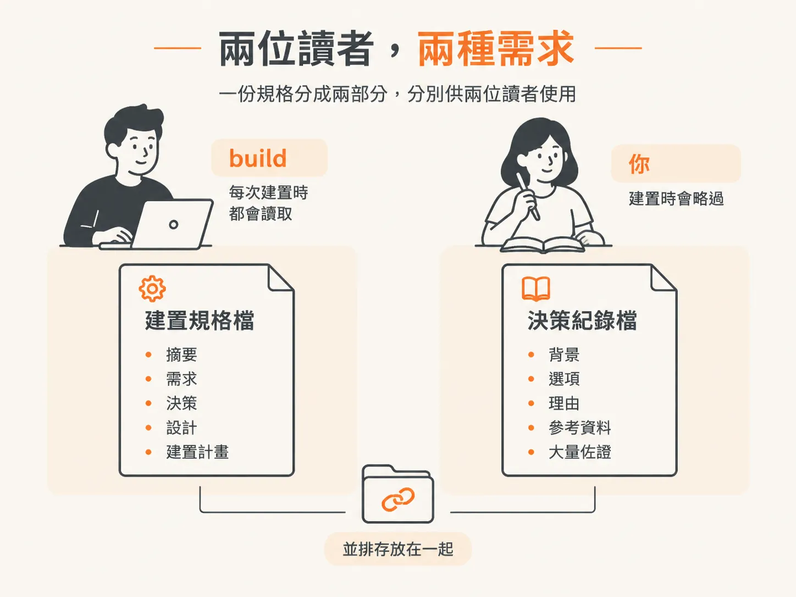
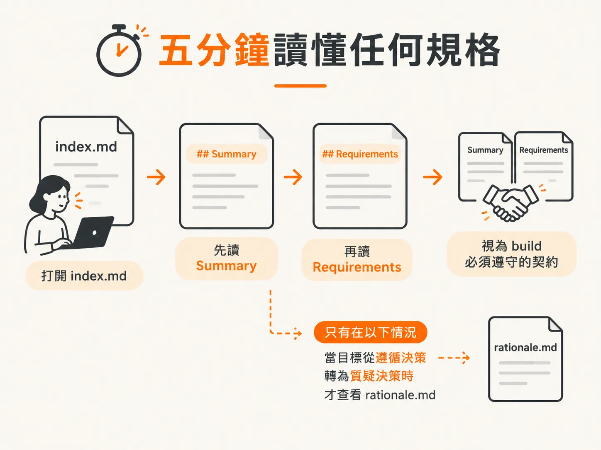

# 兩個讀者：build 要決定，你要理由

## 兩個讀者，兩種需求

上一篇文章最後留下一個問題：build 會讀取哪個檔案？而你又該保留哪個檔案？

答案要從兩者的分工談起。一份規格有兩種讀者，而他們需要的內容截然不同：build 需要的是決策，你需要的是論證。

這種分工正是本課要帶走的核心概念，也是這種目錄結構存在的原因。

## index.md 是 /develop 會讀取的檔案

`index.md` 是 build 規格檔。`/develop` 會讀取這個檔案，但會略過 `rationale.md`。

因此，`index.md` 只包含 build 可據以執行的內容：`## Summary`、包含驗收條件（AC-1、AC-2 等）的 `## Requirements`、`## Decision`、設計章節、`## Build plan`、`## Consequences`，以及 `## Follow-up`。

設計章節會依規格類型而有所不同。功能規格會有 `## Feature design`，架構規格會有 `## Proposed stack`，跨領域標準則會有 `## Standard definition`。

檔案結尾會用一行文字指向 `rationale.md`，讓想了解論證的讀者知道該去哪裡查閱。傘狀目錄也會在開頭加入 `## Structure` 章節，逐行列出所有子規格。

## /develop 會略過 rationale.md

`rationale.md` 是決策紀錄，內容包括 `## Context`、`## Options considered`、`## Rationale` 和 `## References`。

較大型的佐證資料也會放在這裡，例如清查清單、稽核結果和技術版圖調查。這裡不會另外建立 `research/` 資料夾，因為這些資料會放在 `rationale.md` 自身的子標題下。

這個檔案是供人閱讀的；當 `/architect` 更新或取代某項決策時，也會查閱它。build 過程則絕不會讀取這個檔案。

## 沒有任何內容會被丟棄

推理過程不會被濃縮到消失，也不會遭到刪除。它會永久保留在規格旁邊，供你以及一年後重新檢視架構的任何人閱讀。只是每次 build 時，不會一併載入這些內容。

實作代理程式需要的是決策及其限制，不必每次新增一條路由時，都重新閱讀整段論證。

這就是 Module 4 的 context 課題在工作流程產物中的應用：推理時載入理由，建置時載入決策。

## 為什麼只有大型規格才會拆分

單一檔案規格會把兩種讀者需要的內容放在同一個檔案中，並直接加入決策紀錄章節；整體內容則保持精簡。因此，小型規格不會拆分。

對小型決策來說，推理過程可能只有兩行。另拆成一個檔案，付出的成本反而高於帶來的好處。

因此，只有值得拆分的規格才會採用這種做法：基礎規格，以及涵蓋一系列子決策的傘狀規格。

## 如何在五分鐘內讀懂任何一份規格

打開 `index.md`，閱讀兩個章節：`## Summary` 和 `## Requirements`。這兩個章節說明 build 必須達成的要求。

`## Summary` 是讓人快速掌握內容的摘要。它以淺白的文字寫成，包含兩到四個簡短句子，並在括號中解釋技術術語，讓忙碌的讀者大約二十秒就能掌握重點。

`## Requirements` 則是契約。`/develop` 會依照這些要求進行建置，`/check verify` 也會逐一根據驗收條件進行檢查。

只有在你想質疑決策，而不是依照決策執行時，才需要查看 `rationale.md`。

## 一份你現在就能讀的範例

Reel repo 中的 stack ADR 採用相同的版面安排。檔案以 `**Status**: Accepted` 開頭，接著是 `## Summary`，用一個段落說明完整決策。

這個段落就是五分鐘閱讀版的縮影。後面的所有內容，都是用來支持或限制這項決策。

你剛讀完一份狀態列寫著 `Accepted` 的規格。但這個詞在不同規格中的意思不盡相同，下一篇文章就會談到這一點。
