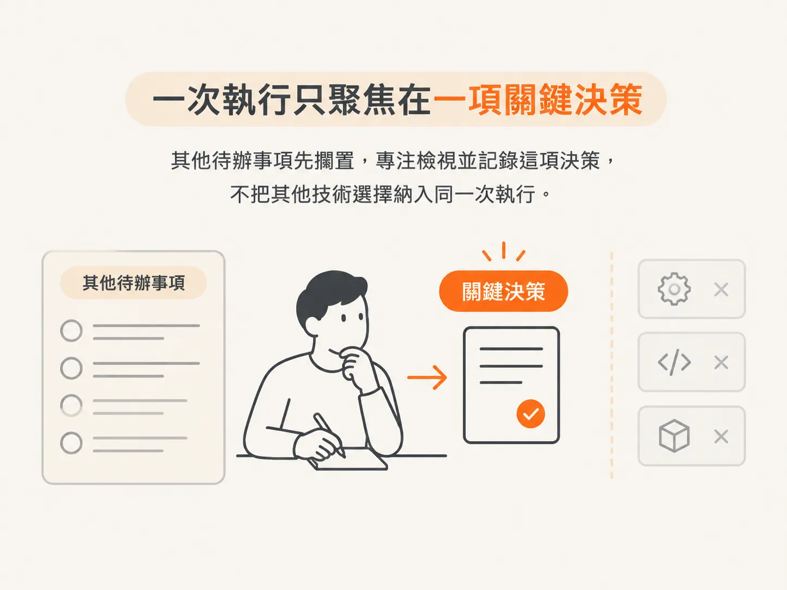
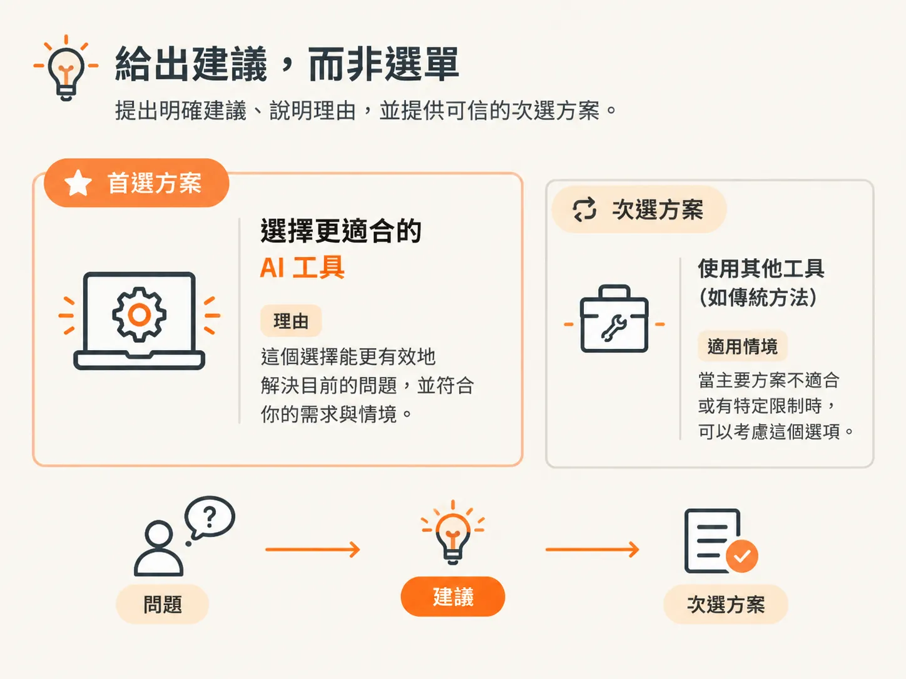
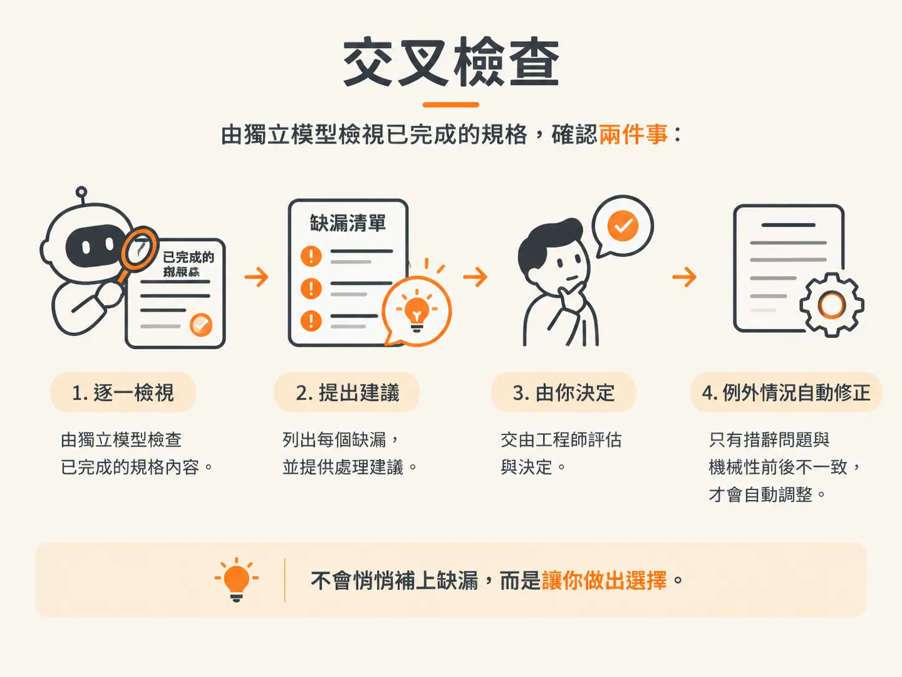

# 跑一次 /architect：一次只做一個決策

## 清除待決標記的那一輪

你現在已經知道什麼樣的決策算是待決，也知道只有 `/architect` 能清除它。這篇文章會帶你完整走過這一輪。

計畫最上方還有一項範圍內尚未解決的決策：整個產品要採用哪種技術堆疊與架構。每項功能都仰賴這項決策，在它確定之前，什麼都還不能開始建置。因此，這一輪要處理的就是這項決策。

## 每一輪只做一個決策

`/architect` 遵循一項左右所有行動的規則：每一輪只做一個決策。

要處理的是一項關鍵決策，不是整份待辦清單。先仔細檢視並記錄下來，再讓程式碼依賴它。

因此，你要讓這個 skill 專注於一項選擇。示範的那一輪，選的就是技術堆疊。

## 先開啟新的工作階段

開始這一輪時，請開啟新的工作階段，不要沿用剛才的聊天。

專案已經存在磁碟上，因此這一輪不需要依賴聊天紀錄。而且舊的聊天紀錄包含了它自己的背景資訊，這次的決策用不上那些內容。

## 提問前會先讀取什麼

在推薦任何工具之前，`/architect` 會先讀取 repo：查看 skill、列出專案檔案，接著讀取 scope。

最後這項讀取會改變答案。它能根據你實際描述的產品做決策，不會套用一套通用的網頁技術堆疊。在示範中，它了解到這個 app 需要即時預覽、置頂留言、共用的客戶存取權限、討論串，以及管理意見回饋的儀表板。

接著，它會讀取 `AGENTS.md`。這個檔案記錄了專案的指令、慣例、模式與結構。全新的 repo 還沒有這個檔案；但如果是既有的程式碼庫，這份檔案可能早在訪談開始前，就已經回答了好幾個問題。

它也會讀取現有的規格文件，確認這項決策是否已經做過，以及下一份規格應使用哪個編號。它還會檢查 git 狀態，因為架構工作應該從已知且最新的專案版本開始。

這一切背後的原則是：repo 已經能回答的問題，就少問你一個。目標是把注意力留給只有你才能提供的資訊，不必把訪談拉長。

## 第一個問題會先問你要不要查資料

第一個真正的問題不是要用什麼工具。它問的是：你願不願意讓這個 skill 查詢目前的技術發展狀況？不願意的話，它就假設原本的資訊仍然最新。

工具建議很快就會過時。一年前合理的資料庫或函式庫，今天可能已經不是最佳選擇。因此，它不會默默根據記憶推薦工具，而會先詢問你是否同意查證。

回答「是」之後，它就會啟動成本低、只讀取資料的子代理，在訪談繼續進行的同時查詢最新的技術資訊。

這些子代理不會弄亂主要對話。它們讀取的網頁不會塞滿對話內容，你只會收到精簡的摘要；來源連結也會保留在規格裡，方便日後查閱。

這些子代理也有預算。這是一小筆研究額度，用來避免查詢過多，與你的 token 數量或訂閱額度無關。這一輪可能會告訴你，有些工具還沒查證就已經用完預算；那些工具就會維持未查證狀態。

## 給你一項建議，而不是一整份選單

訪談會分成幾輪，每一輪都會根據前一輪的答案展開。

第一輪會處理影響其他所有工作的四項核心選擇：app 的類型、框架、資料平台，以及預覽的運作方式。示範中選擇的是全端 app、使用 App Router 的 Next.js、以 Supabase 作為資料平台，並透過直接嵌入的 iframe 顯示預覽。

後續幾輪會聚焦於這個產品特別需要的部分：驗證、ORM、託管、API 形式、如何識別匿名客戶、分享連結，以及檔案上傳。接著是開發所需的工具與設定：樣式、驗證、測試、速率限制；再來是專案設定：套件管理工具、本機資料庫、資料遷移，以及程式碼組織方式。最後一輪會討論電子郵件寄送、CI/CD 和監控。

當答案取決於工程判斷時，這個 skill 會推薦它偏好的選項。它不會丟給你一長串十二種工具，然後就不管了，而是會提出一項明確的建議、清楚的理由，以及一個可信的替代方案。

驗證方式的建議就展現了這種思考方式。既然資料庫已經選了 Supabase，那麼使用 Supabase Auth 就很合理：它本來就是平台的一部分，不需要額外服務，也不會增加費用。

工具可能會改變，重要的是背後的理由。因此，請讀一讀理由，再用自己的情況檢驗：它描述的是你的限制條件，還是一般專案的平均情況？

每個問題你都有三種選擇：接受建議、選擇其他選項，或透過「其他選項」用一句話提出自己的選擇。

決策權在你手上。模型可以研究、比較，甚至為某個選項提出論據，但不能代替你做決定。

## 停止提問後，才讀取範本

訪談會在撰寫任何內容之前結束。只有到這時，skill 才會讀取 agent 提示、規格範本和架構文件。

這樣安排正是重點。在提問階段使用的每個 token，都會用來理解專案、限制條件、替代方案與後果，不會用來載入一份目前還不需要的文件架構。

這和課程前面提到的 context 管理原則相同：推理時載入推理所需的內容，準備撰寫時再載入輸出的結構。

## 基礎性決策會有自己的目錄

技術堆疊是基礎性且影響深遠的決策，因此會採用目錄形式：建置規格放在 `index.md`，決策理由放在 `rationale.md`。

`index.md` 會包含摘要、決策內容、完整填寫的建議技術堆疊、安全模型、設定、後果與後續事項，也會用一句話指向 `rationale.md`。

其中有一項內容是刻意不放進去的：目前沒有建置計畫，也沒有憑空編造的驗收條件，因為技術堆疊規格記錄的是決策，而 `/develop` 會根據這份規格推導出建置骨架的步驟。

這最能說明文件的形式應依照決策本身設計。檔案只包含建置所需的內容，不多也不少。

## 交叉檢查

接著，這一輪會詢問你是否要在閱讀規格之前先做交叉檢查，並建議交由另一個模型審查。

原因在於錯誤的代價。這是專案的基礎，之後每個功能切片都會沿用它，因此這裡一旦漏掉關鍵內容，代價就會非常高。不同的模型可以找出撰寫規格的模型看不到的問題。

審查者有兩項工作。第一是檢查完整性：找出設計中需要的每個值或行為，並確認規格是否說明了該值的來源。第二是檢查合理性：確認是否存在簡單得多的選項、是否漏掉重要的失敗情況，以及任何後果是否會讓這項建議其實沒有撰寫者原先認為的那麼適合。

審查者不會悄悄替你補上缺漏的決策，因為那只是用另一個模型默默做出的選擇，取代原本默默做出的選擇。它會逐項列出問題，並為每個問題提出建議的處理方式，再詢問你要怎麼做。只有不影響決策的措辭問題和機械性的前後不一致，才會自動修正。

示範中，這次審查確實有所幫助。它找出了真正的缺漏，也指出有一處安全性描述把資料列層級安全性（row-level security）的能力說得過於強大。工程師也不同意其中五項缺漏，因為那些內容應該放在資料模型規格裡，並標示為「待第三個功能處理」，不在這裡回答。

這才是這一輪最值得效法的部分：閱讀審查結果，判斷哪些說法成立，並讓決策權留在自己手上。

## 閱讀產出的內容

先開啟 `index.md`。閱讀摘要，確認它描述的是你做出的決策，不是你進行過的訪談。

然後再開啟一次 `rationale.md`。你現在不需要它，因為你已經做出選擇。但等到有人接手這份程式碼，或未來的你想了解當時的情況、有哪些替代方案，以及最後選擇各方案的理由時，它就會派上用場。

這些推理沒有被濃縮省略，也沒有藏起來。它就在規格旁邊，而且不會隨著每一輪實作流程一起載入。

接著接受這份規格，這一輪就完成了。你也會收到一份簡短報告，列出所有做過的選擇、選擇理由、兩項值得延續的事項，以及磁碟上的變更。

scope 也會跟著更新；呼叫 `/develop` 時，它會再加入額外的子任務。這也是整組 skill 中最耗資源的一個；示範中大約使用了 150,000 個 token。繼續之前，請先清除這個工作階段。

## 什麼時候值得走完整套流程

對於基礎性的技術堆疊決策，投入這些流程是值得的，因為一旦選錯，就會影響每項功能和未來每次遷移。

但如果只是改一行樣式，走同一套流程就太繁瑣了。這也正是工作流程分級存在的原因：只在犯錯代價高的地方採用這種深入程度，不讓每個小修改都經過架構審查。

## 評估自己的決策過程

agent 並不中立。它有自己的傾向，其中三種來自這些模型的訓練方式。

它傾向認同你，所以帶有暗示性的描述很危險。告訴它你的 app 基本上就是給遛狗服務用的 Uber，它可能就會規劃出一個像 Uber 的產品，即使這個比喻掩蓋了真正重要的地方。當 `/architect` 質疑你的前提時，它是在抵抗自己順著你說的本能。請先讀懂它提出的疑慮，不要只因為它拖慢進度就直接否決。

常見答案也是它的預設，所以第一項建議通常會以一般專案為出發點。你的商業風險、團隊壓力、個人限制或尚未解決的疑慮，不會自動反映在答案裡。請它說明推理過程，再根據自己的情況檢驗這些理由。

它希望看起來像是已經完成工作，所以如果訪談短得異常，你應該提高警覺，別急著感到驚豔。真正危險的失誤，是一份看似整齊的計畫，背後卻建立在你早已不記得自己做過的捷徑上。

接下來的判斷由你負責，重點可以歸納成三個問題：你是否了解每項建議背後的理由，還是有幾個選擇只因為工具名稱聽起來熟悉就直接通過？規格產生的每個值、狀態、權限或行為，是否都標明了來源？你選擇的方法是否能處理最大的風險，還是只是 agent 提出的第一個選項？

你現在已經掌握整個流程：規格是 `docs/specs/` 裡的 Markdown 檔案；文件形式會依決策規模而定；兩份檔案分別服務不同的讀者；不同類型的規格，其狀態代表的意義也不同；而待決事項則會透過一輪只做一個決策的流程來清除。

拿一個真正的想法試著跑一次。先用 `/scope` 整理自己的專案，再用 `/architect` 處理計畫中第一個標記為待決的關鍵決策。完成後，磁碟上應該會有兩份檔案：一份持續更新的計畫，以及計畫所依賴的第一項已接受決策。
