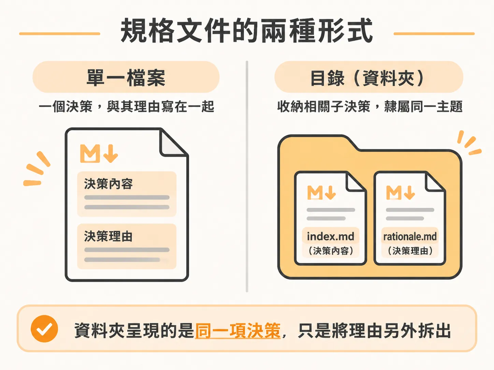

# 兩種形狀，一條選法

## 前言

spec 是放在 `docs/specs/` 裡的 Markdown 檔案，格式很簡單。它和 skill 一樣，都是純 Markdown，不需要安裝任何新工具。

首先要決定的是採用哪種結構。如果一個檔案就夠，卻選擇用目錄收納，就會讓同一項決策分散在兩個檔案裡。凡是會讀取這份 spec 的建置流程，也得額外花力氣理解這種結構，但這些推理其實不是建置流程所需的。

下一個功能就會遇到這個選擇。一般而言，一項決策放在一個檔案裡就夠了。只有當某項技術堆疊決策會成為未來每個功能都要參照的基礎時，才需要用目錄來承載。

本文分五步說明：兩種結構及其選擇方式、兩種讀取者各自會讀取哪些內容、`Status` 的意思、為什麼 `Assumed` 狀態的 spec 會讓流程無法完成，以及一次實際執行 `/architect` 的過程。本文首先要回答的問題是：該選擇單一檔案，還是目錄？

## 沒有需要學習的新格式

spec 放在 `docs/specs/` 裡。它就是 Markdown，沒有其他格式。

這點很重要，因為 spec 不必和其他東西競爭。沒有必須符合的 schema，也沒有必須填寫的範本。唯一需要做出的決定，就是採用哪種結構。

## 兩種結構

spec 有兩種結構：單一檔案直接記錄一項決策；目錄則用來收納一組彼此相關、隸屬於同一主題的子決策。

| 結構 | 適用情況 | 範例 |
| --- | --- | --- |
| 單一檔案 | 預設選項 | `docs/specs/0003-comment-threads.md` |
| 目錄 | 用來收納一組相關的子決策；或是內容較為繁重，值得讓每次建置讀取時不必一併理解背後的推理 | `docs/specs/0001-stack/`，內含 `index.md` 和 `rationale.md` |

單一檔案是預設選項，自有其道理：一項決策放在一個地方，只需要記住一個路徑。

## 結構取決於決策的規模

原則只有一句：結構取決於決策的規模，而不是專案的規模。

因此，大型專案一樣可以為每項決策各寫一份單一檔案的 spec。小型專案也可能需要目錄，前提是其中一項決策會成為一連串後續決策的基礎，而且之後的每個功能都會讀取它。

預設使用單一檔案。這門課程中的技術堆疊決策之所以採用目錄，是因為它屬於基礎決策，未來每個功能都會讀取它。大多數功能的 spec 不需要目錄。

## 一條命名規則

如果目錄不遵守命名規則，放在其他目錄旁邊時就會顯得格格不入。因此，命名規則只有一條：編號放在目錄名稱裡，頂層檔案一律命名為 `index.md`。

不要用 `0001-stack/0001-stack.md`。編號屬於資料夾，不屬於裡面的檔案。

## 目錄能帶來什麼

採用目錄，是為了把一件事拆成兩部分。`index.md` 記錄建置流程必須做出的決策；`rationale.md` 則記錄背後的理由。

只有當理由需要大量說明，或這項決策是後續一整組決策的基礎時，拆成兩個檔案才值得。否則，這麼做只會增加額外負擔。

現在你已經選好結構。接下來要回答的問題，正是採用目錄後會遇到的問題：建置流程要讀取哪個檔案？哪個檔案則由你保留？
