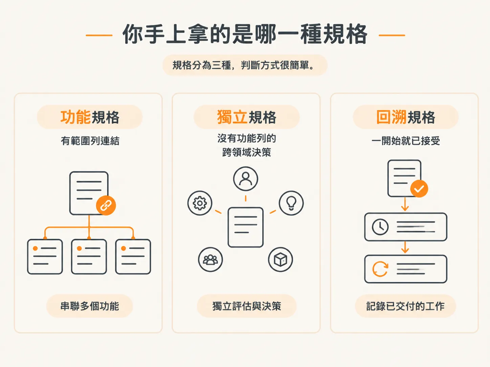
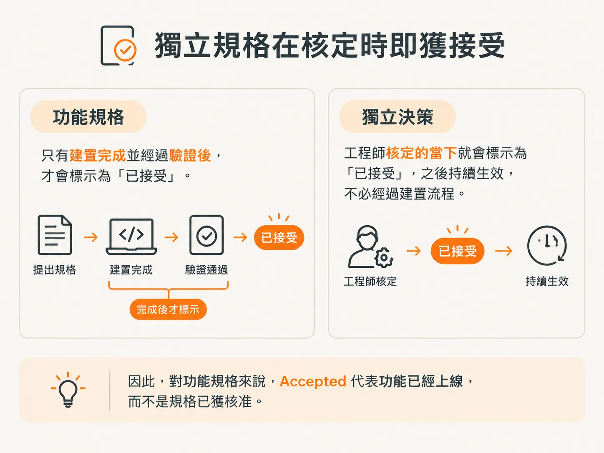

# Status 到底在說什麼

## 兩種生命週期，共用一個詞

上一篇文章最後提到一個狀態：`Accepted`。這個詞值得進一步說明，因為這裡有兩種不同的生命週期，卻共用同一個詞。

每份規格都有一行 `**Status**`。適用哪一種生命週期，取決於規格的種類。

## 你手上的是哪一種規格？

規格分為三種，判斷方式很簡單。

| 種類 | 判斷方式 | 生命週期 |
| --- | --- | --- |
| 功能規格 | 範圍中的某項功能連結到這份規格 | `Proposed` → `In Progress` → `Accepted` |
| 獨立決策規格 | 沒有對應功能列的跨領域標準 | `Proposed` → `Accepted` |
| 回顧規格 | 用來記錄已經上線的工作 | 一開始就是 `Accepted` |

## 功能規格追蹤建置進度

如果某份規格連結到範圍中的一項功能，它追蹤的就是那項功能。`/architect` 會將它標記為 `Proposed`，之後狀態便不再變更。

建置開始時，`/develop` 會將狀態改為 `In Progress`。等功能完成建置並通過驗證後，狀態才會改為 `Accepted`。

因此，對功能規格來說，`Accepted` 代表功能已經上線，而不是規格已獲核准。

這正是最容易讓人困惑的地方。由於這個狀態追蹤的是建置進度，即使規格已獲得一致同意，狀態仍可能不是 `Accepted`。

## 獨立規格在決策正式確認後就會成為 Accepted

獨立決策規格是沒有對應功能列的跨領域標準，它的運作方式正好相反。

規格寫好時是 `Proposed`；正式確認決策後，它就會變成 `Accepted`。從那一刻起，這項決策便正式生效，而 `/develop` 不會再推進它的狀態。

因此，同一個詞代表兩種意思：對功能規格來說，它表示程式碼已經完成；對獨立規格來說，它表示決策已正式生效。

## 回顧規格一開始就是 Accepted

偶爾你會看到這類規格。用來記錄已上線工作的規格，一開始就是 `Accepted`。

沒有任何事情需要等待。建置早已完成，因此這份紀錄從一開始就處於最終狀態。

## 不會自行變動的狀態

上述三種生命週期都會依照各自的時程推進。還有第四種狀態不會自行推進，而且可能讓功能無法結案。

建置過程中，`/develop` 可能會遇到尚未決定的事項。如果你選擇繼續進行，就會產生另一份規格，而那份規格會改變 `done` 的定義。下一篇文章會接著說明。
