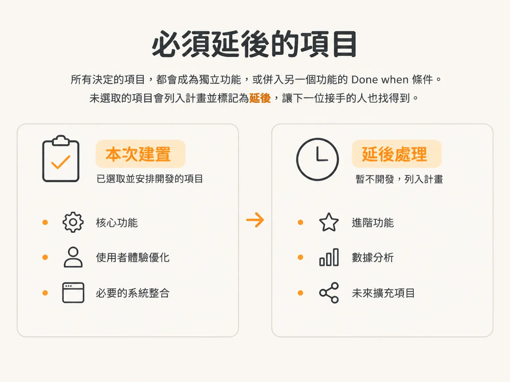

# 決策面板：把 MVP 邊界問到寫下來

範圍檔案負責記錄答案。`/scope` 會先收集這些答案，再寫入任何資料。

## 先推斷，再提問

這個 skill 的行為就像資深產品工程師。它會先推斷想法中已經提到的內容，例如使用者、專案、預覽和留言，因此不會把問題浪費在這些事情上。

它只會詢問無法從想法本身推斷的內容，聚焦於商業、產品和上市策略。

問題會分成小批次提出，每個面板最多四題。每個選項面板都會提供可供選擇的方案，不會只給一份中立的選單。

## 面板長什麼樣子

每個面板都會提供兩到四個適合這項產品的具體選項。其中恰好一個會標上 `(recommended)`，並附上一句推薦理由。

這就是設計方式：先替你做出選擇，再讓你自行調整。你不必盯著空白欄位，從頭設計整個產品。

你仍然可以填入其他答案。選擇器會自動加入自由輸入的「其他」欄位，因此 skill 不會自行新增「其他」選項。

## 第一個面板：MVP 的範圍

第一個問題也是最重要的一題：能同時帶來核心價值的最小可交付版本是什麼？

如果忽略這個問題，功能清單就會不斷變長。沒有設定範圍，也沒有明確列出哪些內容不在範圍內，就等於什麼都可以納入。

我們的目標正好相反：先做出一個能交付、能測試的版本，用來驗證想法，再逐步推進。

以客戶回饋 app 為例，面板提供了三種範圍選項：

- 單一專案，支援釘選留言和標記為已解決。
- 支援釘選、討論串和通知。
- 完整的審查流程：狀態包括待處理、進行中、已修復和不修復；同時擷取螢幕截圖、瀏覽器和螢幕尺寸，並由客戶核准每一輪審查。

再讀一次這三個選項。它們不是三種時程安排，而是三種不同的產品。

正因如此，不該等 agent 寫到一半才決定要做哪一種。這次示範選擇了第一個選項：建立一個設定好預覽目標的專案、分享連結，讓客戶釘選留言，而你可以在儀表板中查看。

## 通常要到產品上線時才想到的問題

下一個面板會問：客戶要在哪裡加上釘選標記？這裡的答案是，在框架中載入正式網站，並在頁面上疊加留言層。客戶不必在自己的網站中加入任何程式碼。

接著，面板會問一個多數開發者通常要到上線前才想到的問題：客戶沒有帳號，要怎麼開啟分享的專案？如果透過網址提供存取權，又要如何避免不該看到的人也能開啟？

這不是無關緊要的實作細節，而是一項存取權決策。

`/scope` 趁著改變答案還很容易時，就把這件事問清楚，不必等到三週後，才發現原先的假設已經散布在路由、資料庫、資料表和 UI 中。

這個專案選擇使用不需登入的秘密連結。任何取得連結的人，只要輸入一次姓名就能使用。連結也可以撤銷。這種方式對客戶來說最方便，也符合產品的核心目的。

## 先談收費，再談功能

下一個面板會問一個與收費相關的問題：這次開發要包含計費功能嗎？

答案是否定的。先讓使用者立即獲得價值，暫不收費；等到有人真的開始免費使用後，再考慮收費。

接著是多選題，使用核取方塊，不用單選按鈕：第一輪開發要包含哪些功能，又有哪些要先延後？

- 登入功能：納入。專案和留言都必須屬於特定使用者。
- 電子郵件通知：延後。客戶留言後，可以直接寄一封電子郵件通知你。
- 即時更新：延後。訊息不必即時送達。
- 留言附加圖片：納入。客戶想展示某個區塊的替代設計時，這項功能就很有用。
- 通知方式：只使用儀表板徽章。這項選擇決定你要如何得知客戶留下了留言。

確認功能後，接著處理那些常常要到上線前才想起來的跨領域事項：錯誤監控，延後；具備 SEO 的公開行銷頁面，納入；產品分析和無障礙設計，目前先不做。

## 延後的事項必須寫下來

在聊天中說一句「現在先不做」並不夠。下次開會時，大家可能不會記得這件事。

每個決定要做的項目，都會成為獨立功能，或併入另一個功能的 `Done when` 條件。所有未選取的項目都會列入計畫並標記為延後，讓下一位接手的人也找得到。

這次示範最後以一組簡單的數字收尾：規劃了 10 項功能，另有 14 項延後處理。延後項目多並不代表失敗，而是表示範圍界線發揮了作用。

## 工具選擇的界線

`/scope` 絕不會替你挑選工具。這裡不會選擇或指定任何供應商、函式庫、ORM、主機或 BaaS。

這些內容應由 `/architect` 在規格中逐項決定。只要某項功能牽涉工具選擇，它就屬於 `Needs spec: yes`。

讓範圍規劃不受特定工具限制，才能避免依賴項目一有變動，整份規劃就跟著過時。

## 還缺少什麼

範圍已經寫下來，延後清單也已經列出。現在還缺少建置順序的規劃，因為單看功能清單，還看不出先後次序。

`/scope` 還會再問一個會改變整份計畫架構的問題：這項產品應該如何切分？下一篇文章會介紹四種答案。
