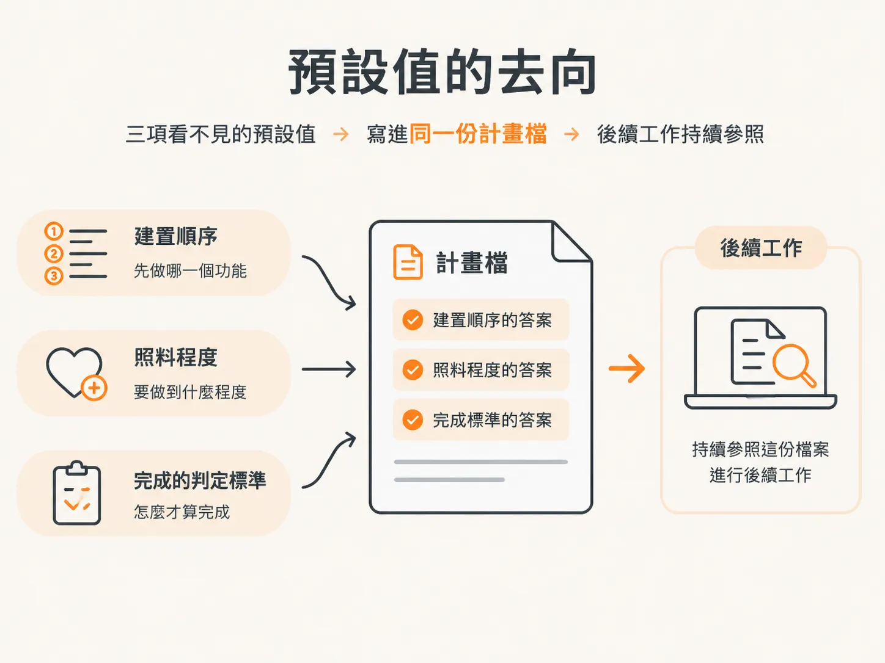

# 每個專案都跑在預設值上

## 前言

每個專案都會依照一些預設值運作。其中有三項會決定工作的進行方式：功能依什麼順序開發、每項變更發布前要經過多少檢查，以及在還沒有人做出決定時該如何處理。

Vibe 開發就是這樣運作的。沒有人決定開發順序，agent 就先做它最先想到的功能；沒有人決定哪些內容不在範圍內，於是什麼都可以做；也沒有人決定一項功能要經過多少驗證才算完成，agent 就選了最省事的答案：什麼都不做。

當你在聊天中描述一個點子，接著在還沒寫下任何計畫前，就任由程式碼開始出現，這種情況便已發生。當下看起來一切正常，代價卻會在之後浮現：開發範圍已經擴大，界線卻仍然模糊。

本單元會依照 `/scope` 的實際執行順序，完整走過這個指令。首先會介紹三項預設值，以及 Vibe 開發為何缺乏明確界線；接著會說明 `scope.md` 的架構、用來劃定 MVP 範圍的決策面板、開發方式、第一個切片，以及工作流程等級。最後，你可以對自己的點子執行 `/scope`，並記下三件事：MVP 的範圍、每項功能的 `Done when` 條件，以及第一個要開發的切片。

整個單元都在回答同一個問題：哪些預設值是你自己選的？哪些又是別人替你選的？

## 三個預設值，沒有人負責

因此，執行專案有兩種做法：你可以刻意決定這些預設值，也可以任由 agent 在每次順手挑選功能時，逐一替你做出決定。

## 預設值一：開發順序

在 Vibe 開發過程中，順序不是誰決定的，是 agent 挑功能時順手排出來的。

這樣形成的先後次序仍然是一種順序。它決定了產品目前有哪些部分，以及哪些部分只能留待之後再猜。沒有人投票決定這個順序；它只是自然而然地形成，接著便左右了後續工作的樣貌。

## 預設值二：檢查程度

第二項預設值，是每項變更發布前要經過多少檢查。

沒有人決定一項功能要驗證到什麼程度，所以檢查程度就是零。沒有檢查、沒有測試，也沒有再檢視一次。

尷尬的是，缺少檢查不會立刻顯現。工作仍然持續進行，直到問題寫進程式碼。

## 預設值三：怎樣才算完成

如果沒有人決定「完成」代表什麼，答案就不會是「看到時自然就知道」，而會變成任何最容易用來宣稱完成的標準。

答案和檢查程度一樣：什麼都沒有。功能看起來完成了，就算完成。沒有明確標準可供確認，因為根本沒有人把標準寫下來。

三項預設值，背後只有一個決定者：agent。它總是挑最順手的答案。

## 這些事都沒有討論過

在 Vibe 開發過程中，這些事從未被討論或記錄下來。大部分問題甚至要等到它們已經變成程式碼，才會浮出檯面。

而這些，就是專案的預設值。

## `/scope` 能補上什麼

`/scope` 會把一個點子轉化為有先後順序、內容概略的計畫，並隨著產品交付持續更新，確保計畫始終符合實際情況。

它會回答四個問題：要做什麼、依照什麼順序做、投入多少心力，以及哪些部分需要先做決定。它不會告訴你某件事該如何實作；那是 `/architect` 和 `/develop` 的工作。

工作順序在這裡很重要。`/scope` 會先提問，再開始撰寫，接著產生一個檔案。之後，每個 skill 都會從這個檔案查找功能，而不是重新整理聊天內容來重建計畫。

## 預設值會寫到哪裡

只有當有人寫下不同的答案，預設值才不再左右決策。因此，第一步就是找到這個檔案。

執行 `/scope`，就能避免別人替你決定預設值。下一篇文章會打開它產生的檔案，看看檔案最上方寫了什麼、每個功能區塊包含哪些內容，以及如何找到下一個待完成項目。

