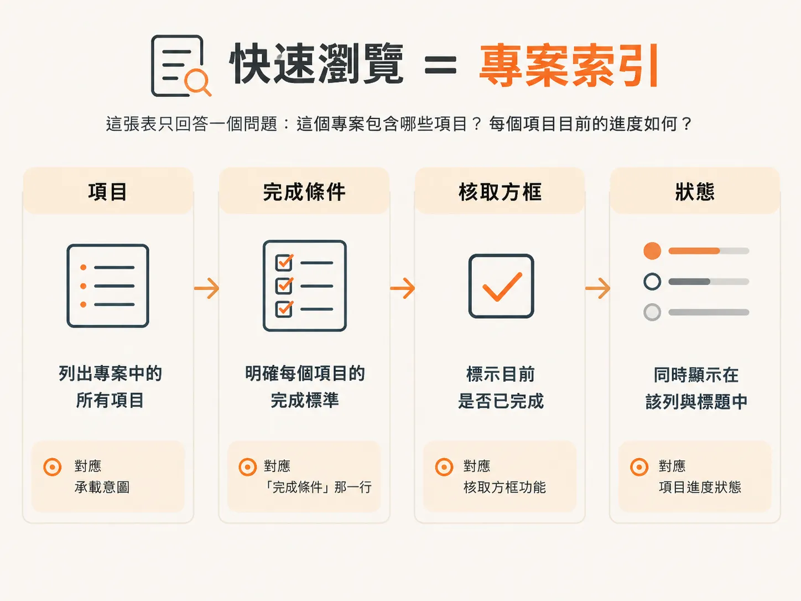
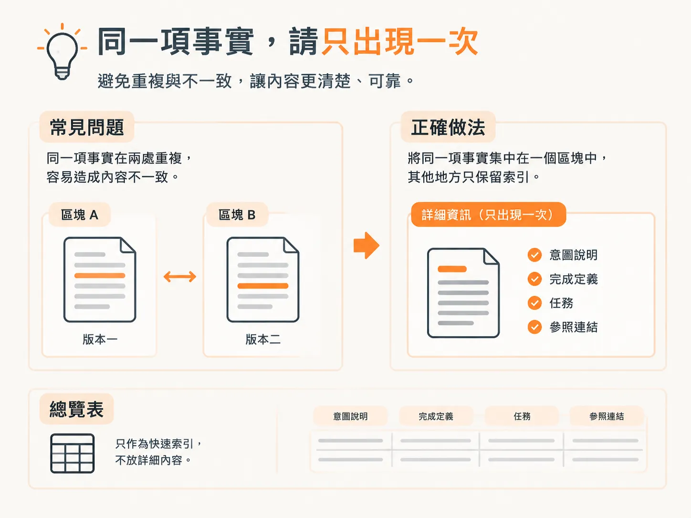

# Living scope：At a glance 表加 feature 區塊

上一篇文章以一個檔案作結，這一篇則從打開這個檔案開始。

`/scope` 會為小型產品建立 `docs/scope/scope.md`。這個檔案分成兩部分：一張快速總覽表，以及依階段分組的 feature 區塊，呈現完整計畫。

結構就這麼簡單。各區塊的排列順序就是建置順序，不必另外再維護一份清單。

<!-- derived -->

```markdown
# Scope: Client Feedback

A client feedback app where a shared link lets a client pin comments onto a live page.

**Build approach:** Tracer Bullet (one thin path through the complete system).
**Workflow:** Beta (after `/develop`, `/check verify` then `/test`).

## At a glance

| # | Feature | Phase | Status |
|---|---------|-------|--------|
| 1 | Stack & architecture | Foundation | planned |
| 2 | Data model | Foundation | planned |
| 3 | Core review loop | Slice 1 | planned |
| … | … | … | … |
```

## 四個欄位，各司其職

這張表只回答兩件事：這個專案包含哪些項目，以及每個項目目前的進度。



`#` 是順序。`Feature` 是之後下指令時會用到的名稱。`Phase` 是項目所屬的分組，foundation 或 slice。`Status` 是它目前的狀態。

狀態只會出現在兩個地方：總覽表中，以及該 feature 區塊的標題旁。第二處狀態標記讓你讀到計畫深處時，不必再往上捲動查找。

## 四行看完一個區塊

往下滑過總覽表後，每個 feature 都會有自己的區塊。

標題格式是 `### N. Name`，只有標籤能提供重要資訊時才加，例如 `needs a decision`、單一 feature 的作法覆寫，或工作流程層級的覆寫 `· GA`。標題不會寫成一列用直線分隔的中繼資料。

每個區塊接著依固定順序列出三項內容：一到兩行的意圖說明、一行 `Done when:`，以及核取方塊任務。

以下是 `/scope` 撰寫的 feature 3。

<!-- derived -->

```markdown
### 3. Core review loop · needs a decision
A client opens the shared link, pins one comment on the live preview, and the project owner sees it in the dashboard.
**Done when:** a client with no account pins one comment on a live page, and that comment appears on the dashboard with the page it came from.
- [ ] Design it (spec): `/architect core review loop`
```

意圖說明交代這個 feature 是什麼、為什麼重要。`Done when:` 這一行是驗收條件的雛形，也就是這個 feature 的 WHAT，而不是規格文件。之後 `/architect` 會再將它擴充為完整需求。

`needs a decision` 標籤正是為此而設。它表示這個 feature 還有一項決策尚未做出，因此第一個核取方塊會是 `/architect`。

## 每項資訊只出現一次

意圖說明、完成定義、任務和參照連結都放在區塊裡。總覽表只作為快速索引。



這項規則也有另一面：只列出已設定的內容。不放 `n/a`、`inherit`，也不留空欄位。像 `spec 0002 · code in ./src` 這類參照資訊，只有在規格文件或程式碼存在後才會出現，而且只出現一次。

原因很簡單：同一份檔案若重複記載相同資訊，遲早會出現前後不一致，最後大家便不再相信任何一份記錄。

## 下一步永遠是第一個尚未勾選的方塊

這是讓 agent 能使用這份檔案的關鍵。

對於尚未設計的 feature，`/scope` 會列出一個方塊，指出該 feature 的起始指令。如果需要做決策，指令就是 `/architect <feature>`；如果不需要，就是 `/develop <feature>`；如果是標準與工具的基礎建置，就用 `/audit`。

`/architect` 完成規格後，區塊就會擴充：設計方塊會被勾選，並加入規格連結；接著新增一個建置方塊，其中包含從規格文件的建置計畫整理出的兩到五個里程碑。是否加入收尾方塊，則由工作流程層級決定。

<!-- derived -->

```markdown
### 2. Data model · in-progress
Core entities every later feature builds on: users, projects, live pages, comment pins.
**Done when:** the entities and their relationships support comments, access, and the dashboard without a breaking migration.
- [x] Design it (spec): `/architect data model`
- [ ] Build it: `/develop data model`
   - [ ] Schema and constraints: tables, keys, unique and check rules
   - [ ] Access rules: which rows a signed in user can read and write
   - [ ] Apply the migration and confirm it live
- [ ] Verify it: `/check verify data model`
- [ ] Test it: `/test data model`
```

這樣讀區塊，就不必猜測下一步該做什麼，只要找出第一個尚未勾選的方塊。這裡是 `Build it: /develop data model`。


細項建置任務會留在規格文件的 `## Build plan` 中。scope 只保留里程碑摘要，讓檔案短到足以在不同工作時段之間快速瀏覽。

## 狀態會改變，資料列則會保留

新 feature 的初始狀態是 `planned`；`/develop` 會把它更新為 `in-progress`，完成後再改為 `done`。`/sync` 則根據實際的 diff 核對並調整計畫。

另外還有兩種狀態。`existing` 表示這項工作在工作流程開始前就已存在，因此 `/develop` 和 `/sync` 都不會處理它。`dropped` 則表示這個 feature 已從 scope 中移除，但資料列仍會保留，留下歷史紀錄。

`done` 和 `existing` 並不相同。`done` 表示這個 pipeline 已建置並驗證該 feature；`existing` 則表示該 feature 原本就已存在。

## 這份檔案刻意不寫的內容

同一份檔案也少了一樣東西：整份檔案裡找不到任何函式庫名稱。

這不是漏寫。選用哪個函式庫屬於架構決策，而架構決策應由 `/architect` 處理，不該寫進專案計畫。scope 會記錄產品需要什麼，但不會假裝技術方案已經選定。

這樣一來，第一次替換函式庫時，計畫就不會立刻過時。工具會改變，但產品仍然需要帳號、留言、存取控制、預覽和儀表板。

## 能延續到下一個工作時段的檔案

計畫直接寫回原檔。plan、replan 和 add 只調整或追加現有內容，不會建立新的日期檔案。

因此，下一個工作時段不必從記憶開始，直接從檔案開始就好；進度就寫在裡頭。之後只要執行不帶參數的 `/scope`，它就會重新讀取 repository，把計畫與實際完成的內容比對，告訴你接下來該做什麼。

檔案也會說明為何有些資訊尚未補上。某一列標示 `needs a decision`，代表還有一個決定沒做。這份檔案好不好，說到底取決於背後那些決定。

下一篇文章會介紹這些決定從何而來：在寫下任何內容之前，先進行一輪決策面板討論。
