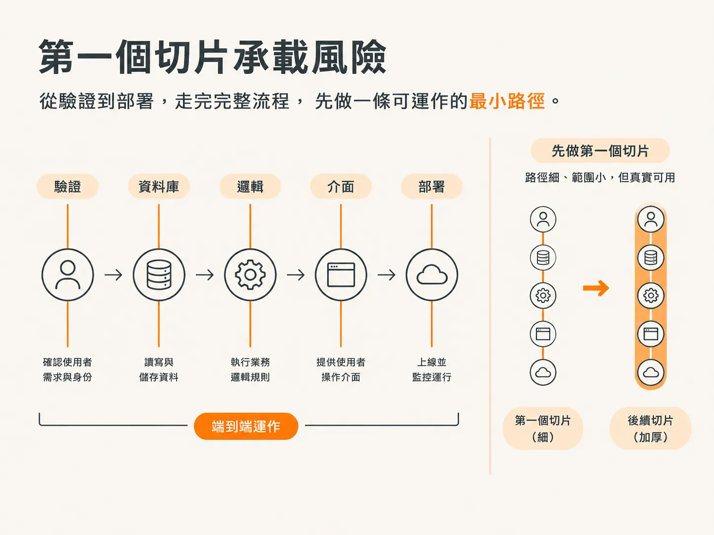

# Tracer Bullet：先穿一條線，再逐一加粗

功能清單不代表執行順序。`/scope` 現在要問一個足以改變整份計畫方向的問題：這項產品應該如何切分？

## 四種答案，四種取捨

每種做法，都是在判斷哪一種風險最需要優先處理。

- **Tracer Bullet**：垂直切片。每項功能都貫穿所有層，並且能實際運作。
- **Skateboard**：先做 MVP。推出精簡但可用的完整產品，再逐步擴充。
- **Facade**：先做 UI。用佔位資料打造可點擊的外殼，再接上後端。這種做法的成果只適合作為原型。
- **Journey**：每個階段都端到端完成一條完整的使用者路徑。

面板只說明每種做法背後的指導原則，不列執行步驟。討論焦點因此落在整體切分方式，不在待辦事項上。

## 預設做法，以及改用其他做法的三個理由

正式的產品開發預設採用 Tracer Bullet。只有在目標明確要求時，才會改用其他做法。

- 需要快速驗證核心循環，就選 Skateboard。
- 產品本身就是使用體驗或轉換漏斗，就選 Journey。
- 需要快速做出可點擊的原型，就選 Facade；並且要明確說明，這項成果只適合作為原型。

## 為什麼這個應用程式選擇 Tracer Bullet

在客戶回饋應用程式的案例中，建議也說明了背後的真正考量：最大的風險，是釘選留言能否從即時頁面一路傳回儀表板。

如果這項互動無法運作，產品其他部分幾乎就不重要了。

因此，`/scope` 會先處理這項不確定性，不會先完成每個畫面、每種留言狀態和每項儀表板工具。

第一條真正的使用者路徑範圍很小，卻從頭到尾都能運作：客戶開啟連結、看到即時預覽、釘選一則留言，而這則留言會出現在儀表板上。

## 這種做法會培養出的工程師

選定做法後，這項技能才會讀取該做法的說明檔，並採用相應的角色設定。示範中，是選定 Tracer Bullet 後才開啟對應檔案，並沒有事先查看。

在這種角色設定下，工程師會直覺地先確認整條流程能否運作，再完整實作任何單一部分。讓一條可用的路徑貫穿每一層，比只把其中一層完整做出來更重要。

這個原則會帶出三條規則：

- 最需要擔心的是各層之間接不起來：驗證、資料庫、API、UI、部署。要用一條真正可運作的路徑，及早排除這項風險。
- 第一個切片的完成標準，是使用者的一次真實操作能從 UI 經過 API、邏輯層與資料庫，再完成回應。範圍可以很窄，但整條路徑都必須是真實可用的。
- 保留真實的結構：真正的驗證、真正的 schema、真正的 UI。只縮小範圍，不造假，也不使用 stub。

## 第一個切片用來承擔風險

第一個切片是穿過核心使用者循環、範圍最小但真實可用的一條路徑。它必須涵蓋每一層，而且確實能運作。

這個切片就是 walking skeleton，因此不必另外規劃一個完成後就丟棄的 skeleton。兩者合併即可。

從切片 1 開始就必須是真實的部分包括：驗證、資料庫及其 migration、核心寫入與讀取路徑，以及只涵蓋這條路徑的可用 UI。

之後再逐步加入的部分包括：邀請、可編輯範本、提醒、歷史紀錄、搜尋、管理功能和洞察分析。

後續每個切片，都會擴展這條已經能運作的路徑。切片不是把某項功能完整做完，而是在現有可用範圍上再加上一條路徑。

順序很重要。絕不能先把每項功能的某一層都做完，卻還沒讓整個循環跑過一次。

## 另外三種做法有何不同

Skateboard 看起來和 Tracer Bullet 相似，但兩者並不相同。它不只縮小範圍，也會刪減結構。如果某個團隊或角色不是產品第一天就需要的，就先不做。它的第一個交付成果，是一個範圍精簡、但真實使用者願意採用的完整產品；它要排除的風險是：根本沒有人想用這項產品。

Facade 則是刻意以假資料模擬後端。第一階段會用模擬資料做出所有關鍵畫面，讓使用者可以瀏覽，而且畫面看起來可信。驗證、資料持久化，以及所有真實的讀寫功能，都會等到之後再逐個畫面接上。它要排除的風險是：把使用體驗做錯。

Journey 會先完整做好一條使用者路徑，包括邊界、空白、錯誤和確認等狀態，之後才開始做下一條路徑。它要排除的風險是：整個產品都做得不夠深入，每個功能卻又都只完成了一半。

四種做法都可能是正確選擇。該選哪一種，要看產品實際面對的風險；而這個應用程式的風險，落在核心互動上。

## 選擇會記錄在哪裡

`/scope` 會把選擇寫進 scope 標頭：`Build approach: Tracer Bullet (one thin path through the complete system)`。

這項選擇也會決定每項功能所屬的階段。每項功能都會歸入某個切片，而切片會顯示在「快速總覽」表格中，讓整張表呈現實際的執行順序。

單一功能可以在標題旁加上標籤，指定不同於預設值的做法，例如 `· Facade`。沒有標籤，就代表該功能沿用專案的預設做法。

## 這項做法無法決定的事

這項做法說明工作要如何切分，卻沒有說明每項功能需要套用多嚴格的檢查標準。

臨時原型的切片，和涉及付款的切片，不應套用相同的檢查標準。這是 `/scope` 會提出的最後一個問題；下一篇文章會介紹答案：workflow tier.
