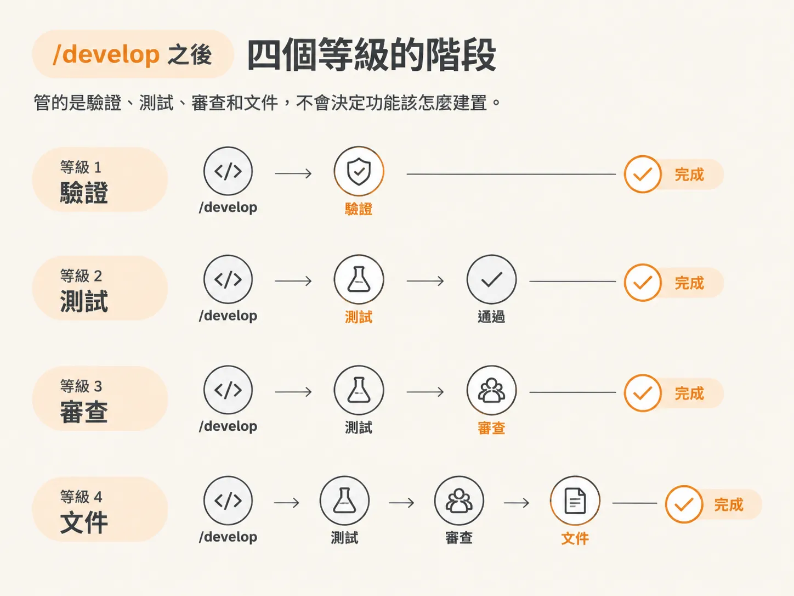
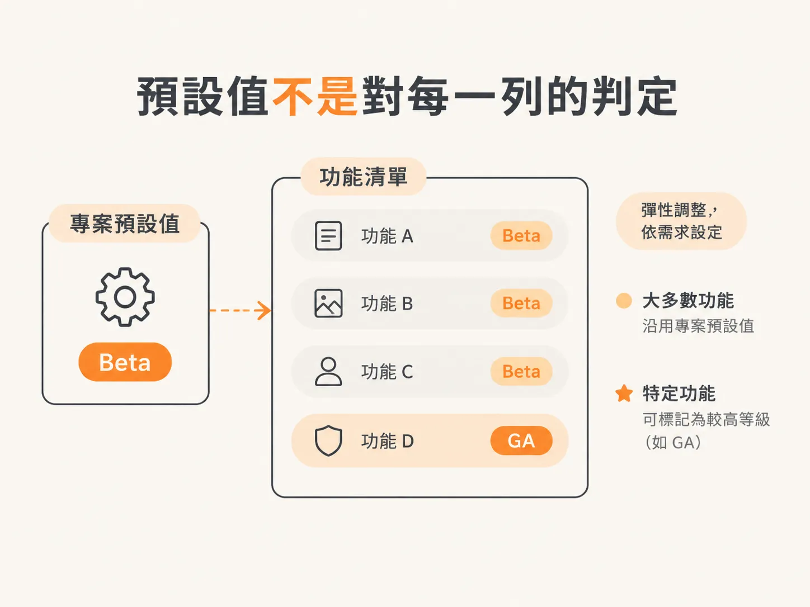

# Workflow tier：一個 feature 要多重

上一篇文章最後留下了一個 build 方法無法回答的問題：每個功能需要多嚴謹？

一次性原型的功能切片，和涉及付款流程的功能切片，不該套用相同的檢查。因此，`/scope` 會為每個功能設定一個嚴謹度等級。

## 一個旋鈕，四個位置

四個位置分別是 `Prototype`、`Alpha`、`Beta`、`GA`。

專案會設定一個預設等級，而 `/scope` 會將它記錄在 scope 標頭的 `**Workflow:**` 這一行。若某個功能需要比其他功能更嚴謹或更寬鬆，可以在標題旁加上標籤，例如 `· GA`。沒有標籤的功能則沿用預設等級。

## 只管 `/develop` 之後的階段

這一段請仔細讀，因為大多數混淆都源自這裡。

這個等級管的是 `/develop` 之後的階段：驗證、測試、審查和文件。它不會決定功能該怎麼建置。

- `Prototype`：不需要額外階段。你只仰賴 `/develop` 在建置期間自行檢查：能做的話就執行型別檢查、呈現畫面，再加上你自己的目視確認。
- `Alpha`：在實際 app 上執行 `/check verify`。
- `Beta`：先執行 `/check verify`，再執行 `/test`。
- `GA`：再加上由全新模型執行的 `/check review`，以及 `/document`。

這個等級也會決定哪個階段可以把狀態標成 `done`。`Prototype` 由 `/develop` 結束；`Alpha` 由 `/check verify` 結束；`Beta` 和 `GA` 則由 `/test` 結束。

整套機制就是這樣：一個專案預設等級、一個覆寫標籤，以及一組用來結束流程的檢查項目。

## 不會關掉 `/architect`

有個容易踩到的陷阱，值得特別說明：等級較寬鬆，不代表可以跳過決策關卡。

無論在哪個等級，只要某個功能涉及承重決策，就仍然要先執行 `/architect`，或記錄一份 `Assumed` 規格。`Alpha` 不代表可以跳過 architect；它的意思是，精簡的功能通常會標記為 `Needs spec: no`，因此很少需要走到那一步。

`Assumed` 規格永遠不會阻擋 `done`。在 `/architect` 正式核准之前，它會持續標示為等待確認。這就是決策債，而且無論在哪個等級，都會清楚呈現。

## 選擇預設等級

選擇時可以參考以下幾個訊號：

- 一次性原型、實驗或個人一次性專案：`Prototype`。
- 低風險產品，或希望經過驗證的內部工具：`Alpha`。
- 一般的正式上線產品：`Beta`。
- 付款、驗證、個人識別資訊（PII）、法規遵循、受監管的工作，或團隊共用的程式碼庫：`GA`。

示範中把這個 app 視為正式產品，因此選了 `Beta`：先在 app 中確認每個功能都能正常運作，再為承重部分補上測試。

示範沒有建議選 `GA`，原因很簡單：目前沒有付款流程、法規要求或其他大型系統。

## 代價是速度

每升一個等級，就會多出一層測試、審查等工作，建置速度也會隨之變慢。

因此，這是一項有意識的取捨：偏向速度，還是偏向完整的企業級測試。

## 預設等級不代表每一列都得一樣

即使專案預設是 `Beta`，簡單的功能仍可以按照 `Prototype` 或 `Alpha` 的規則處理。若某個功能需要以正式上線的標準看待，也可以將它標記為 `GA`。

`/develop` 會讀取實際生效的等級：先看功能覆寫標籤，再看專案預設值，並據此調整建議的後續步驟。`Prototype` 專案不會被要求執行 verify；`Alpha` 專案也不會被要求進行完整的審查流程。

## 一次執行的結果

scope 已經完成。我們只輸入了一句話：一款客戶回饋 app，讓客戶透過共用連結，在即時頁面上釘選留言。

最後規劃出 10 個功能、延後 14 個功能，採用 Tracer Bullet 作為建置方式，工作流程則選了 `Beta`。

接下來執行 `/clear`，然後處理第一個尚未勾選的項目。對這個 app 來說，第一項是技術堆疊與架構決策。在建置任何功能之前，專案仍需要先選定技術堆疊、框架和資料庫。這些是目前待辦事項中影響最大的技術決策，應由 `/architect` 負責處理。

## 用誠實的檢查收尾

即使清除工作階段，計畫仍會保留下來。團隊中的每位開發者，以及在同一個程式碼庫工作的每個 agent，都能看懂它。再次執行不帶參數的 `/scope`，它就會比對計畫與實際交付的內容，並告訴你下一步該做什麼。

這就是這個節點帶來的成果：把三個看不見的預設，變成三個明確寫下的答案——MVP 的範圍邊界、每個功能的 `Done when` 條件，以及第一個願意承擔風險的切片。

還有一項檢查要做，而且必須誠實回答：你設定的等級，真的符合正在打造的東西嗎？它究竟是週末實驗、個人工具，還是其他人會依賴的正式產品？

下一道關卡不在這個節點裡。`/architect` 會接手第一個承重決策，並將它轉化成規格。
