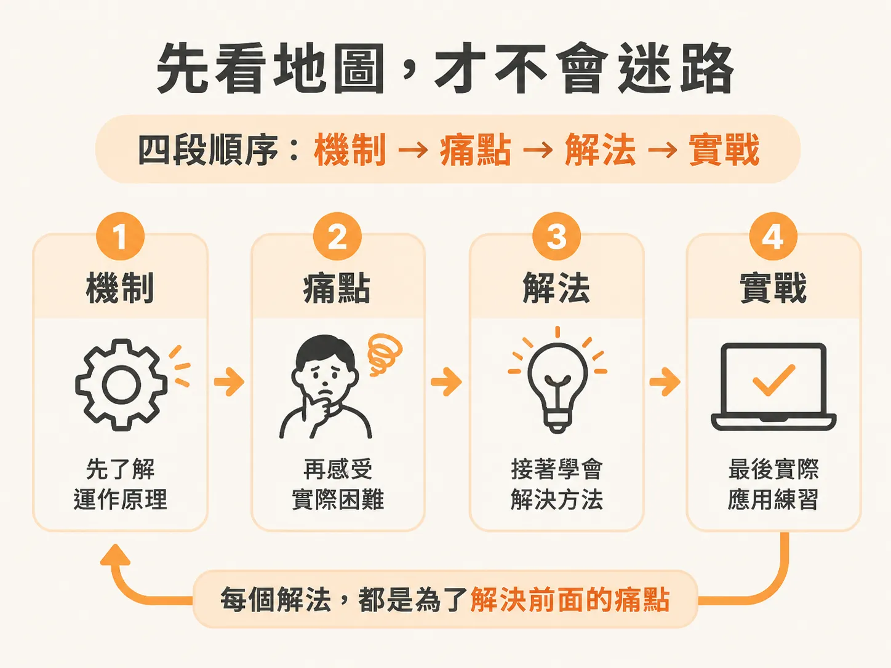
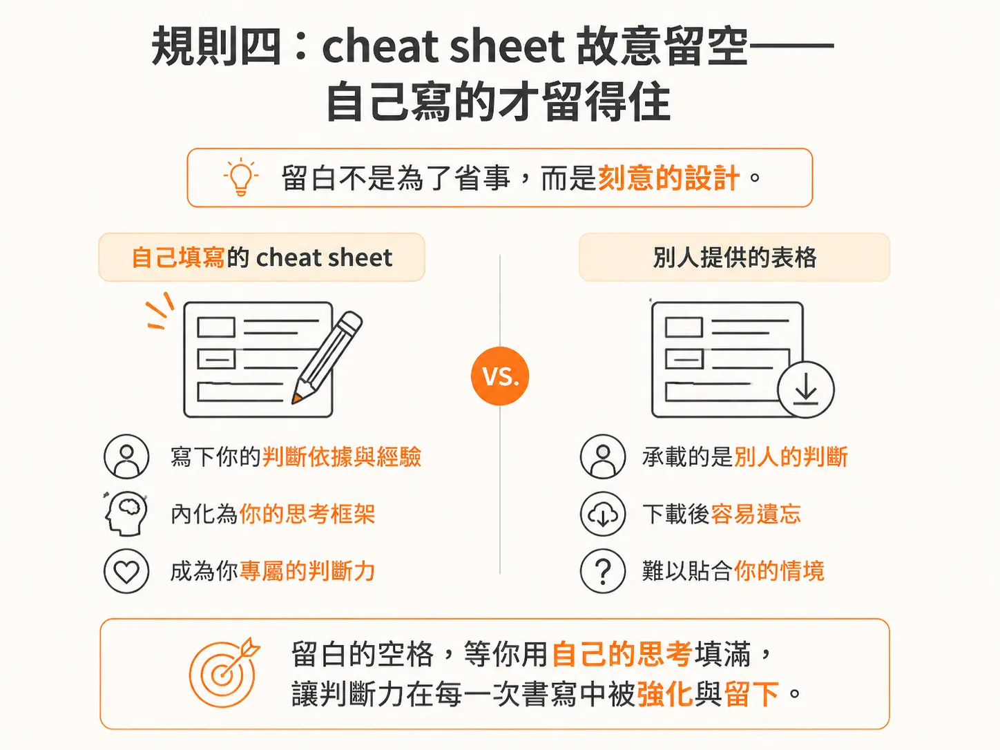
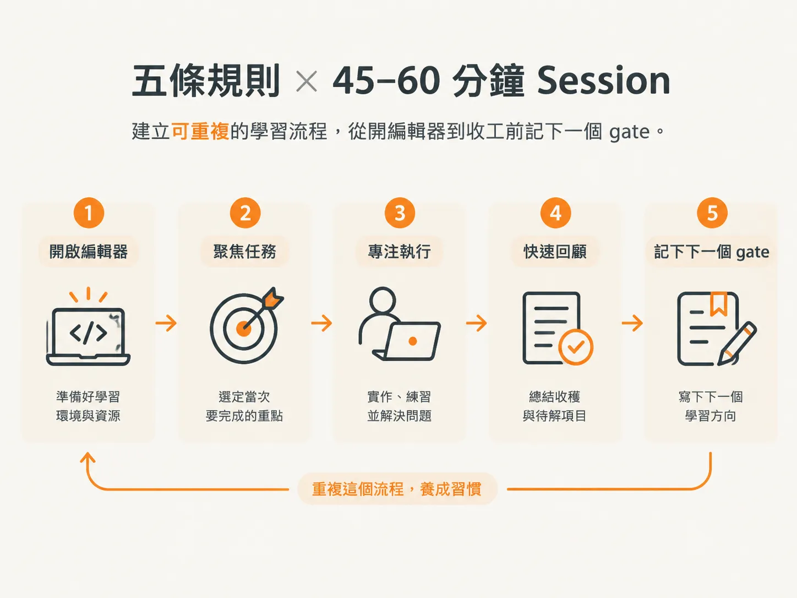

# How to Take This Course：怎麼上這門課與使用 cheat sheet

工具已經裝好了，剩下的就是掌握節奏。這一頁會把節奏講清楚。

## 規則一：build with me——看人做，效果只有自己做的一成

第一條，跟我一起動手做。講者是認真的。

這是一門 workflow course，不是 theory course。只有親手跑過一套 workflow，它才會真正變成你的。

光看講者操作，效果大概只有自己動手做的十分之一。所以整個 session 都要把編輯器開著。

你的節奏是每次 45–60 分鐘、每週 2–3 次。因此，每次 session 的第一個動作固定是：在同一個編輯器視窗中打開當次要操作的 repo，再把影片放在旁邊。

這門課的最小單位不是「一集」，而是一次親自動手的 session。

## 規則二：先看地圖，才不會迷路——四段式順序

第二條，先給你一張地圖，讓你隨時知道自己走到哪裡。

課程依照以下順序進行。首先是 fundamentals：了解 agents 在底層如何運作，以及如何思考 context。這一段與工具無關，是後面所有內容的地基。

接著是一個可能讓人意外的段落：用 vibe coding、完全不使用 skills，手動做出一個成果，讓你確切感受到痛點在哪裡。

然後才介紹 JSM workflow。每一個 skill 都會以「剛才感受到的痛點」的解法登場。

最後，將 workflow 放進真實情境中實際操作：從零開始的專案、legacy codebase，以及整個流程出問題時該怎麼辦。

把這四段寫在一張便條紙上，貼在螢幕旁：機制 → 痛點 → 解法 → 實戰。特別注意，第三、第四段提到的第三種情境是 recovery，不是第三個 scenario。

順序就是：機制、痛點、解法、實戰。每個解法都對應到你剛才親身感受到的痛點，所以順序本身就是教學設計。

## 規則三：不要跳過對照模組——後面的內容能豁然開朗，全靠它

第三條，不要跳過那個對照模組。它會把「手動 prompting／vibe coding 寫出的 codebase」和「用 workflow 寫出的 codebase」放在一起比較。

你一定會直覺地想跳進那套亮眼的 workflow。盡量忍住。

那個模組是後面所有內容豁然開朗的關鍵。

這一課的「弄壞它」練習是這樣的：跳過對照模組，直接進入 legacy 模組。你會得到一個只完成一半、又悄悄讓你感到挫折的結果，因為你缺少底下那層 context。

對照模組就是你的 baseline。沒有 baseline，你就分不清哪些是「刻意決定的」，哪些只是「預設值造成的結果」。

這種分辨力，正是這門課的畢業標準。

## 規則四：cheat sheet 故意留白——自己寫的才記得住

第四條，課程會附上一張 cheat sheet，但它一開始是空白的，這是故意的。

你要自己把它填起來：每個 skill 的用途，以及什麼時候該使用它，都用自己的話寫下來。

每次需要新增一行時，講者都會提醒你。因為自己寫下來的內容才會留下來，下載來的東西則不會。

課程結束時會解鎖官方 one-pager，供你對照。不過老實說，到那時你大概已經不需要它了。

cheat sheet 是承載 retrieval 的工具，不是參考文件。「什麼時候該使用它」那一欄，寫的其實就是你自己的判斷規則。

留白不是為了省事，而是刻意的設計。自己填寫的表格，才能承載你的判斷力；別人提供的表格，承載的只是別人的判斷。

## 規則五：照順序走，先做 challenge 再看解答

第五條，照順序走。講者知道，workflow 實作與 legacy 模組大概正是你買這門課的原因，但不要直接跳到那裡。

每個模組都建立在前一個模組之上。缺少前面幾層 context，legacy workflow 只會做到一半，還會悄悄讓你感到挫折。

challenge 也是一樣：先自己試，再看解答。

掙扎的過程本身就是那一課；解答只是用來確認你已經走到那一步。

判準很嚴格：你必須先留下一份失敗的嘗試，否則解答對你來說只是一段影片。

順序不是禮貌，而是依賴圖。跳過內容的代價不是看不懂，而是只得到一個「半成品」；而半成品最難除錯。

## 把五條規則濃縮成一次 45–60 分鐘的 session

這門課的規則只有五條。講者最後會說：「No more setup」，然後直接進入機制。

把五條規則融入一次 session，大致會是這樣：

打開 repo 和編輯器，跟著操作當次模組；先自己寫下 challenge 的失敗嘗試；在 cheat sheet 補上一行，記下「這個 skill 的用途，以及我什麼時候會使用它」；收工前，再寫一句「這次哪個 gate 擋下了什麼」。

規則必須落實成一套可以重複的 session 流程，否則就只是五句好聽的話。

這五條規則所保護的，是下一個 node 要你親眼看見的那場失敗。模型只能讀取公開程式碼，而且會替你填補空白。這一課把節奏安排好，就是為了讓你看見那場失敗時，手上已經有可以對照的東西。
