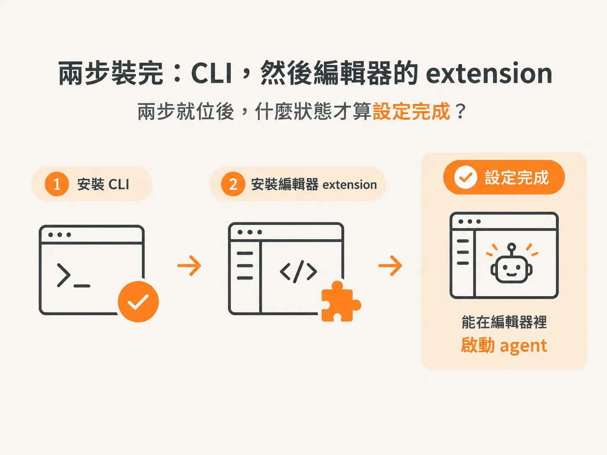

# Install the CLI in Your IDE：把 CLI 裝進你的編輯器

上一頁留下了兩個問題：工具要裝在哪裡？為什麼只示範一個？先回答第二個。

## 這一節很無聊，所以很短

講者自己也說，這是整門課裡唯一一堂無聊的課。而且你很可能早就設好環境了，所以他會講得很快。

設定不是這門課的核心內容。在這裡尋找深度，就找錯地方了。

把這一節當成開工前的繳費窗口就好。繳完費，就進入正題。

## 為什麼固定用一個工具示範：抽象教學等於叫你自己翻譯

這門課要教的 workflow、skills，以及思考 context 的方式，全都與工具無關。

這些想法可以套用到 Cursor、Codex，或任何你喜歡的工具上。

但他不會用抽象的方式教完，再讓你自己想辦法轉換。他會選定一個工具，直接示範。

過程中，他也會指出每個部分如何對應到其他工具。所以你永遠不會被綁定在某一種工具上。

他為此辦過投票。結果顯示，明顯多數人想看 Claude Code，所以他就用它來示範。

你已經學過 claude-code 的 skills 與 MCP。因此，這一節對你來說不是新技術，而是一項教學原則的宣告：具體示範、提供對照，不把你鎖在單一工具裡。

具體示範，再加上對照映射，才能讓你把所學帶到別的工具上。純粹抽象，只是把翻譯工作丟回給你。

## 安裝前先接受一件事：真正的 agentic 工作得用付費方案

安裝前，先說句實話：真正的 agentic 工作得用付費方案。

免費版適合試試看，不適合拿來建東西。

先從最便宜的付費方案開始。等你持續遇到使用上限，再升級。

如果你有預算可以投入，講者強烈建議直接選 Max。這確實是一筆投資，但你會從這些 agent 身上得到很多回報。他自己用的就是 Max。

價格變動很頻繁，最新價格的連結放在這一課下面。

升級的判準很明確：不是因為「想用到最多」就升級，而是因為「每天都撞上同一個上限」才升級。

免費版適合試玩，付費版才適合施工。先從最小方案開始，持續撞牆再升級。

## 兩步裝好：先裝 CLI，再裝編輯器擴充功能

第一步是安裝 CLI。

如果你用 VS Code，就照講者的做法，再安裝 Claude Code extension。

就這樣。其他內容會在後面的課程中介紹。

完成條件可以用一句話來確認：我能在編輯器裡直接和 agent 對話，而且它使用的是付費方案。

這一節的驗收標準就是：「能在編輯器裡啟動 agent。」

工具就位了。但工具不會替你安排學習節奏。這門課希望你怎麼學，才能真正把這些東西掌握在手上？
