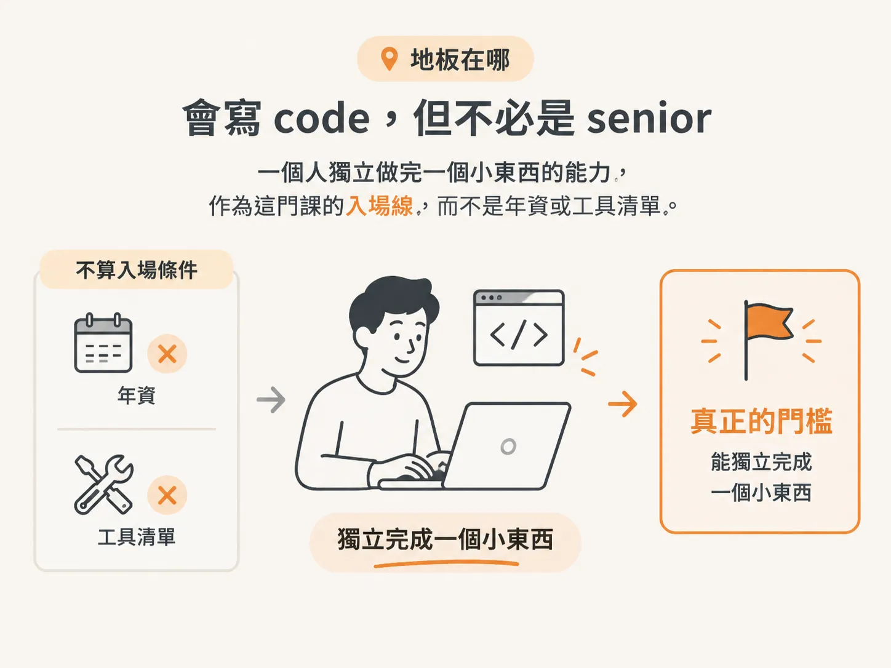
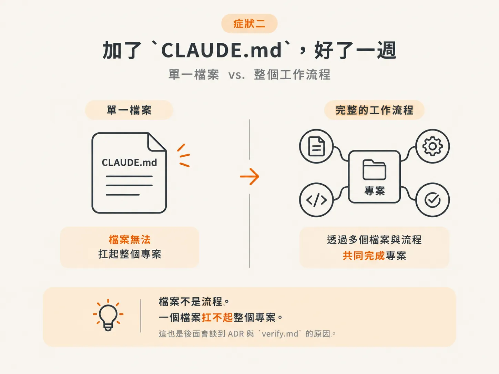
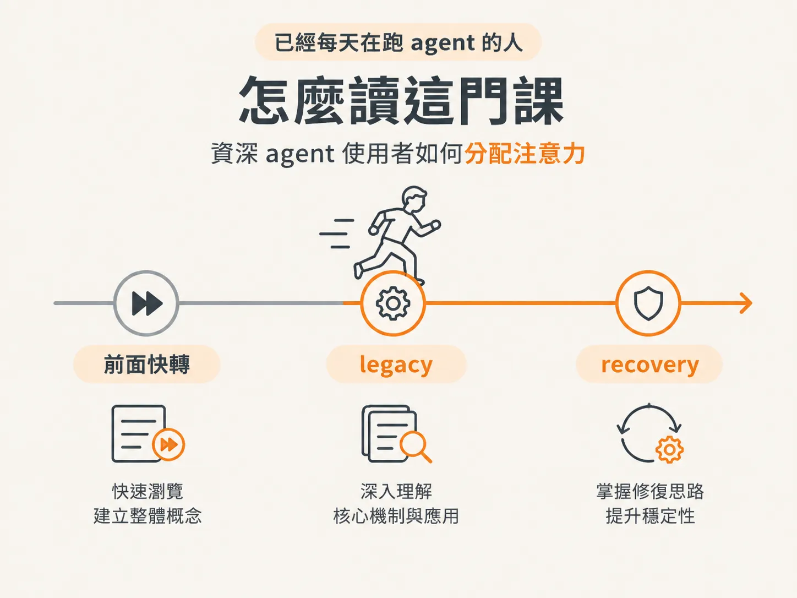

# Prerequisites：這門課是寫給誰的

上一頁最後問的是：你站在哪裡？這一頁用三種畫像回答。

## 地板在哪：會寫 code，但不必是 senior

這門課是為已經會寫 code 的開發者設計的。不必是 senior，但你要能獨立做出一個東西。

可以是一個 component、一條 API route，或一個小 app。而且你不需要有人在旁邊帶著你寫語法。

如果你一行 code 都沒寫過，這裡就不是你的起點。講者寧可現在就說清楚，也不想浪費你的時間。

技術方面的要求其實很低。你會寫 code，懂得基本使用終端機，也能在編輯器裡找到需要的東西，這樣就夠了。

你不需要任何特定的 framework，也不需要任何特定的 AI 工具。agent 的相關知識從零開始，會一步步打好基礎。

你已經跨過這條線了。TS、Node、Express、React、Postgres，這些你都熟悉。所以這一節對你來說不是門檻，而是入場確認。你可以把注意力放到下一個看不見的門檻。

真正的門檻是「能獨立完成一個小東西」。年資不算，工具清單也不算；能不能自己完成一個小東西，才算。

## 症狀一：AI 只在 chat window 裡

第一種畫像是這樣：你用過 AI 寫 code，但使用方式始終停留在 chat window 裡。

你把問題貼進 ChatGPT 或 Claude，再把答案複製回來、修改一下。遇到錯誤，就把錯誤訊息貼回去，再試一次。

這樣「大概可以」，直到專案變大，這套方法開始失靈，而你也說不出原因。

這門課要做的，是帶你從「跟 AI 聊天」走到「指揮一個 AI」，並在真實專案中執行真正的 agentic workflow。

判斷方法很簡單：上一次讓 AI 改 code 時，你的工作單位是「一次貼上」，還是「repo 裡的一項任務」？

問題不在於 AI 不夠強，而在於你的工作單位還停留在單次貼上。專案規模一大，就沒有一套流程能承接工作。

## 症狀二：加了 `CLAUDE.md`，好了一週

第二種畫像再往前一步：你看了一支影片，照著做，於是加了 `CLAUDE.md`。

它確實有用，大概維持了一週。

接著，agent 開始在 session 中途忘記事情、消耗大量 token，還會和自己聲稱讀過的檔案內容互相矛盾。

這不是你做得不好，而是你讓一個 instructions file 承擔了整個真實專案的需求。

你需要的是一套 workflow，而不只是更好的檔案。這正是這門課要補上的缺口。

你對「session 聊久了就變笨」的感受，在這裡會被重新理解：問題不在對話太長，而在於你用一個檔案取代了整套流程。

檔案不是流程。一個檔案扛不起整個專案。這也是後面會談到 ADR 與 `verify.md` 的原因。

## 兩個真正的前置條件：付費方案與心態

還有一個實務上的條件：coding agent 需要付費方案。

最基本的方案就足以開始。等真的碰到使用上限再升級，詳細內容會在下一課說明。

不過，有一項心態上的前置條件比任何技術條件都重要：帶著「願意改變工作方式」的態度來學。

真正能受益的開發者，往往不是最資深的那一群，而是最願意保持開放的人。

講者看過年資二十年的開發者拒絕調整，最後卡住；也看過入行六個月的人快速成長，因為他願意用不同的方式看待這份工作。

帶著這份心態來，你就能充分吸收這門課的內容。

所以你有兩張門票：一張是刷卡付費，另一張是願意調整行為。技術能力不是門票，因為它早已是入場資格。

錢與心態是門票；技術則是前提。

## 已經每天在跑 agent 的人，怎麼讀這門課

如果你已經是 senior，而且每天都在使用 agent，前面幾個 module 可以快轉，但不要整段跳過。

接著，在 legacy codebase 與 recovery 的部分放慢速度。即使是資深的 agent 使用者，到了這些地方也常常只能靠猜。這門課最能為你帶來價值的，也正是這些內容。

你正是這類學員：agent harness 的迴圈、background agent 的 runtime、claude-code 的 skills 與 routines，你都已經熟悉。所以這一課的自我檢查結論應該是：概念快轉，brownfield 慢下來。

可以快轉，但別跳過。legacy 與 recovery，才是這門課最值得你投入的部分。

你已經能說出自己缺的是 workflow。那麼，這套 workflow 要跑在什麼樣的專案上？下一個 step 會帶你看兩個 scenario 和三個起點。
