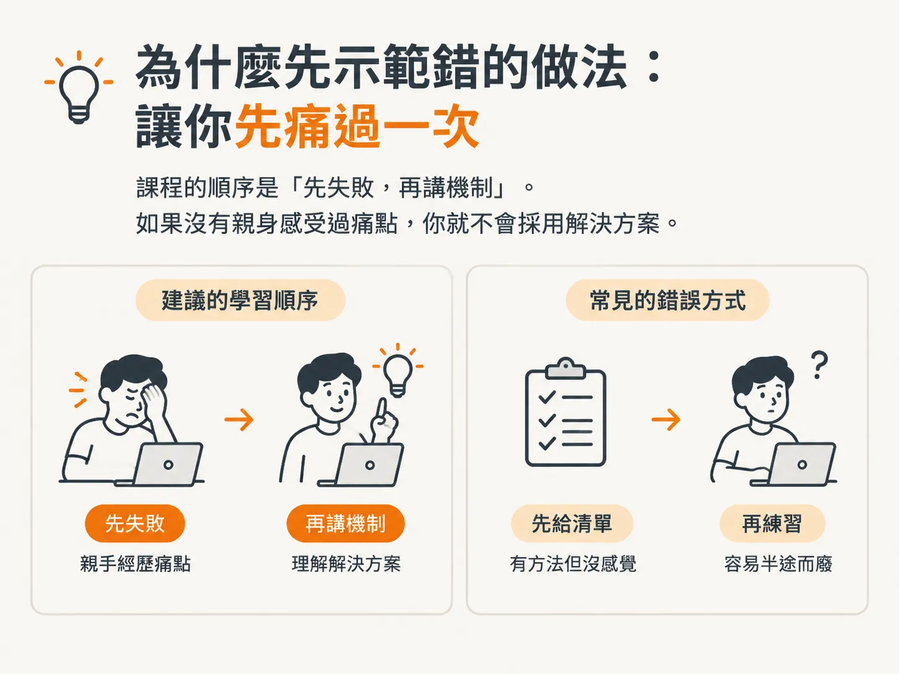
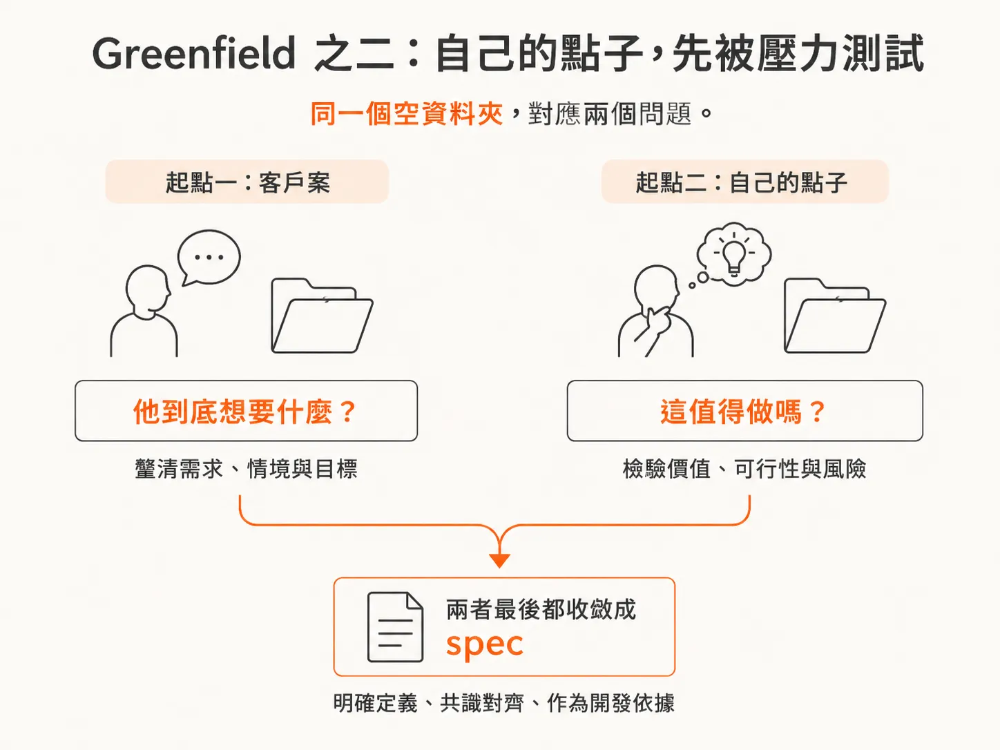
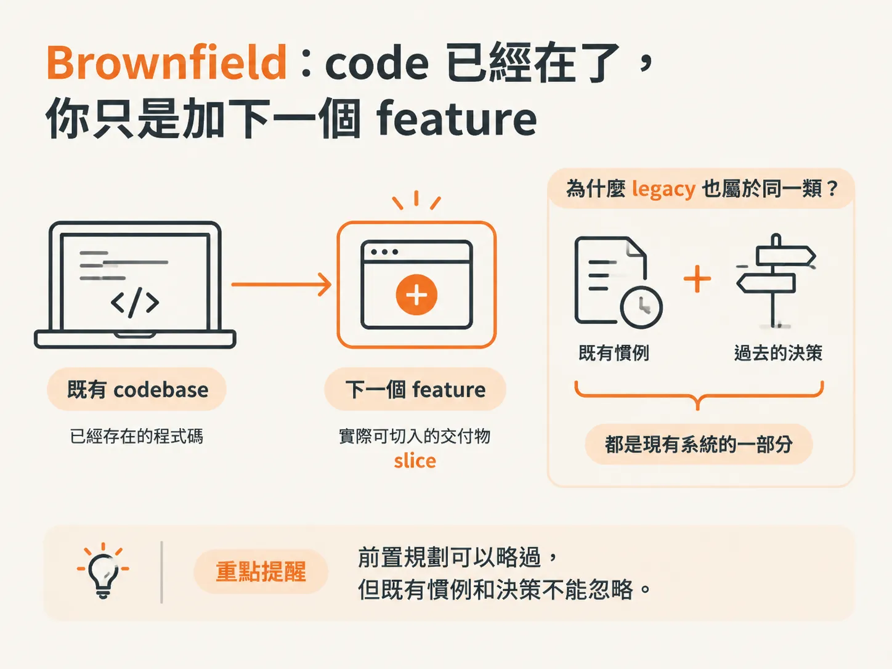

# The Two Scenarios You'll Build In：greenfield 與 brownfield

上一頁提到，你缺的是 workflow。這一頁先說明它適用於哪些類型的專案，以及為什麼要先讓你失敗一次。

## 為什麼先示範錯誤做法：讓你先痛過一次

很多課程丟給你一套 workflow 和幾個自製 skill，接著就把你丟在一旁。它們從不示範，這些東西要怎麼在真實工作中派上用場。

所以這門課會先示範「不要怎麼寫 code」：一種是手工寫，另一種是 vibe coding。

這看起來似乎簡單，實際上卻是更難走的路。你親手試過一次，就會切身感受到其中的問題。

接著，課程才會帶出 workflow，並讓它在你真正會遇到的情境中跑一遍。

你偏好的順序也是如此：先看失敗的樣子，再回頭理解背後的機制。

課程的順序是「先失敗，再講機制」。如果沒有親身感受過痛點，你就不會採用解決方案。

## Greenfield 之一：客戶丟給你一團模糊需求

第一個 scenario 是全新的專案，可分成兩種你會開新專案的理由。

第一種是客戶案。有人交給你一組模糊、半成形，有時甚至坦白說很荒唐的需求。

你的工作，是把這團混亂整理成真正可用的 technical specification，也就是 spec，讓 agents 能依照它建置。

這條路適合接 freelance 案，也適合經營自己的軟體 agency。

客戶說：「我要一個像 Airbnb、但更簡單的產品；要先有會員功能，還要有通知，時程是三個月。」你要交付的不是 code，而是一份把這些話轉成可驗收範圍的 spec。

客戶案的交付物是 spec。那就是你賣的東西。

## Greenfield 之二：自己的點子，先接受壓力測試

第二種理由，是想實現自己的點子。也許你想替自己做一個 SaaS。

這時會用到一個特別的 skill，在任何一行 code 出現之前，先對這個點子進行壓力測試、把它打磨得更成熟，直到它確實值得投入開發。接著，才把它整理成 spec。

兩條路的起點相同，都是一個空資料夾；一條通往更好的客戶案，另一條通往你自己的產品。

同一個空資料夾，對應兩個問題。客戶案要問：「他到底想要什麼？」自己的點子則要問：「這值得做嗎？」

greenfield 的兩種理由，差別在於你要先回答哪個問題，但交付物都是 spec。

## Brownfield：code 已經存在，你只是在新增下一個 feature

第二個 scenario 是在既有專案上工作。code 已經存在，你只是在新增下一個 feature。這才是最常見的日常情境。

workflow 提供了一條可以直接切入的路，略過那些不需要重新進行的前置規劃。

手上有一個既有 repo，要新增「匯出 CSV」功能，沒有人會要你把整個專案重寫。

brownfield 的交付物是一個能實際切入的 slice。前置規劃可以略過，但既有慣例和決策不能忽略。

## Legacy 也是 brownfield：沒人寫過，也沒人留下紀錄

legacy codebase 也屬於這個 scenario。這份 code 不是你寫的，而且已經非常老舊，有些部分還壞了。

慣例沒有文件記錄，而你剛接手這個專案。

這是大多數開發者真正身處的環境，也是幾乎所有其他課程假裝不存在的情境。這門課不會假裝。

「上一位工程師離職了，這份 code 沒人看得懂，明天起由你維護。」這不是例外，而是常態。

「這份 code 不是我寫的」不是特殊情況，而是常態。因此，brownfield 技能比 greenfield 技能更常派上用場。

## 兩個 scenario，同一套 workflow，差別在入口

這就是兩個 scenario：greenfield 與 brownfield。

greenfield 從空資料夾開始；brownfield 則是 code 已經存在，你只是在上面新增下一個 feature。

最後，你會在這兩種情境中各跑一次完全相同的 workflow。因此，你不是在收集 skill，而是會確切知道何時該用、以及怎麼使用每一個 skill。

把三種起點濃縮成一句話，掛在牆上：客戶案要「逼出 spec」；自己的點子要「先證明值得做」；別人的 codebase 則要「先讀懂慣例」。

一套流程、兩個入口、三種起點。判斷該從哪個入口開始，本身就是判斷力的一部分。

兩個 scenario 都要在同一套工具中跑一遍。那套工具該安裝在哪裡？又為什麼只示範其中一套？
