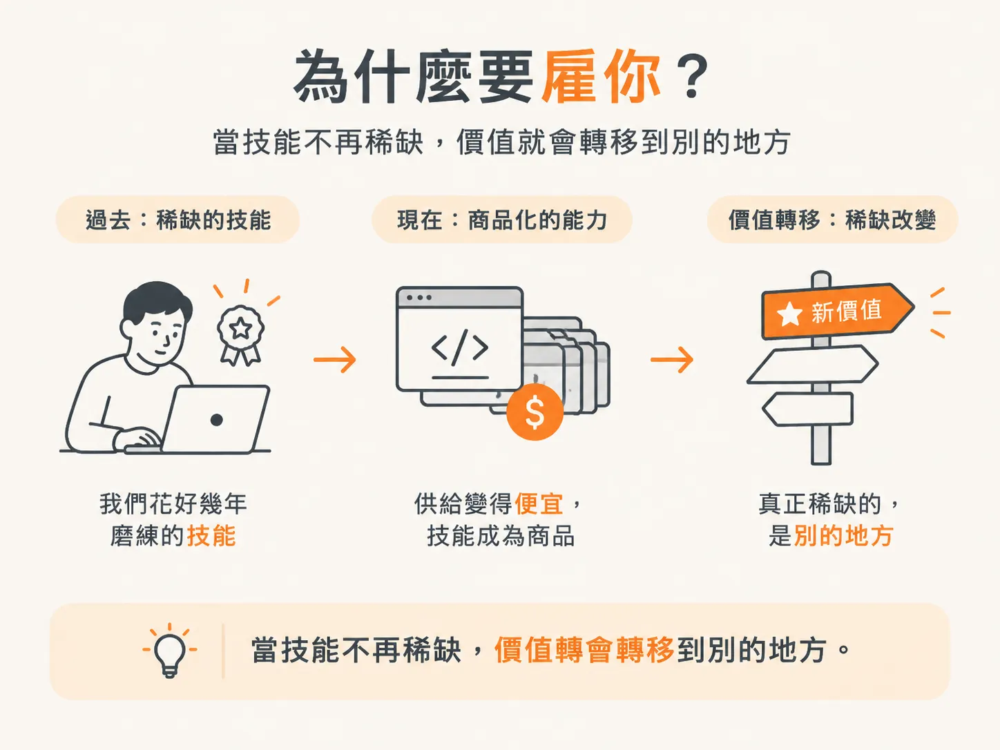
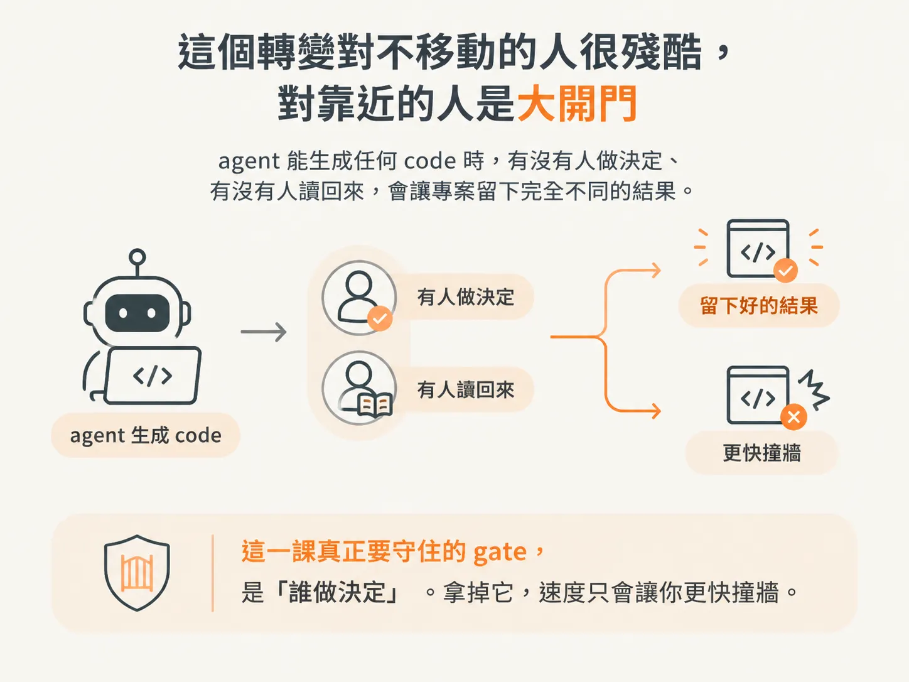

# What This Course Will and Won't Make You：這門課會給你什麼、不會給你什麼

## 前言

你已經會叫 agent 寫程式了。問題不在這裡，而在於決策沒有事先寫下來，驗收也沒有留下證據。程式碼跑得動，卻沒人敢改。這個 node 要先建立起這層工程判斷，因為後面每一道 gate 都仰賴它。

不先建立這層判斷，速度只會讓你更快撞牆。你會拿到一個能 demo 的東西，卻在 demo 結束後才開始付帳：成本、漂移，還有那些沒人說得出為什麼存在的 code。

你可能遇過這些情況：你加了一個 instructions file，它好用了一個禮拜，之後 agent 就開始忘東忘西；你手上有客戶提出的模糊需求，或一份沒人留下文件的 legacy codebase。

這個 node 會依序回答五個問題：如果誰都能生成 code，我憑什麼值得被雇用？我是不是這門課的讀者，真正的前置條件是什麼？Greenfield 與 brownfield 各自要我交出什麼？工具要裝到什麼程度？這條長課程要怎麼上？讀完之後，你會把 Claude Code 裝進自己的編輯器，也會有一套可以重複使用的 session 節奏。

這一篇先回答第一個問題：如果誰都能生成 code，你憑什麼值得被雇用？

## 寫程式不再是難點之後，剩下的問題是「為什麼要雇你」

寫 code 已經不是最難的部分。這不是什麼驚人之語，只是我們現在所處的位置。

你可以用白話描述一個 feature。咖啡還沒涼，能跑的 code 就回來了。而且每個人都做得到。

我們花好幾年磨練的那項技能，如今已成為商品化的能力。當供給變得便宜，稀缺的東西也就跟著改變。

所以，真正的問題也變了：如果誰都能生成 code，你憑什麼值得被雇用？

把「幫我做一個有 feed 的 app」丟給 agent，畫面在咖啡涼掉之前就出來了。對這門課來說，這不是解法，而是問題的起點。

這門課要探討的，就是取代寫 code 之後，真正重要的是什麼。

## 為什麼「更會寫 prompt」是錯的答案

你可能會想，那就去補強 prompt engineering 吧。但這門課對「誰都能生成 code」的回答，明確不是寫出更好的 prompt。

理由很簡單：如果 AI 聰明到能寫你的 code，它也就聰明到能寫你的 prompt。

你花兩週調出來的那段神奇指令，模型下一版就可能自己寫得出來。你的優勢不會累積，反而會被吸收。

任何建立在「我比模型更會下指令」之上的優勢，都有保存期限。

## 真正稀缺的是判斷力，它體現在三個動作上

現在做得好的開發者，不是 prompt 巫師，而是有判斷力的人。這就是這門課所說的 judgment。

他們知道該建什麼，會引導 agent 朝目標前進，也會像 senior 審閱 junior 的 PR 一樣，仔細檢視 agent 交回來的成果。最後，他們交付的是經得起檢視的東西。

agent 不會替你帶來 judgment。它只會提高缺乏 judgment 的代價。

好消息是，judgment 可以學會。這就是整門課要教的事。

你手上就有可以對照的素材。`learning-center` 這個 repo 裡的許多 node 與 step 都是 agent 產出的。有些地方看得出是經過決策的，有些則是沿著預設一路漂移而來。這兩者之間的差別，正是 senior 審閱 junior PR 時會留意的地方。

所以，judgment 可以拆成三個分開練習的動作：決定要建什麼、指引方向，以及驗收交回來的成果。

## 這門課不會把你變成什麼

這門課不會把你變成那種「靠 prompt 產出自己也看不懂的 code」的人。它要做的恰好相反。

你仍然是那個工程師。AI 只是成了你合作過最快、最有天分的 junior 或 mid。你的工作是帶領它，這正是我們要建立的技能。

順便也校正一下「AI 搶工作」這種說法：職缺不是消失了，而是改變了形狀。願意調整的人，才能走在前面。

如果你 merge 了一個 diff，卻說不出其中某一行為什麼存在，那不是 AI 的問題，而是你把 senior 的位置讓了出去。

你的角色並沒有改變，你依然是 engineer。改變的是，你帶領的對象速度更快了，因此「讀回來」這件事也變得更加重要。

## 這個轉變對不願改變的人很殘酷，對願意靠近的人則敞開大門

這種等級的轉變，對拒絕改變的人很殘酷；但對願意靠近它的人來說，則是機會大開。

做個練習：想像一個專案，agent 能生成任何 code，卻沒有人決定要建什麼，也沒有人檢視產出的成果。過一陣子之後，你手上會剩下什麼？

這一課真正要守住的 gate，是「誰做決定」。拿掉它，速度只會讓你更快撞牆。

如果稀缺的是 judgment，而不是工具操作，那這門課預設你已經具備哪些條件？下一個 step 會用三種讀者畫像，幫你確認自己是否符合這些條件。
