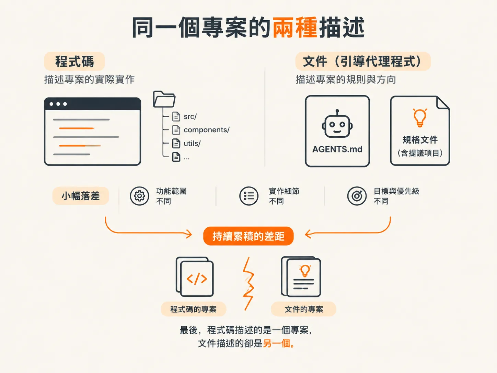
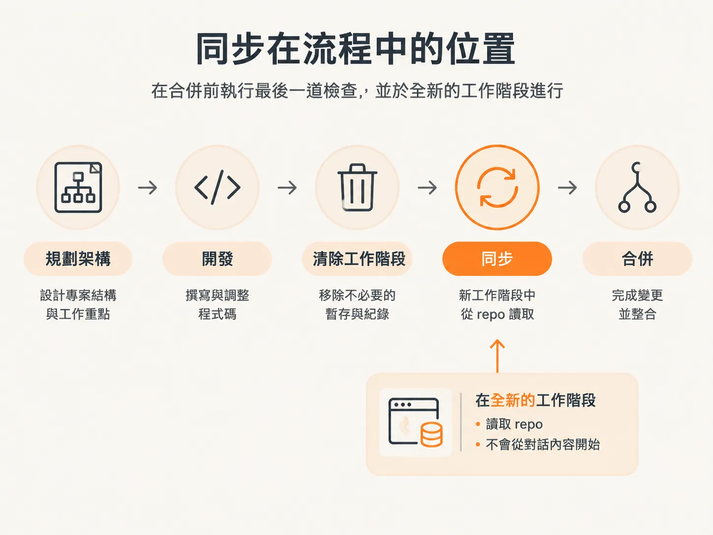
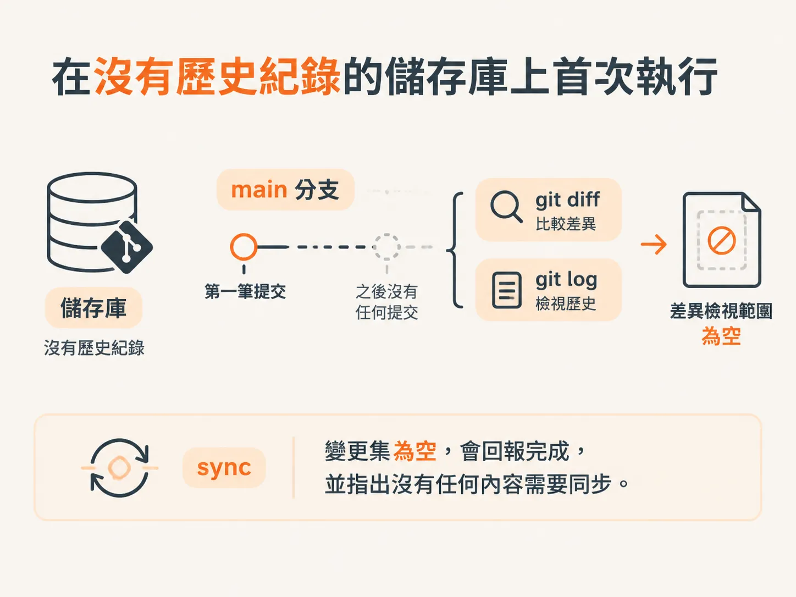

# Code 說一個專案，檔案說另一個

## 前言

這一節談的是合併前的最後一步：`/sync` skill。程式碼與描述程式碼的文件會逐漸脫節。若放任不管，repo 和它自己的文件最終就會變成兩個不同的專案。

當某項慣例已經寫進實作，卻沒有同步到 agent 的 MD 檔時，就會出現這種情況。當規格仍將某項功能標示為「提議中」，但後續功能早已推出時，也會出現同樣的問題。這些落差單獨看都不大，但累積起來，就會讓你無法再信任這些檔案。

這裡分成五個部分。首先說明什麼是脫節，以及為什麼每次都執行 sync 的成本很低。接著說明如何用 `--name-status` 閱讀實際的 git diff，以及哪些檔案不能作為產品證據。然後談編輯 `AGENTS.md` 的界線。接下來會說明如何讓範圍核取方塊與規格中的 Status 行保持一致。最後則會介紹如何設定 Supabase MCP，確保 migration 套用到真實的 schema，而不是你想像中的 schema。

先從這個落差本身開始：合併前，究竟有哪些內容已經過時？

## 同一個專案的兩種描述

每次程式碼變更，都可能讓引導 agent 的檔案跟不上。實作中出現了一項慣例，卻沒有同步到 agent 的 MD 檔。

規格也會發生同樣的事：文件仍說某項功能處於提議階段，但後續功能早已推出。

這些問題單獨看都不嚴重，卻會不斷累積。最後，程式碼描述的是一個專案，文件描述的卻是另一個。

## sync 在流程中的位置

`sync` 用來補上這個落差，而且它在流程中的位置固定：先 architect，再 develop，接著清除 session，最後才能 sync。

應在工作結束、合併之前執行 sync。在課程示範中，skill 會在新視窗裡開啟，因此這一輪會從 repo 開始，而不是從建立專案的聊天內容開始。

示範選用的是一個已經很久沒有開發的專案。旁白回頭查看範圍設定，略過驗證與測試初始功能的步驟，直接轉向編碼規範和工具設定。

這個專案有明確的完成條件：根目錄的 agent MD 必須反映實際使用的技術堆疊，而且 lint、format 和型別檢查都能在全新 clone 的專案上執行。要達成這些條件，必須先執行過 `audit`。

## 第一次在沒有歷史紀錄的 repo 上執行

sync 首先發現這個目錄不是 Git repo。由於 sync 仰賴 Git diff 和 Git log，當時沒有可供比對的 diff。

因此，必須先初始化 repo：執行 init、加入所有檔案，然後查看 status。`.gitignore` 正確地排除了 `node_modules`。

Next.js 的建置資訊會寫入 `main` 上的基準設定。由於這是第一筆 commit，沒有先前狀態可供比對。

因此，sync 的變更集是空的。它會回報完成，並指出沒有任何內容需要同步。

## 為什麼每次執行的成本都很低

這次沒有任何變更，正是重點。sync 不必讀完整個程式碼庫就能判斷什麼都沒變；它只要查詢 Git 中有哪些變更，而 Git 回報沒有變更即可。

sync 的輸入是 diff 和 log。diff 為空，工作量也就為零，整個執行過程只需幾秒。正因如此，sync 可以放在每次合併流程的最後，不必等到特殊時機才執行。

等 repo 有了歷史紀錄，sync 就有內容可讀。接下來的問題是：實際上該看 diff 中的哪些內容？又有哪些內容不能算是證據？
