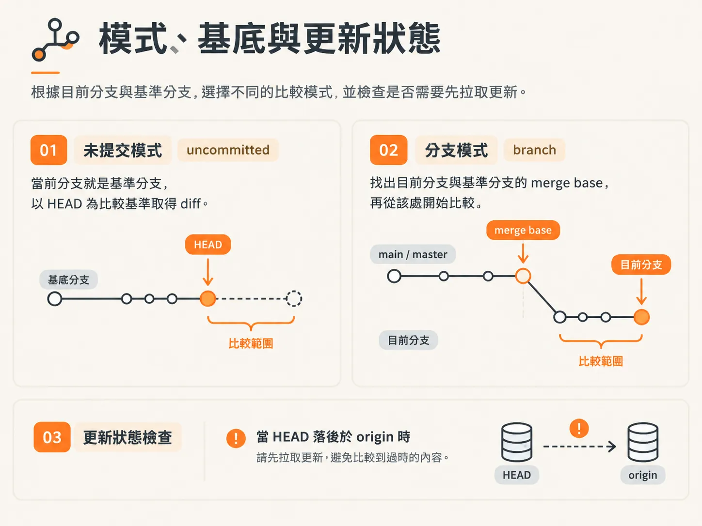
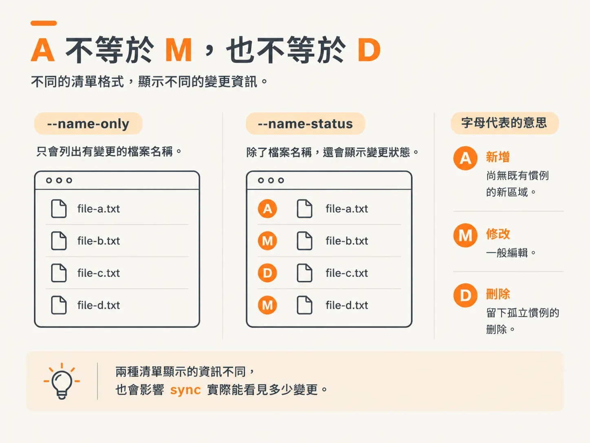
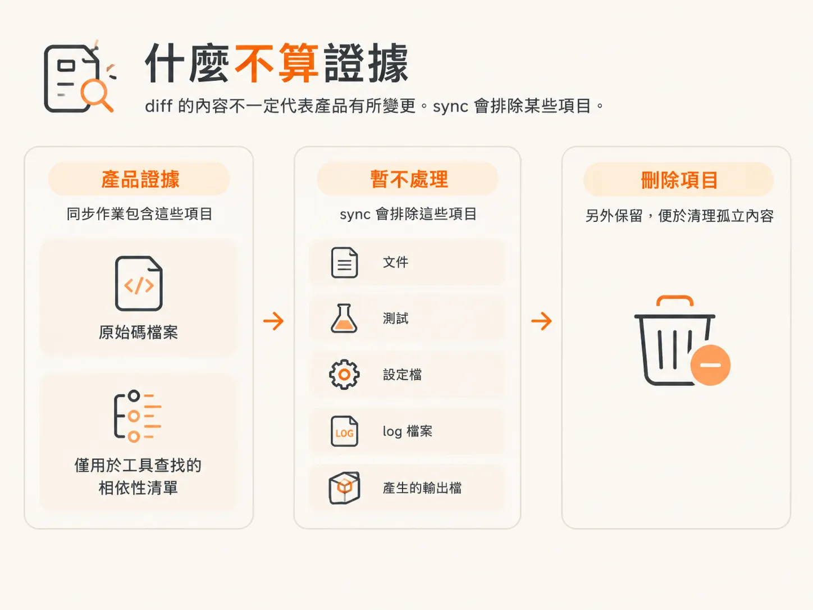
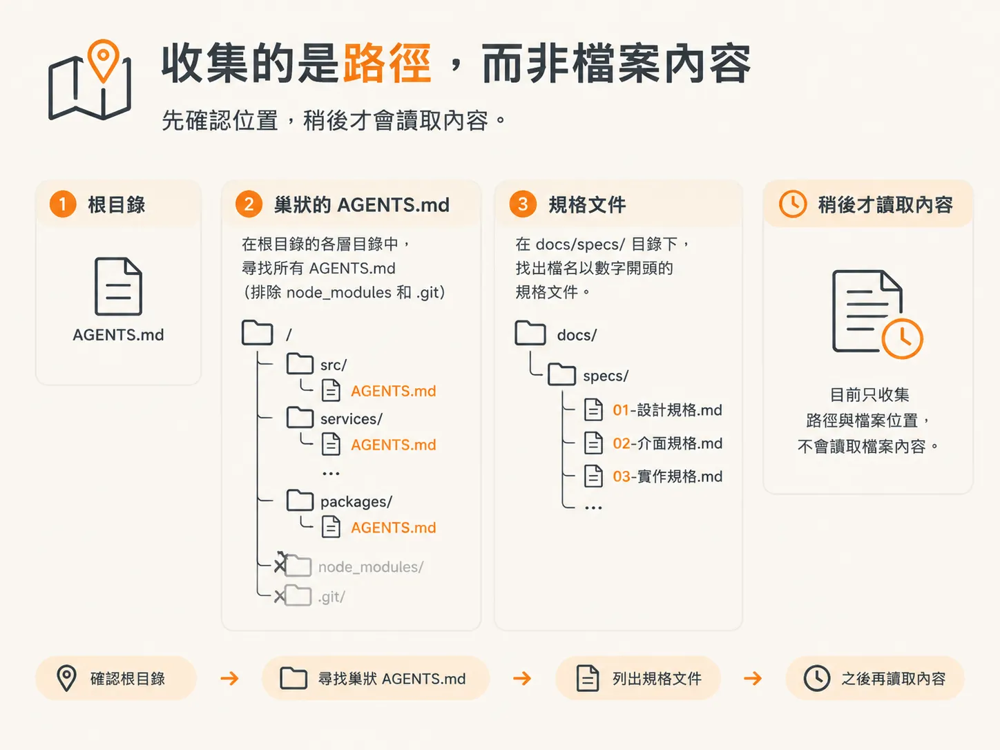

# 讀 git 的真實變更：added、modified、deleted

上一篇文章最後留下的是一個沒有任何內容需要同步的 repo，因為第一次 commit 沒有先前的狀態可供比較。這篇則從一個確實有變更的 repo 開始。

示範中只需要做兩個小修改。首先，再執行一次 `audit`，記錄專案慣例和工具選擇。它會檢視程式碼庫、確認 ClaudeMD 指向正確的位置，接著讀取 ESLint 設定，發現 lint 尚未列入其中，於是將 lint 加進 `AGENTS.md`。這項工作很單純，`audit` 也順利完成。

接著，把三個 scope 項目標記為已完成。通常 skill 會在項目完成時替你標記；如果你不想等它處理，也可以自行手動標記。

第二個修改是實際的 UI 修正。將一張截圖放進新開的視窗，並在按住 Shift 的同時送進去。指示很簡短：從截圖可以看出，首頁的 review live page 卡片在桌面版上垂直延伸得太高，請調整它，讓版面符合預期。

Agent 修改後執行 lint，沒有發現任何錯誤。在 `localhost:3000` 上看起來好多了，但仍未完全符合版面。這張卡片獨占一列，因此高度應該和旁邊兩張卡片相同。再提供第二張截圖並補上一則評論後，問題就解決了；Agent 甚至在清理前先用手機版測試過。

這次練習的重點是最後留下的 git 狀態：`agents.md` 和 `scope.md` 這兩個檔案有變更。修改雖然不多，但已足以讓 sync 執行。

## 模式、基準與最新狀態

sync 會以低成本界定變更範圍，並為每個檔案標記狀態。skill 會先確認基準分支：如果 `main` 存在，就使用 `main`；否則改用 `master`。

接著，它會選擇模式。如果目前分支就是基準分支，模式會是 `uncommitted`，並以 `HEAD` 為比較基準取得 diff。否則，模式會是 `branch`：它會找出目前分支與基準分支的 merge base，再從該處開始比較。



<!-- source: sources/agentic-engineer/20261030/skills/skills/sync/SKILL.md#L88-L89 -->
```bash
# current branch is the base
git diff --name-status HEAD

# otherwise
git merge-base "$BASE" HEAD
git diff --name-status <merge-base>
```

未追蹤的檔案也會列入清單，並標記為 `A`，因為它們同樣屬於這次變更的一部分。skill 也會記下模式、基準分支和 merge base，讓後續的寫入步驟知道當時採用什麼作為比較基準。

多人共用 repo 時，第一步是確認最新狀態。sync 會在背景執行 fetch；如果 `HEAD` 落後於 `origin/$BASE`，就會提醒你先 pull。隊友可能已經同步過這些文件。

## A 不等於 M，也不等於 D

這裡使用的旗標是 `--name-status`，而不是 `--name-only`。這正是這一步的重點。

`--name-only` 會告訴你哪些檔案有變更；`--name-status` 則會指出每個檔案是新增、修改還是刪除。每個字母代表不同情況，也會影響 sync 實際能看見多少變更。



新增檔案可能代表出現了全新的領域，而其中尚未記錄任何慣例。檔案遭到刪除，則表示有些慣例已不再使用，這時正適合清理孤立內容。修改檔案則是最常見的情況。只看檔名清單，無法分辨這三種狀況。

## 哪些內容不算變更證據

diff 中的內容不一定代表產品有所變更。sync 會排除某些項目：文件、測試、設定檔、log 檔案和產生的輸出檔。



其中有些項目本身也需要維護，但 sync 不會把它們當成產品變更的證據。文件是需要更新的目標，不是判斷新行為的可靠依據；測試也不是可以長期沿用的領域慣例。

有兩類項目不會直接丟棄，而是另外保留。遭到刪除的檔案會列在獨立清單中，因為它們能作為清理孤立內容的依據。依賴清單的變更也會另外列出，因為它們能告訴 skill 該查詢哪些工具。

lock file 只會用作訊號，其中的內容絕不會傳出去。

接著是硬性停止條件：如果沒有剩下任何來源檔案或依賴清單變更，sync 就會停止，並回報沒有內容需要同步。它不會啟動其他程序。

這就是為什麼只有文件變更時，流程會在這裡結束。如果這次只修改了 Markdown，指令會在觸及其他內容之前就先返回。

## 看路徑，不看檔案內容

sync 接下來收集的是路徑，而不是文字內容。它會確認根目錄是否有 `AGENTS.md`，找出 `node_modules` 和 `.git` 以外各層目錄中的所有 `AGENTS.md`，並列出 `docs/specs/` 底下檔名以數字開頭的規格文件。



它也會找出 diff 實際涉及的 scope 檔案。在 monorepo 中，如果變更路徑位於 `apps/<x>/` 底下，就會選取 `docs/scope/<x>/`；skill 不會讀取整個 `docs/scope/`。

根目錄的 `AGENTS.md` 是唯一會立即讀取的檔案，因為它是其他內容的依據。對每個變更檔案，skill 都會記下最近一層、包含 `AGENTS.md` 的上層目錄。那個目錄中的檔案最可能需要更新。

如果 diff 還新增了重要的外部工具，skill 會根據依賴清單再查一次，確認該工具是否有 agent skill 或 MCP。一般的工具函式庫則會略過。開始搜尋前，它會先詢問你。

## 每次執行都很安全

和 `develop` 相比，這只是一輪輕量檢查。執行後，它會做一些健檢，接著專案就會保持在最新狀態。課程指出，無論是面對較大型的程式碼庫，還是變更更頻繁的專案，每次執行都完全安全。

整個循環現在已經閉合：規劃、決策、程式碼，以及記憶。接下來要做的是根據實際交付的內容，重新核對記憶。

diff 已經告訴你，哪個 `AGENTS.md` 距離這次變更最近。接下來的問題是：你可以修改這個檔案的哪些部分？又有哪些內容絕不能重寫？
