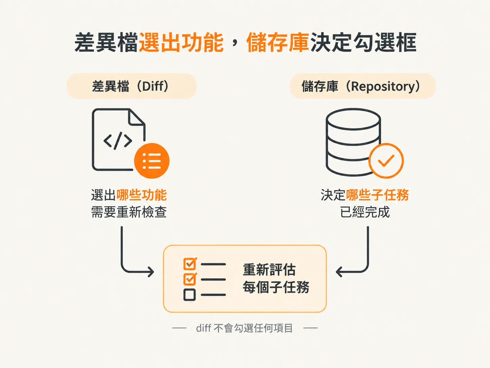
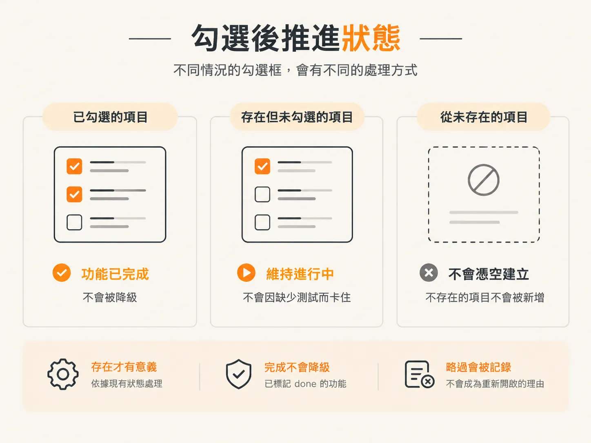
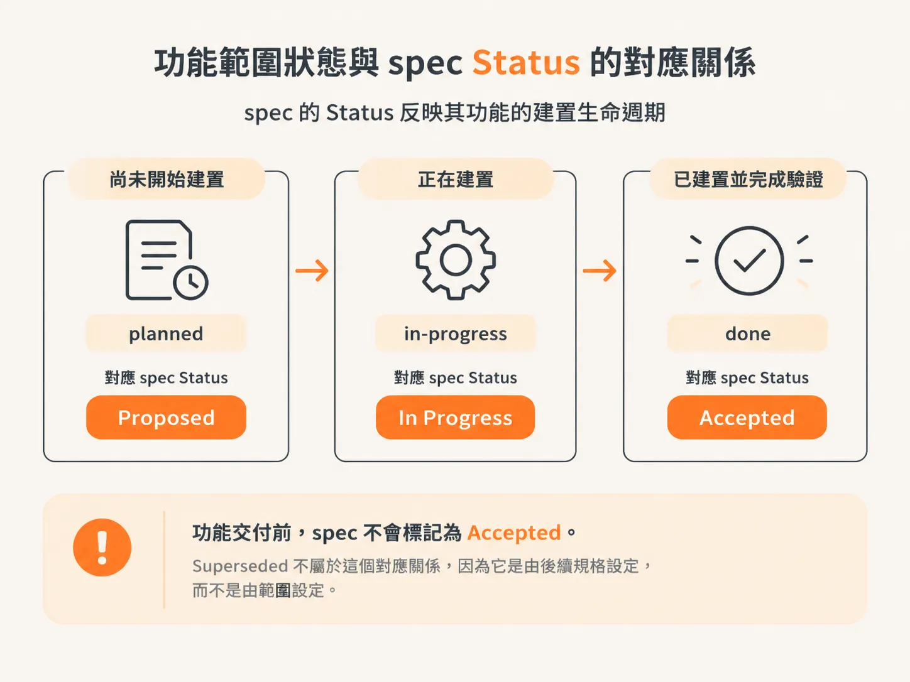
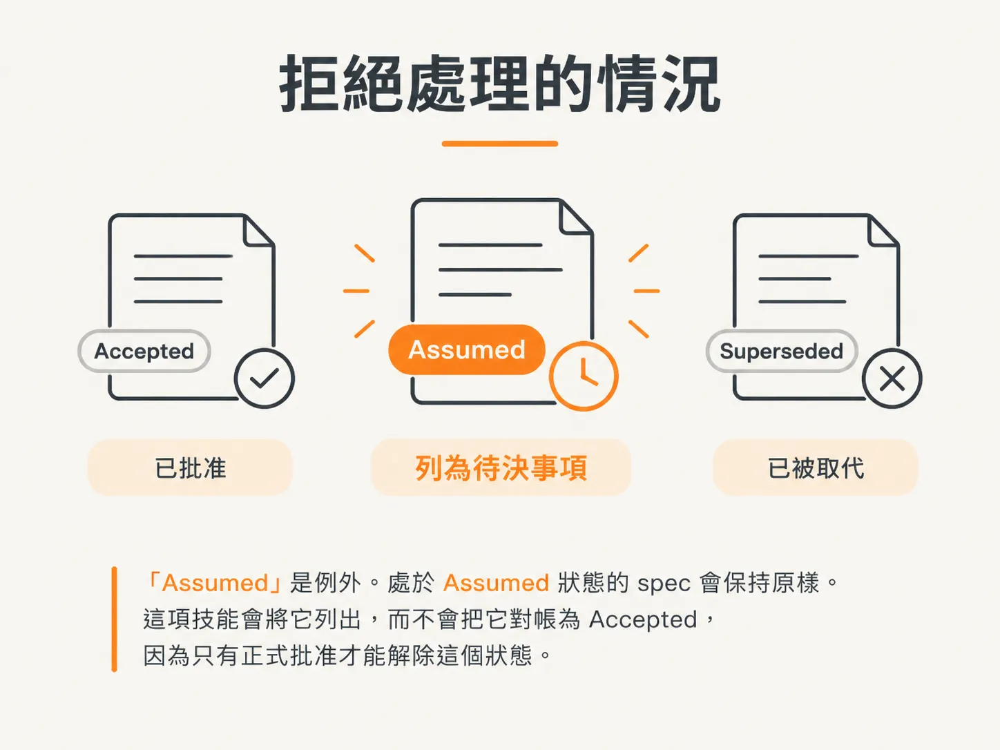

# 對帳 scope 勾選與 spec 的 Status 行

邊界表格已說明：這一輪會勾選那些能以 repo 證據確認的 scope 子任務。這篇文章要說明這句話的意思，以及 spec 中唯一允許修改的那一行。

這裡有兩個核心原則：只有 repo 中存在的證據，才能作為勾選依據；spec 的狀態反映的是功能狀態，而不是對功能的主觀看法。

## diff 決定檢查哪些功能，repo 決定勾選狀態

`sync` 是通用的子任務對帳工具。`/develop` 會勾選自己的子任務；至於 `/test`、`/audit` 和 `/sync` 的子任務，則沒有其他工具負責勾選。

因此，對每個受 diff 影響的功能，`sync` 都會根據 repo 的目前狀態，重新評估每個子任務，而不只檢查這次 diff 新增了什麼。diff 決定要檢查哪些功能；repo 狀態則決定哪些子任務已完成。



因此，上一篇文章提到的篩選方式在這裡不適用。排除 `*.test.*` 和 `docs/**`，是為了決定哪些檔案要同步到 `AGENTS.md`，而不是限制對帳範圍；測試檔、`AGENTS.md` 和設定檔，正是證據所在。

在示範中，變化很小，也很明確：`sync` 將 stack 和 architecture 標記為已完成，並同步更新了 scope 中的對應項目。

## 哪些內容算是證據

| 子任務 | 足以勾選的證據 |
|---|---|
| 實作功能，以及各個里程碑 | 功能程式碼已存在於所屬區域，且里程碑對應的區塊已完成 |
| UI、資料模型、後端、整合、資料整合 | 對應檔案已存在：元件、schema 或 migrations、服務或端點，或已以真實查詢取代 mock |
| 驗證 | spec 旁有 `verify.md`，或有紀錄顯示該功能已通過執行時驗證 |
| 測試 | 有涵蓋該功能所屬區域的測試檔 |
| 由新的模型審查 | `docs/reviews/` 下有該功能的審查結果檔 |
| 文件 | 有涵蓋該功能的 PR 內文、`CHANGELOG.md` 項目或發行說明 |
| SEO 與中繼資料 | 功能頁面上已有中繼資料或結構化資料 |
| 同步、記錄慣例 | 該區域已有 `AGENTS.md`，且內容反映該功能 |
| 編碼標準與工具 | repo 中已有 linter、formatter 或 pre-commit 設定 |

表格上方的原則採取保守做法：只有證據明確存在時才勾選。不確定時，先不要勾選。

## 勾選後，再更新狀態

狀態記錄在兩個地方：`At-a-glance` 表格，以及功能標題旁。只要該功能現有的勾選框仍有未勾選項目，狀態就維持 `in-progress`。只有在該功能所有現有的勾選框都已勾選時，才將狀態設為 `done`。

「現有」這個詞很重要。如果某個功能原本就沒有 `Test it` 勾選框，就不會因為缺少測試而一直無法完成。而工程師已標記為 `done` 的功能，也絕不會被降級；略過的步驟會記錄為略過，而不會成為重新開啟功能的理由。



scope 檔案中的其他內容都不在修改範圍內。絕不能新增、刪除或重新命名功能或勾選框，也不能調整它們的順序；這些工作屬於 `/scope`。`existing` 和 `dropped` 狀態的功能會略過。如果找不到與已交付程式碼對應的功能，`sync` 會記為未對應，並要求執行 `/scope`，而不是自行新增一個區段。

歸屬判定也遵循同樣的原則。只有在檔案能明確對應到單一功能時，才會勾選。在 monorepo 中，變更檔案所屬的 workspace 會決定要更新哪一份 scope。如果某個區域可能對應到多項功能，就記錄為無法明確判定，不要猜測。

格式錯誤的 scope 檔案一律不修改。`sync` 會記錄需要人工處理或重新執行 `/scope` 的情況，然後繼續處理其他項目。不要根據錯誤的判讀採取行動。

## spec 的 Status 行是狀態映射

spec 的 Status 行反映其功能的建置生命週期。`Proposed` 表示尚未開始建置，對應的 scope 狀態是 `planned`。`In Progress` 表示正在建置，對應 `in-progress`。`Accepted` 表示已建置並完成驗證，對應 `done`。功能交付前，spec 不會標記為 `Accepted`。



`Superseded` 是第四種狀態，不會根據 scope 狀態設定。舊 spec 被後續 spec 取代時，應由 `/architect` 負責處理。

這項規則只適用於連結到可建置 scope 功能的 spec。獨立的決策 spec，例如基礎技術堆疊選擇或跨領域標準，則依決策狀態處理：撰寫時為 `Proposed`，正式核准後為 `Accepted`。這些 spec 沒有連結功能是預期情況，並不代表存在不一致，因此不會對帳或標記。

對於涵蓋多項內容的 umbrella decision，這項規則會套用到有連結的 `index.md` 上。子 spec 不帶狀態，因此不會對帳。

實際步驟刻意保持簡單：先找出 spec 管理的功能，讀取該功能目前的 scope 狀態，再推導目標狀態。接著，寫入前再次讀取 spec，因為隊友或其他工作階段可能已經修改過它。如果該行已是目標狀態，就不做任何事；否則只修改那一行，並記錄這項變更。

## 遇到這些情況時不會修改

`Assumed` 是例外。處於 `Assumed` 狀態的 spec 會保持原樣。`sync` 會將它列出，而不會把它對帳為 `Accepted`，因為只有正式批准才能解除這個狀態。



這屬於決策債務，會以相應方式回報：執行 `/architect` 進行正式批准。修改狀態不等於正式批准。

如果必須靠猜測才能判定，`sync` 也會拒絕修改。例如，無法確定 spec 是否只連結到一項功能、對應關係不清楚、該行已標記為 `Superseded`，或無法說明降級的理由時，都不會修改。這些差異會列入過時項目清單，原本的狀態行則維持不變。

## 標記過時 spec，必須指出明確矛盾

標記過時的 spec 必須非常嚴謹，因為過多雜訊會削弱信任。只有當變更路徑看起來可能涉及 spec 主題時，`sync` 才會讀取該 spec；判斷依據是標題和開頭幾行。它不會不加判斷地讀取所有 spec。

接著，只有在能指出變更與哪項具體決策相矛盾時，才會標記。例如，spec 規定使用某個資料儲存系統，但變更新增了另一種資料儲存系統的 adapter；spec 固定了某個介面或邊界，但變更破壞了這項規定；或有後續 spec 取代了目前的 spec。

「可能受影響」這種模糊說法不符合標記條件。不確定時，就不標記。符合條件的項目會記錄遭違反的具體內容，並建議執行 `/architect`。這裡不會修改 spec 內容；只有 spec 的擁有者能修改。

## 報告就是交付成果

每次執行最後都會輸出同一種固定格式的區塊。每個區段都會列出變更內容；沒有內容的區段則省略。如果沒有任何變更，也沒有過時項目，輸出就只有兩行，表示不需要同步。

<!-- source: sources/agentic-engineer/20261030/skills/skills/sync/agent-prompt.md#L183-L209 -->
```
SCOPE: <N> changed files

AGENTS_UPDATED:
- <path>, <what you added or corrected, one line>

AGENTS_CREATED:
- <area>/AGENTS.md, <conventions captured; root pointer added>

ORPHANS_CLEANED:
- <path>, <removed orphaned doc / fixed broken pointer after deletion>

SCOPE_RECONCILED:
- <feature>, <sub-tasks ticked / status advanced to match the diff; or "unmapped: <area>">

SPEC_STATUS_RECONCILED:
- <docs/specs/file>, <Status line: Proposed→In Progress→Accepted to match the feature's scope status>

STALE_SPECS:
- <docs/specs/file>, <why the change makes it stale, or a status mismatch you couldn't safely reconcile>

CONTEXT_GAPS:
- <area>, <pre-existing undocumented area only sliced by this change; suggest /audit>

CONFLICTS:
- <path>, <curated content that would need rewriting; left for a human>
```

這個區塊讓整個流程可以被檢查。你可以閱讀報告、對其中一項提出異議，再單獨還原那項變更。

此外，還有一個選擇性的尾段：如果根目錄的 `## Git` 欄位表示已啟用整合，而且 commit 不是手動執行，`sync` 會詢問是否要提交這次對帳結果，並使用一行主旨和 co-author trailer。它絕不會推送。

到目前為止提到的文件都是 repo 裡的檔案。migration 則不同：它描述的是存在於其他地方的資料庫。這個節點最後要問的是，這項描述會拿來和真實 schema 核對，還是只會和檔案中假想的 schema 對照。
