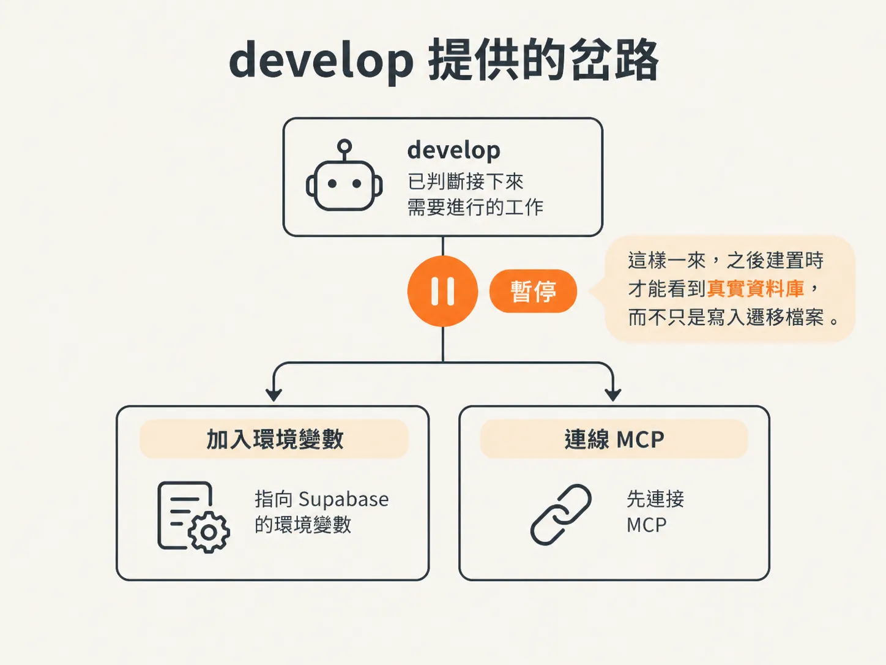
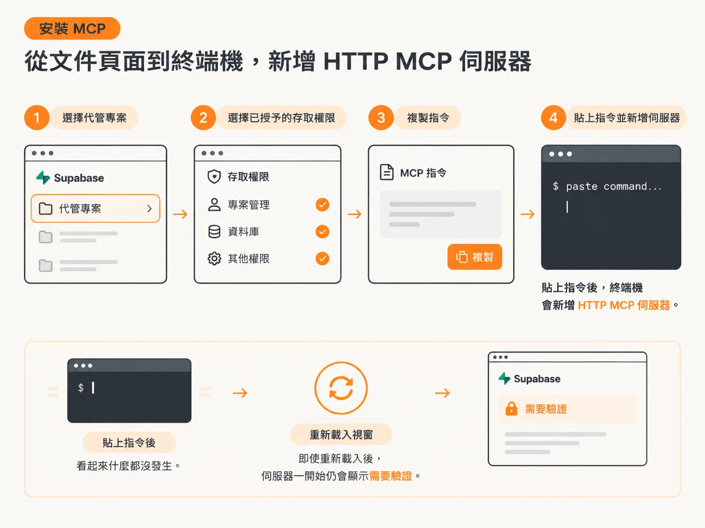
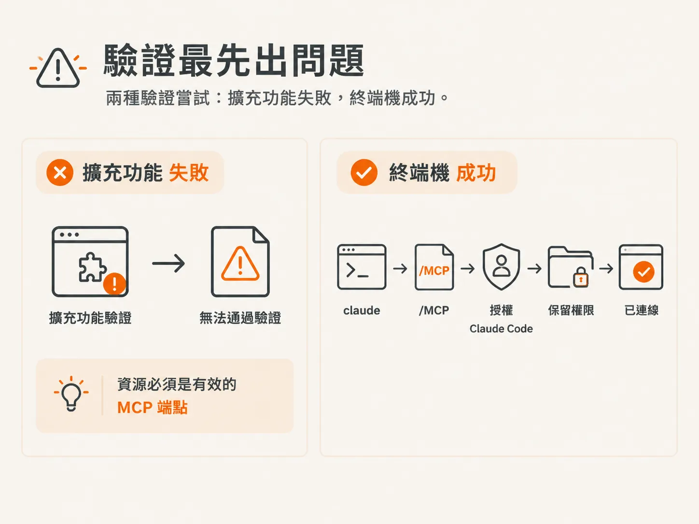
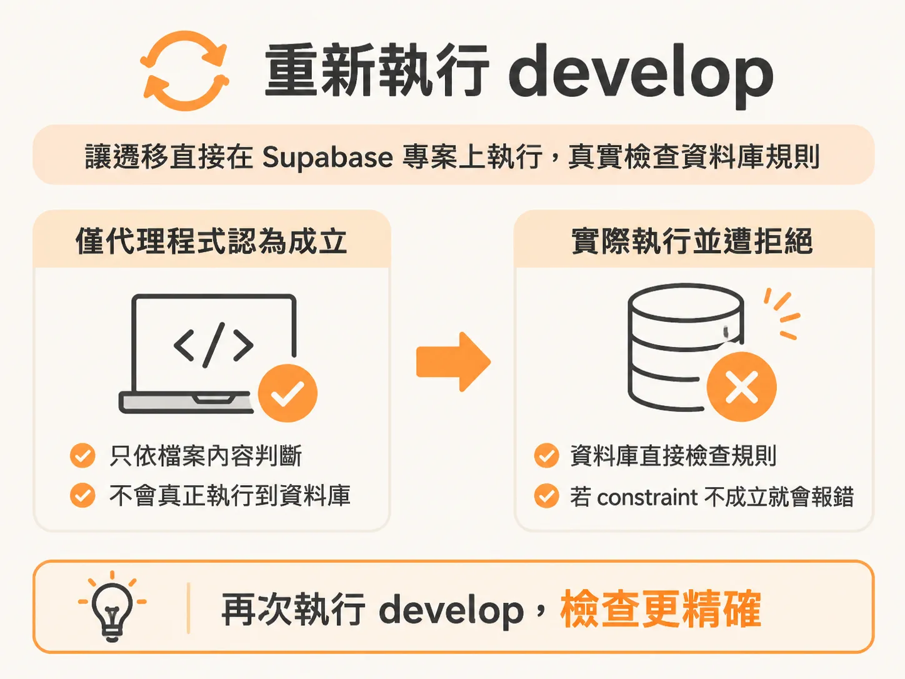

# Install Supabase MCP：讓 migration 打在真的 schema 上

migration 描述的是另一個環境中的資料庫狀態。在此之前，這個節點的所有檢查都只會讀取檔案。到了最後一步，其中一項檢查會直接在資料庫上執行。

這堂課從一次 `develop` 執行到一半的情況開始。代理程式正在建立資料模型，途中停下來提出問題。

## develop 提供的選擇

`develop` 已經判斷接下來要做什麼，接著詢問：現在要加入指向 Supabase 的環境變數，還是先連接 MCP？

答案是立即連接 MCP。因此，develop 暫停工作，並說明接下來該怎麼做：連接 MCP 後，再執行一次 `develop data model`，它就會接著完成建置。

這個答案改變了建置流程的檢查方式。沒有 MCP 時，migration 只是代理程式撰寫並自行認定正確的檔案；有了 MCP，migration 就能實際執行。

## 在 repo 背後建立一個真實專案

首先需要建立資料庫。到 Supabase 建立新專案時，最好一開始就連到 GitHub repo，這樣之後更容易掌握所有內容。

將程式碼推送到新的 repo，例如命名為 `client feedback app agentic`，並設成公開，方便查看。接著複製 repo URL，並告訴代理程式將目前完成的程式碼推送上去。

repo 建立好之後，在 Supabase 選擇它的 URL。你可以授權存取所有 repo，也可以只授權這裡需要的 client feedback app。

接著輸入專案名稱，並設定新的資料庫密碼。請將密碼妥善保存，避免遺失。

此時，程式碼應該已經在 GitHub 上。重新載入 repo，就會看到代理程式目前撰寫的程式碼。回到 Supabase，也會看到新建立的專案。

## 安裝 MCP

前往 Supabase MCP 文件頁面中的託管專案區塊，取得指令。選擇專案；這裡選的是 client feedback app，接著選擇要授予的存取權限。這項設定要連到 Claude Code。

複製指令，開啟終端機並貼上，這樣就會新增一個 HTTP MCP server。

此時看起來似乎什麼都沒發生。你需要重新載入視窗；即使重新載入後，伺服器一開始仍會顯示需要驗證。

## 驗證是最先遇到的問題

有兩種連線方式，但其中一種行不通。在擴充功能中搜尋 MCP servers，並從那裡驗證時，會收到錯誤訊息，指出資源必須是有效的 MCP endpoint。

可行的方法是使用終端機。在終端機執行 `claude`，就會看到有一個 MCP server 需要驗證。接著執行 `/MCP` 並按下 Enter，瀏覽器這次就會開啟正確的頁面。

授權 Claude Code，保留目前的權限設定，然後按下授權。驗證就會成功。

若要確認是否完成，請開啟新視窗並查看 MCP servers。剛開始可能會顯示正在連線；重新開啟頁面後，就會看到 Supabase 已連線。這就是預期的狀態。

## 再次執行 develop

現在可以接著執行工作流程。再次啟動 `develop`，它會判斷專案目前的進度，或向你提問。這裡要回答的是：範圍是 data model，目前仍在進行中。

接著只要輸入 `develop data model`。這次代理程式知道自己有 MCP 存取權限，因此可以自行執行 migrations。

這正是繞這一圈的目的。現在 migration 會直接在專案上執行。如果某項 constraint 不成立，資料庫本身就會報錯，而不是只在文字說明中指出問題。由於檢查確實有執行，工作成果也會更精確。

## 這個節點會留下什麼

整個流程有五個步驟，但核心概念只有一個：程式碼和描述程式碼的文件會逐漸脫節，除非有某種機制能讓兩者重新對齊。

`/sync` 就是這種機制。它會讀取包含逐檔狀態的差異內容，略過文件、測試和產生的輸出。接著只在變更導致 `AGENTS.md` 不再正確時，精確修改需要調整的部分。再根據 repo 中有依據的內容勾選範圍項目，並更新規格中的 Status 欄位，反映目前狀態。最後，它會列出所有修改，供人檢查。

最後這一步是在更底層執行同樣的工作。migration 也是一種文件，必須和唯一不會脫節的來源保持一致：它實際執行時所面對的資料庫。
