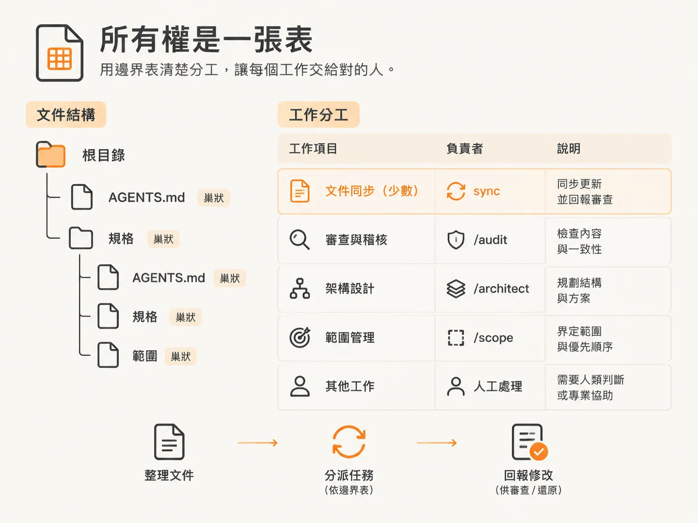
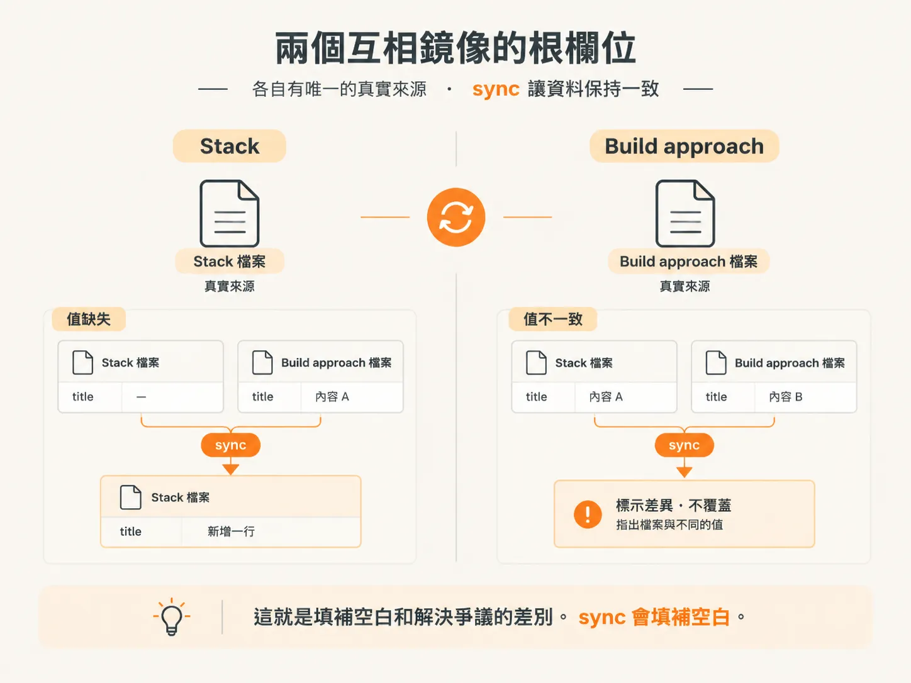
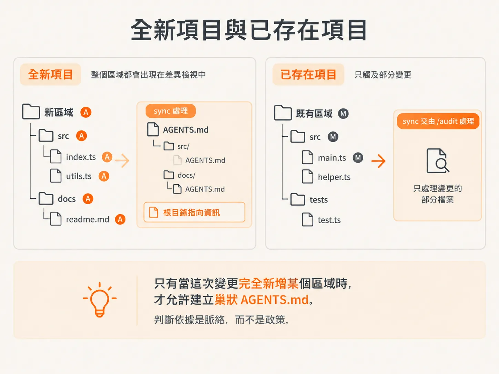
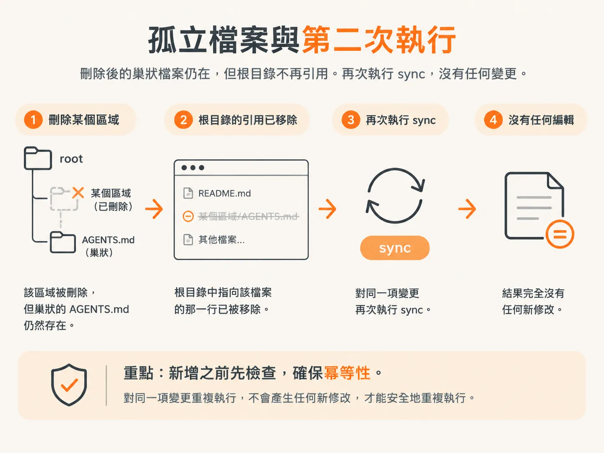

# 外科式、加法、耐久：AGENTS.md 的維護邊界

diff 已經告訴你，哪個 `AGENTS.md` 與這次變更最相關。接下來，你需要知道可以修改多少內容。

這不是憑個人喜好決定的。這個 skill 有一張邊界表，逐項列出哪些工作屬於 `sync`，哪些應交由其他 skill 或人類處理。它會在報告中列出每個經過整理的檔案改了什麼，方便你檢查或還原。

它也只會因為一個原因暫停：沒有任何變更。除此之外，它都會繼續執行。

## 工作歸屬是一張表

`sync` 會維護根目錄與巢狀目錄中現有的 `AGENTS.md`。它也負責幾項範圍明確的工作：同步根目錄中的 build approach 內容；在變更新增 `design.md` 時建立指向它的連結；為這次變更新增的區域建立巢狀文件；同步 spec 的 Status 欄位；以及勾選它能驗證完成的 scope 子任務。

其他工作則由不同對象負責。建立或重整根目錄的 `AGENTS.md`，應交由 `/audit` 處理；為早已存在、但從未有文件記錄的區域撰寫巢狀文件，也同樣交由它處理。清除 spec 中的 `Assumed`，或編輯 spec 內容，則應交回 `/architect`。在 scope 中新增或重新排列功能，則屬於 `/scope` 的工作。

至於覆寫經過整理的文字，完全不是 skill 能決定的事，必須交由人類處理。

另外還有兩條邊界值得記住。`sync` 只會同步 diff 涉及的 workspace 所使用的 scope 檔案，不會一次處理 `docs/scope/` 下的所有檔案。而且它只會寫入表格授權的內容。

檔案路徑的基準很簡單：spec 和 scope 預設放在 `docs/` 下；如果 `docs/` 是已發布的文件網站，則改用 `.workflow/`。使用實際存在的目錄即可。

## 修改前要通過三項檢查

對於每個涵蓋範圍受到這次變更影響的現有 `AGENTS.md`，skill 會先確認實際變更了什麼。變更是否影響某項指令，例如 build、test、run 或某個 script？是否影響慣例、限制或相依項目？是否因為目標路徑移動或消失，導致檔案指標失效？是否新增了在這次變更結束後仍然適用的規則？

確認這些之後，skill 才會決定是否編輯；任何修改都必須通過三項檢查。

精準：只修改或新增特定行，不重寫整個段落。補充或修正：新增缺漏資訊，或修正錯誤內容，但絕不刪除自己尚未完全理解的經過整理指引。長久有效：內容必須在這次變更結束後仍然成立，因此不能是一次性備註、歷史紀錄或功能摘要。

## 根目錄中兩個互相映照的欄位

根目錄的 `AGENTS.md` 有兩個欄位會反映檔案以外的資訊。`## Stack` 會反映 `docs/specs/` 下含有 `## Proposed stack` 段落的架構 spec。`## Build approach` 則會反映 scope 標頭中的 build approach 欄位，也就是由 `/scope` 記錄的內容。

`sync` 不負責自行發明這兩個欄位的值。如果缺少值，skill 會補上該行，並在報告中記錄為已更新。如果欄位內容與來源不一致、根目錄版本含有經過整理的補充文字，或無法判斷哪一邊才是權威來源，skill 就不會自行選邊，而會標出差異並指出比對過的檔案。

這就是填補空白和解決爭議的差別。`sync` 會填補空白。

## 區域 skill、MCP 和指標

如果這次變更新增了重要工具，skill 會在最相關、範圍最明確的文件中精確記錄。專案層級的工具，例如 framework、ORM、樣式工具、核心資料庫、hosting 或 test runner，應記在根目錄檔案中。區域專用工具，例如付款、驗證、電子郵件、檔案上傳、搜尋或佇列，則應記在該區域的巢狀文件中；如果沒有這類文件，就在根目錄加上一則簡短說明，並註明缺少區域脈絡。

已安裝的 skill 應在 `## Agent skills` 下各自列為一個項目，使用專案實際的 skills 目錄，並以 `<owner>/<repo>` 作為識別名稱。如果沒有這個段落，就建立它。不要把多個 skill 合併成一長串名稱，因為這麼做的目的，是只載入需要的 skill。

未採用的工具和 MCP 則以精簡的單行記錄。選用的 MCP 除非主線程表示已連線，否則應記為建議項目。

`design.md` 只新增指標，不複製內容。若設計系統適用於整個專案，就在根目錄新增一行；若只適用於特定區域，則加在 UI 區域的巢狀文件中。

## 全新區域與既有區域

只有當這次變更完全新增某個區域時，才允許建立巢狀 `AGENTS.md`。判斷依據是脈絡，而不是政策。

具體來說，如果該區域內所有來源檔案在變更檔案清單中的狀態都是 `A`，就建立文件，因為 diff 已呈現整個區域。如果區域內有任何檔案的狀態是 `M`，就代表該區域早已存在，而你只看到了其中一部分。此時不要建立文件，應記錄為脈絡缺口，並交由 `/audit` 處理。

前一篇文章提到的狀態字母，在這裡就派上用場了。全部都是 `A`，代表你掌握了完整情況；只要有一個 `M`，就代表你沒有。

撰寫的文件應聚焦於區域本身：列出本地檔案指標、在地指令、新程式碼中可見的慣例，以及相關規範 spec 的連結。最後要加上一行，註明文件由 `sync` 根據引入該區域的變更草擬，並建議由人類快速檢查。

接著，只在根目錄的 `## Context files` 下新增一行指標，並為該區域建立對應的 `CLAUDE.md` 指標。每個真正不同的新區域只建立一份巢狀文件，不要每個資料夾都各建一份。

## 孤兒文件與第二次執行

被刪除的檔案也要在這裡處理。如果某個巢狀 `AGENTS.md` 描述的程式碼已不存在，它就成了孤兒文件。若整個區域都被刪除，文件也要一併刪除，並移除指向它的那一行。如果只有部分檔案被刪除，就修正文件中失效的指標。

任何 `AGENTS.md` 中指向已刪除或已移動路徑的檔案指標，都必須修正。如果不確定刪除是否永久，應標註出來，而不是直接刪除。

最後一條規則能讓整套流程維持穩定：新增前先檢查。重新閱讀目標文件；如果相關事實、指令或指標已經存在，即使措辭不同，也不要重複新增。

對同一項變更再次執行時，不應產生任何新修改。這樣才能安全地重複執行，也正是第一篇文章提到的原因：沒有變更的那次執行不會造成任何影響。

`AGENTS.md` 只是這個流程會寫入的兩份文件之一。另一份是 spec 的 Status 欄位，而 scope 核取方塊也會寫在其中。接下來的問題是：什麼樣的證據足以證明子任務已完成？
