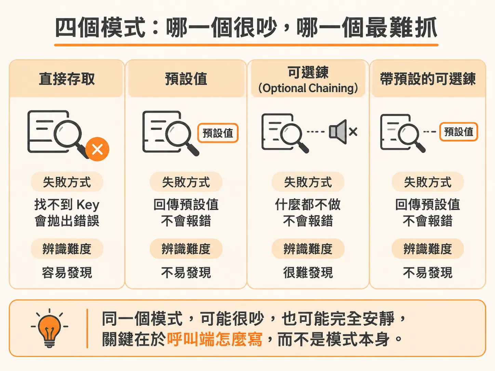
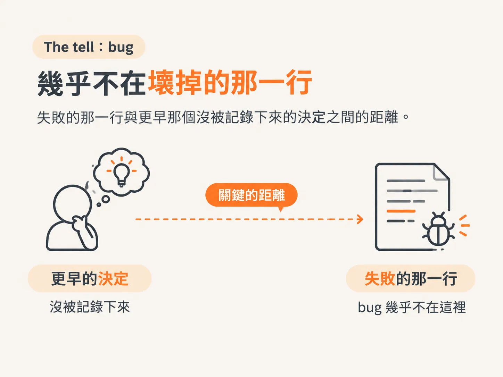
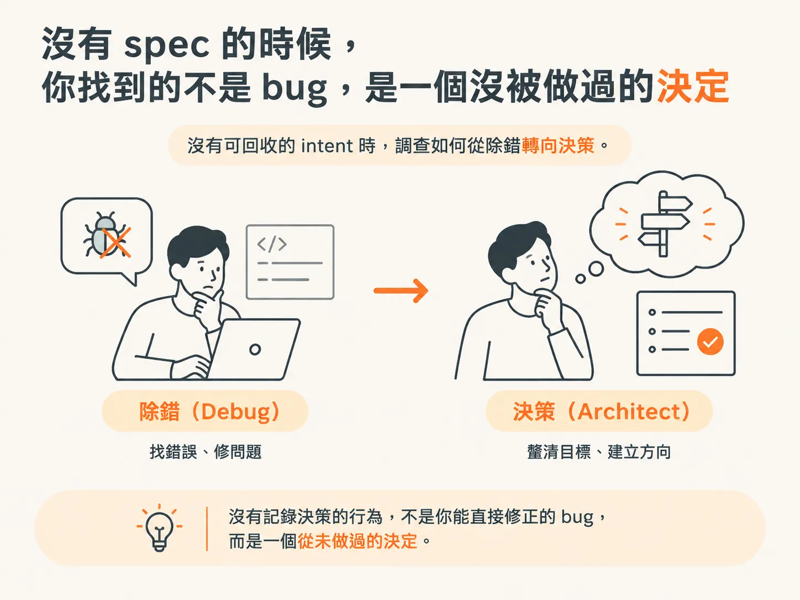

# AI 寫的 code 特有的缺陷

上一課把三種壞掉的情況區分開來後，第二種還留下一個問題：它的 intent 不在你身上。這一課要處理的，就是這個問題——AI 寫的 code 壞掉時，怎麼辨認四種已知模式；沒有 spec 時，又為什麼該找的不是 `/debug`。

## 你沒有記憶可用，所以別假裝知道每一行為什麼存在

Debug 自己的 code 時，你不只是在讀程式碼。你還記得自己當初為什麼那樣寫：那個變數為什麼留著、那個 `if` 為什麼先寫、為什麼某個分支乾脆不處理。這份記憶替你做掉了一半的工作，只是你幾乎不會注意到它的存在。

讀 Agent 寫的 code 時，這份記憶不存在。看著它被生成也無法取代記憶，因為你看到的是輸出，不是推理過程。

所以第一步，是停止假裝自己知道它為什麼這樣寫。

這聽起來像一句勸告，其實是技術。它能避免一個很具體的錯誤：你看了一行程式碼，猜它「大概想做什麼」，接著便照著這個猜測 debug。結果，你調查的不是 code，而是自己對 code 的想像。

把它當成陌生人寫的程式碼來讀。因為它真的就是陌生人寫的。

Login demo 就是現成的例子。看到 login action 從 registry 取 handler，很容易就假定「login handler 一定存在」——但這個假定，正是接下來要驗證的事。

## Intent 有三個來源，而 spec 的 acceptance criteria 最重要

沒有了記憶，就得從三個地方找回 intent。

Spec 的 acceptance criteria 告訴你「原本應該做什麼」；它與實際行為之間的差距，就是 bug。周圍的 code 則告訴你「這個檔案應該遵守哪些慣例」。實際執行的結果告訴你「真正發生了什麼」，而不是 code 看起來在說什麼。

三者之中，spec 最重要。這也是「把東西寫下來」最不華麗、卻最實際的回報。Acceptance criteria 說的是它承諾了什麼，不是它實際做了什麼。這句話能把模糊的調查變成一次比較：一邊是承諾，一邊是實際行為，找出兩者之間的缺口。

Spec 寫著「逾時 30 分鐘後要重新登入」，但實際觀察到的是「31 分鐘後還進得去」——把兩句話並排，缺口就是 bug 所在。

## 四種模式：哪一種很吵，哪一種最難抓

AI 寫的 code 壞掉時，常見的情況可以歸納為四種模式。記住它們的名字，看過一次之後就能很快認出來。

**Invented function：** 呼叫了不存在的函式，或呼叫了兩個版本前才存在的函式。這種錯誤很容易發現，失敗時也很明顯。

**Plausible but wrong logic：** 程式碼讀起來正確，也通過了 review，卻在遇到真實資料時出錯。這是最難抓的一種：程式碼的形式看似正確，推理卻不對。沒有東西會及時抓到它，直到真實資料讓問題現形。

**A decision made mid-file：** 嚴格來說不算 bug。Generator 選了某個做法，卻沒有人 review；直到它和其他部分衝突，問題才浮現。

**The unconsidered edge case：** Happy path 雖然完整，卻沒考慮到不尋常的輸入。這種缺口通常會在餵入真實資料後暴露。

課程中的 login demo 刻意把 handler 改名，卻留下舊名稱的引用。Action 會這樣取 handler：

<!-- source: sources/agentic-engineer/20261030/ai-course-demos/001-login-btn-issue/app/actions/auth-actions.ts#L17-L18 -->
```ts
  const handler = authHandlers["login"];
  const outcome = await handler?.(formData);
```

但 registry 裡的 key 卻叫 `authenticate`：

<!-- source: sources/agentic-engineer/20261030/ai-course-demos/001-login-btn-issue/lib/auth.ts#L44-L45 -->
```ts
export const authHandlers: Record<string, AuthHandler> = {
  authenticate: async (formData) => {
```

Key 不存在時，lookup 會回傳 `undefined`。Optional chaining 讓呼叫什麼都不做，因此沒有任何錯誤浮現。同一種模式可能很吵，也可能完全安靜；是否明顯，取決於呼叫端怎麼寫，而不是模式本身。



## The tell：bug 幾乎不在出錯的那一行

Bug 幾乎從來不在失敗的那一行，而是在更早之前做出、卻沒有人記錄下來的決定。



因此，調查時還要多問一個問題——一個你不會拿來檢視自己 code 的問題：這件事到底有沒有被決定過？

在 login demo 裡，`verifyCredentials` 單獨呼叫時是正確的：帳密正確就回傳 user，否則回傳 null。問題不在密碼比對，而在 dispatch 使用的 key 和 registry 裡的 key 對不上。即使開啟 TypeScript 的 `strict`，也抓不到這個問題，因為 `Record<string, AuthHandler>` 用不存在的 string key 索引仍然合法。Build 零錯誤只能證明型別沒有問題，不能證明那個 key 確實存在。

要追查的是「這個決定是誰做的、寫在哪裡」，而不是沿著 stack trace 找下去。

## 沒有 spec 的時候，你找到的不是 bug，而是一個從未做過的決定

很多 AI 寫的 code 確實沒有 spec。這時候你找到的東西，可能比 bug 更重要。

一個沒有記錄決策的行為，不是你能直接修正的 bug，而是一個從未做過的決定。有人決定「什麼才算正確」之前，你無法判斷這段 code 到底錯沒錯。那不是 `/debug`，而是 `/architect`。



如果沒有驗收句說明「login 成功後應該去哪裡」，那麼「按了沒反應」就不是一個可以證明的 bug，而是一個尚未回答的問題：成功應該是什麼樣子？

先判斷是否有可回收的 intent。若沒有，就退回去做決策，不要用 patch 代替決定。

有了 intent，或確認 intent 不存在並退回 `/architect` 之後，剩下的仍是那六個步驟。下一課要問的是：這六步具體是什麼？為什麼 `/debug` 不能替我下判斷？
