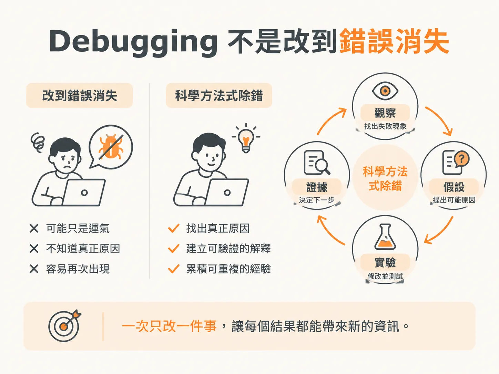
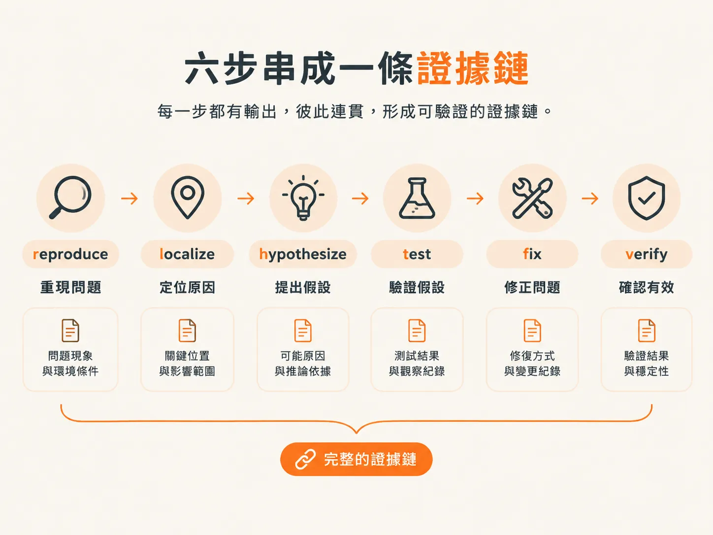
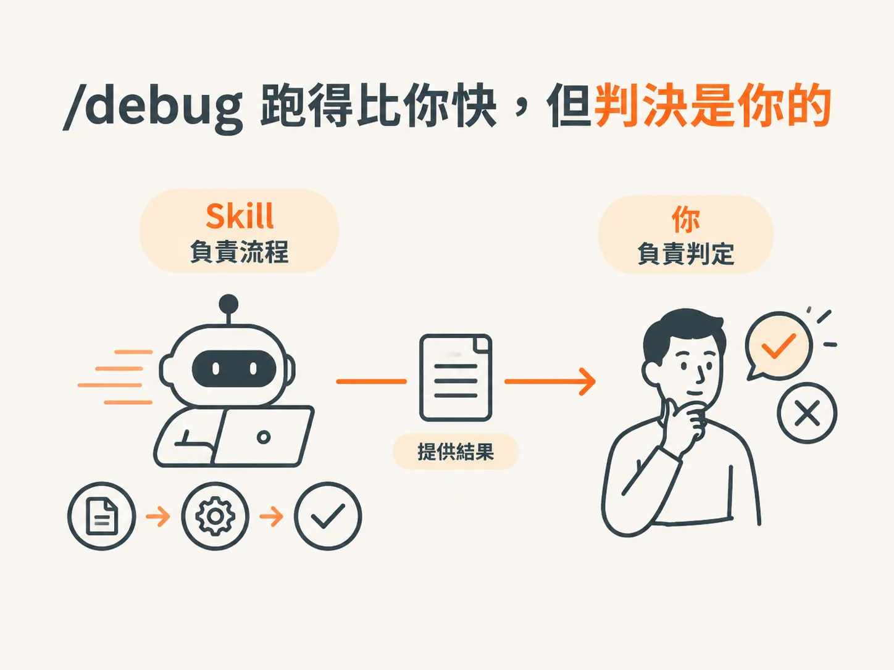

# 在任何程式碼上都有效的方法

上一課從 spec、周圍的 code 和實際行為中補回 intent 之後，剩下的還是那六步。這一課會把六步逐一展開，也回答一個更根本的問題：如果 `/debug` 已經有 skill，而且跑得比我快，我為什麼還要自己學會這套方法？

## Debugging 不是改到錯誤消失

第一類問題是 code 裡的普通 bug，處理它有一套通用的方法。無論使用哪種語言、面對哪個 codebase，或是由誰寫的程式，這套方法都適用。

先從它不是什麼說起：debugging 不是不斷改東西，直到錯誤消失。人人都會這麼做，而這也是 bug 再度出現的原因之一。

Debugging 是把科學方法套用在出問題的程式上：觀察失敗、提出具體解釋、測試假設，再讓證據決定下一步。最重要的習慣是一次只改一件事，讓每個結果都能帶來新的資訊。

Skill 用一句話點出核心：你無法解釋的修正，代表你還沒真正找出 bug。

如果把「錯誤消失了」當作成功，就只驗證了症狀。把「我能說明它為什麼出錯，以及這項修改為什麼能讓它不再出錯」當作成功，才算驗證了原因。成功的判準是能否解釋，而不是看燈號是否轉綠。

## 六步：reproduce → localize → hypothesize → test → fix → verify

Skill 把這套方法整理成一個循環：reproduce → localize → hypothesize → test → fix → verify。一次只提出一個假設，並以證據確認或否決，直到原因獲得證明，再套用最小幅度的修正。

進入這六步之前，還有 Step 0：先明確記錄症狀，包括 observed（精確的錯誤訊息、stack trace、錯誤輸出或截圖）、expected，以及 repro（重現步驟、輸入和環境）。

**Step 1，取得可重現的失敗。** 找一個固定的 test、指令或 request，讓 bug 能隨時重現。如果失敗不穩定，就找出影響重現的因素，例如時機、順序、資料或併發。無法重現，就無從證明 bug 已經修好；如果真的無法重現，就加入 instrumentation，不要盲目修補。

**Step 2，localize。** 開始推理之前，先把失敗範圍縮到最小：對 code path 進行二分、對歷史版本進行 bisect，並檢查實際的值。

**Step 3，hypothesize。** 寫下一個具體、可證偽的假設，例如：「日期被當成本地時間解析，所以 cutoff 出現了時區偏移。」Root cause 不是 symptom：「這裡是 null」描述的是症狀；「為什麼會是 null」才是在追查原因。

**Step 4，test。** 設計最小規模的實驗，例如加入針對性的 log 或 assertion、做一行改動，或寫一個 unit test。假設被否決，就放棄它，帶著新資訊回到 Step 2 或 Step 3；假設獲得證實，才繼續往下。

**Step 5，fix。** 做最小且針對性的修正，處理原因，而不是掩蓋症狀；也不要趁機 refactor。

**Step 6，verify。** 重跑 Step 1 的重現流程、執行周邊的 test suite、加入一個在修正前會失敗而修正後會通過的 regression test，並搜尋是否有其他相同模式的 siblings。

用 Skill 的時區例子走一遍：觀察到 cutoff 出現時區偏移，將問題定位到日期解析那一行，提出「日期被當成本地時間解析」的假設，再用固定時區的 test 驗證。確認後，修改解析方式、重跑 test，並加入 regression test。

六步產出的應該是一條證據鏈，而不是一堆改動。

## 一次一個假設，被否決的假設也是進度

最重要的習慣是一次只改一件事。一次只提出一個假設，並用證據確認或否決；不要用 shotgun 式的做法，一次改好幾個地方。假設被否決，就丟掉對應的改動，不要留下沒有幫助的修改。不要憑直覺直接跳到修正：未經驗證的修正，可能只是掩蓋症狀，讓 bug 繼續存在。

如果可能原因有三個——時區、快取和排序——就不要一次改三個。先測試時區；如果假設不成立，就撤掉那項改動。至少，你已經知道 cutoff 的來源不在那裡。

每個「不成立」，都能縮小下一次實驗的範圍。

## `/debug` 跑得比你快，但判決權在你

即使 Debug 能替你執行這些步驟，你仍然需要懂得這套方法。Skill 可以比你更快地 reproduce、localize、test、fix 和 protect。

但它無法替你判斷：它究竟證明了原因，還是只讓症狀消失。這個判斷權在你手上；如果你自己不懂這套方法，就無法做出判斷。方法由你掌握，skill 只是更快運用它的工具。

只有在無法根據現有資訊重現問題時，Skill 才會提問；它會詢問精確的重現步驟、輸入、環境，以及 observed 和 expected。

Agent 回報「已修好，test 也通過了」時，你要問三個問題：它執行了哪個重現流程？哪個假設獲得證實？為什麼這項修正能排除那個原因？如果答不出來，綠燈就不算證據。

Skill 負責流程，你負責判定。

掌握這套方法之後，下一課就把它交給 `/debug` 實際跑一次：一開始要提供哪三項資訊？過程中要留意什麼？結束後又該如何驗收？
