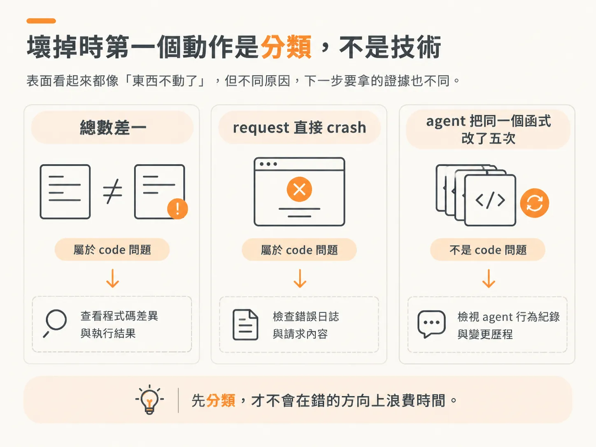
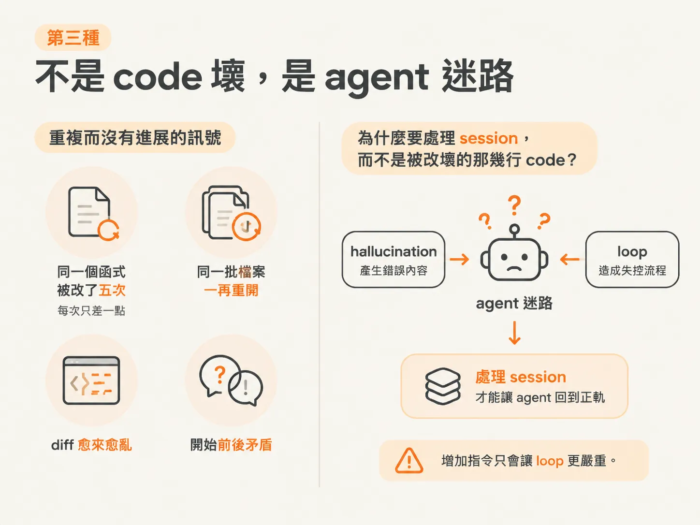
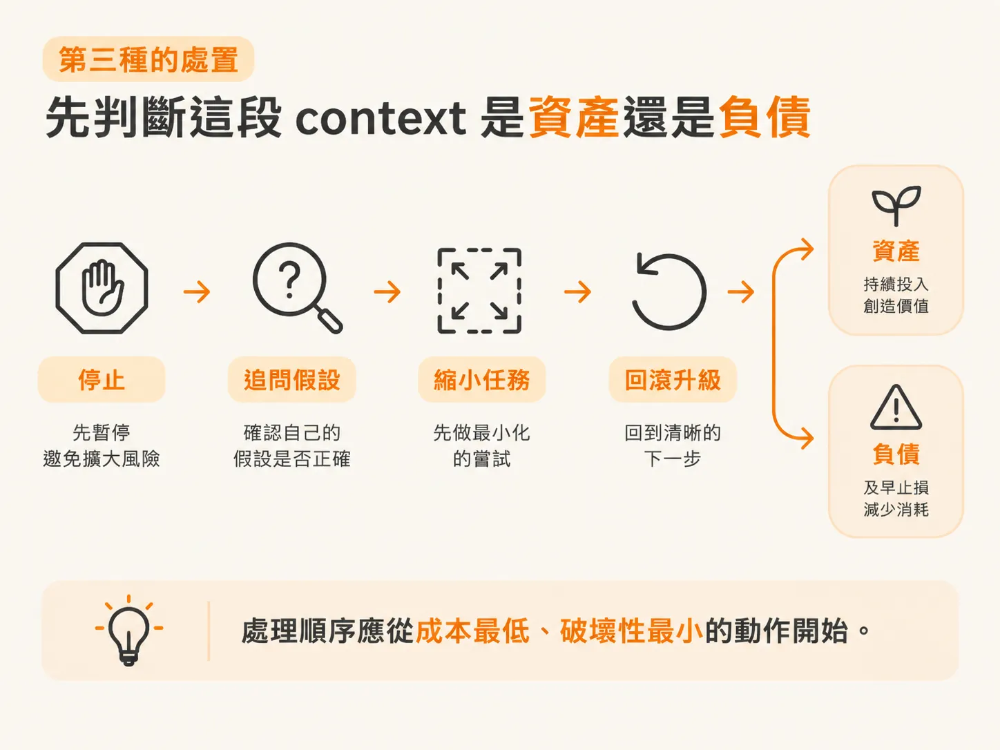

# 這是哪一種壞掉？

## 前言

專案進行到某個階段，第一次亮起紅燈。多數人的反應是開始修改，一直改到燈號轉綠為止。這麼做有時確實能解決問題，但代價是你不知道剛才改了什麼，也不知道為什麼有效。下次同樣的地方再出問題時，你手上仍沒有任何新資訊。更糟的是，你可能對一個根本看不見這個 bug 的 agent 重下同一道指令，或清掉一個已經蒐集好證據的 session。

這個 node 要處理的正是這件事：東西壞掉時，先判斷「這是哪一種壞」，再一次提出一個可證偽的假設，逐步找出根因，而不是只把紅燈改成綠燈就收工。你會在很多情境中遇到這種問題——`/check verify` 紅掉、agent 回報「已修正」但 test 仍然失敗，或同一個函式被來回修改五次，diff 卻愈來愈亂。這些情境看起來都像 bug，實際上需要的處理方式卻各不相同。

四篇文章依序回答四個問題：眼前的故障屬於三種壞掉情況中的哪一種，分錯類要付出什麼代價；AI 寫的 code 出問題時，該如何辨認四種已知模式，以及沒有 spec 時為什麼應該退回 `/architect`；適用於任何 codebase 的六步迴圈是什麼，以及 `/debug` 為什麼不能替你判斷根因；最後，將 observed／expected／repro 交給 `/debug` 跑一次，並以修正的大小驗收它是否真的找到了根因。讀完之後，你會有一套分類方式、一個處理迴圈，以及一條不接受無法解釋之修正的驗收標準。

第一篇先處理最前面的問題：眼前的故障屬於三種情況中的哪一種？分錯類又要付出什麼代價？

## 壞掉時，第一步是分類，不是動手修

真實專案不會永遠一帆風順。多數事情照計畫進行一陣子後，總會有某個環節出問題。這時最有用的第一步，不是套用某種 debugging 技巧，而是先問：這是哪一種壞？

因為壞掉的情況有三種。它們看起來像同一個問題的不同版本，處理方式卻可能完全相反。

總數差一、request 直接 crash、agent 把同一個函式改了五次——前兩種是 code 壞了，第三種不是。它們表面上都像是「東西不動了」，但如果你用同一套方式處理，就會把時間花在錯的方向上。

所以，東西壞掉時，先別急著修。先判斷是哪一種。

## 第一種：可觀察、可重現的 code bug

第一種是一般的 code bug：計算結果錯誤、request crash，或總數差一。這是真正的 fault，會造成看得見、也能重現的行為。

無論 code 是你、另一位 developer，還是 agent 寫的，這類問題的特性都一樣。修復方式也是工程師在 agent 出現之前就已經採用的那一套。

判準是能否重現，而不是由誰撰寫。固定輸入後再跑一次，錯誤依然出現，就屬於這一類。

## 第二種：happy path 看似完成，第一個不尋常的輸入才讓問題現形

第二種是 AI 寫的 code 常見的失敗模式。它可能呼叫不存在的 library function、寫出乍看正確但實際上悄悄出錯的邏輯；也可能在檔案中途做了重要決定，卻沒有告訴你；還可能漏掉某條 access rule、一個 edge case，或只有真實資料才會觸發的失敗。

這些情況的共同點是：happy path 看起來一切正常，直到第一個不尋常的輸入出現，agent 從未考慮過的問題才一一浮現。

這類故障難以追查，因為你不能依靠作者的意圖來推理——你不是作者。即使你親眼看著 code 被寫出來，也不代表你知道每一行為什麼會出現在那裡。

例如，權限檢查只在單一 happy path 上測試過：管理員帳號一路順利，換成一般使用者後，才發現有一條 access rule 根本沒有納入考量。

它的訊號是「happy path 通過了，intent 卻沒有落實」。要準確辨認這類問題，需要下一課介紹的四種模式。

## 第三種：不是 code 壞了，而是 agent 迷路了

第三種情況根本不是 code 出問題，而是 agent 失去了方向。

它反覆做同一件事、把相同的檔案改來改去；每次嘗試都讓專案變得更糟，也愈來愈偏離問題根源，卻始終沒有降低信心。

這時繼續叫它修，通常沒有幫助。你原本找來解決問題的工具，現在已經成了問題的一部分。

它的訊號是反覆嘗試，卻毫無進展：同一個函式被改了五次，每次只差一點；同一批檔案一再重開；diff 愈來愈亂；開始前後矛盾。hallucination 會產生錯誤內容，loop 則會造成失控的流程。增加指令只會讓 loop 更嚴重。

同一個函式第五次被重寫，diff 比第一次更亂，agent 卻仍然說「已修正」——這就是第三種情況。

## 第三種情況的處理方式：判斷這段 context 是資產還是負債

發現 agent 陷入 loop 後，先判斷這個 session 累積的 context 是否值得保留。

如果它已經有實質進展，只是快要沒有空間，context 就是資產，可以 compact。若裡面塞滿失敗的嘗試和重複的假設，context 就是負債，應該 clear。兩種情況判斷反了，代價都很高：清掉有進展的 session，等於丟掉已經蒐集到的證據；compact 一個已經混亂的 session，則會把錯誤推理一併壓縮、帶到後續，更難察覺。

處理順序應從成本最低、破壞性最小的動作開始。

先停下來。Esc 會中止回應，Ctrl+C 會退出 session；這裡需要的是前者，而且這一步沒有成本。接著問 agent 相信什麼：請它說明「你認為問題是什麼？你做了哪些可能有誤的假設？」卡住的 agent 通常會一直繞著同一個錯誤假設打轉。讓它把假設說出來，有時就能當場打斷 loop。再來是減少任務範圍，而不是增加指令。多數 loop 都是從任務太大開始的：把「重構 authentication 模組」縮小成「從這個檔案抽出 token refresh，其他都不要碰」。

如果失敗的嘗試已經破壞了東西，不要再讓已經混亂的 agent 替自己收拾爛攤子。checkpoint 不一定能救回被 shell 修改過的檔案，`git restore`／`git reset` 是通用的退路。

如果判斷 context 已成負債，clear 應該是最後一步，而且要帶著證據進入新 session。不要重複原本的 prompt，否則很可能重建同一個 loop。新 session 一開始就提供精確的錯誤、失敗的 test，以及舊 session 一直漏掉的關鍵事實。清掉的是對話，不是工作；scope、spec 和 AGENTS.md 都還留在磁碟上。

處理時，從最便宜、破壞性最小的動作開始。clear 留到最後，而且要帶著證據進行。

## 分錯類的代價，以及三種壞掉情況背後的共同規則

花時間分類，究竟能省下什麼？三種錯誤判斷各有不同代價，而且都不小。

把第二種當成第一種，你會繼續對一個看不見 bug 的 agent 下指令；此時真正該做的，是自己停下來重現問題。把第三種當成 code bug，你可能花上一小時修改 code，卻忽略真正的問題是 agent 十個 turn 前就已經忘了任務。太早清掉一個混亂的 session，則可能丟掉它已經蒐集到的證據。

這三種情況背後有一條共同規則：無法解釋的修正，代表你還沒有真正找到 bug。

錯誤消失了，但你說不出原因，這並不能證明根因已經消失。你可能只是把症狀藏起來、轉移到別處，或改動 code，讓問題暫時不容易觸發。因此，要依據證據，而不是直覺。bug 是你能證明的案例，不是一則被你消音的訊息。

分類不是為問題貼標籤，而是決定下一步該蒐集什麼證據；而那條共同規則，則是三個分支都必須遵守的驗收標準。

三種情況中，只有第二種需要額外的辨識方式，因為 intent 並不在你的腦子裡。下一課要問的是：AI 寫的 code 出問題時，四種模式各自是什麼樣子？沒有 spec 時，又該找誰？
