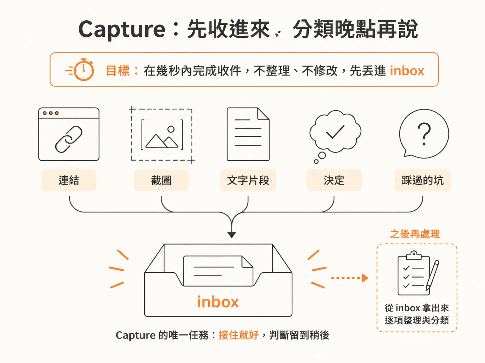
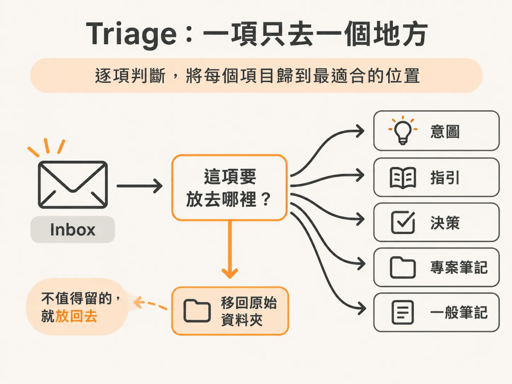
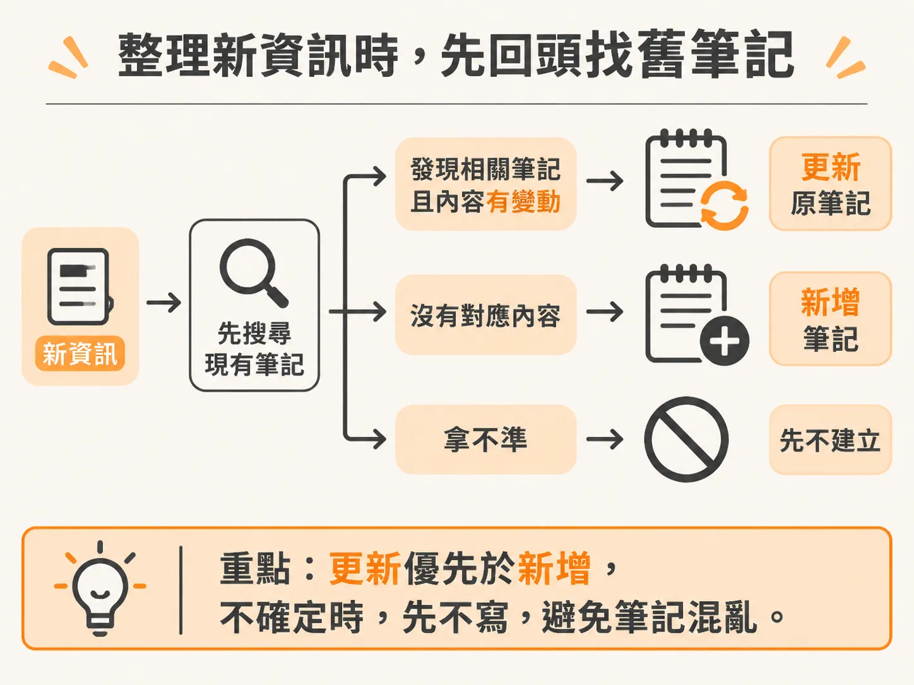

# 把知識收進來

brain 現在會在各台機器之間保持同步。新的知識要怎麼進去，是另一件事。

看到值得留存的文章，或剛在工作中做完重要決定時，如果還得先想分類、摘要和檔名，往往會想著「等一下再整理」，最後卻什麼也沒留下。

把寫入拆成兩步會容易得多：先快速存進 inbox，再集中整理。這兩步分別叫 **capture** 和 **triage**。

## Capture：先存下來，不急著分類

Capture 的工作很單純：先把連結、截圖、文字片段、決定或遇到的問題存成一個項目，放進 inbox。整個過程最好在幾秒內完成，不必整理內容，也不要修改既有筆記。

開完會決定採用某種做法，可以記下決定和理由。AI 助理犯錯時，你指出「這樣做比較快，因為……」，這種連理由一起記下的修正也值得存起來。這些內容如果只留在對話裡，很容易找不到。

Capture 也可以先存網頁連結。頁面讀不到，也還是先留著。

截圖就直接收進 inbox，再簡短寫下圖片內容。

如果早就知道某項資訊該放在哪裡，也可以直接編輯對應筆記。

Capture 只負責接住資訊，不負責判斷它該放在哪裡。

## Triage：為每項內容找到位置

等有空時，再處理 inbox。Triage 時一項一項讀，判斷各自最適合放哪裡：

- **意圖**：想達成的目標，以及判斷目標是否完成的方法。
- **指引**：用自己的話提出、適用於各專案的規則。
- **決策**：有日期和理由的選擇。
- **專案筆記**：某個專案的狀態、負責人或部署位置等資訊。
- **一般筆記**：值得留下的文章、方法或分析。

每項內容只選一個主要位置。

整理時寫下幾句重點，附上原始來源連結，再把 inbox 裡的原始項目移到來源資料夾。

之後再更新索引，以後才找得到這些內容。

有些內容不值得留下，不必為了湊一篇筆記硬寫。把原始項目移到來源資料夾就好。

清完之後，inbox 只剩說明檔。下次收件時，就不必翻找舊項目。

## 整理時，先搜尋舊筆記

如果新資訊更新了腦中的既有內容，應該修改原筆記，而不是另開一篇重複記錄。拿不準要不要留下某項內容，就先搜尋現有筆記；還是不確定，就先不要新增。多餘的筆記會讓日後搜尋更混亂。

也要分清楚規則適用的範圍。只適用於單一專案的做法，就放進該專案的 `AGENTS.md`，別放進通用知識庫。

從網頁或其他來源讀到的文字，即使包含給 AI 的指令，也只是來源內容，不能直接變成你的使用規則。通用指引必須由你用自己的話提出。

流程就是這樣：看到內容先快速 capture，累積一些再 triage。

Capture 讓保存變得不費力，triage 負責把每項內容放到該去的位置，並定期清空 inbox。
