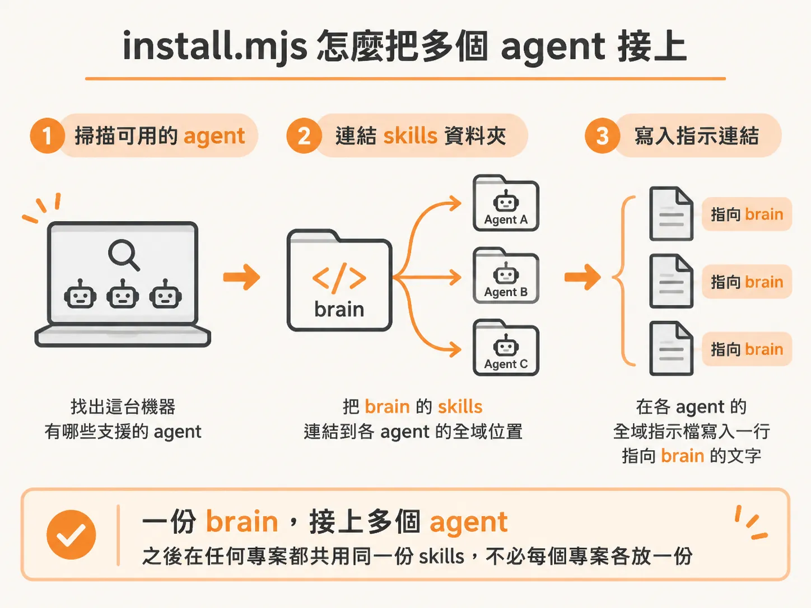

# 把每一個 agent 接上

如果你在不同專案間切換使用 Claude Code、Codex 或 Cursor，可以讓它們共用同一套 skills 和工作規則。把 brain 放在共用資料夾，再用 `install.mjs` 將它連接到這台機器上的 agent。

先把 brain 範本建立成自己的私人 GitHub repo，再到每台要用的機器上 clone。建議放在 `~/brain` 這種看得見的資料夾，因為 Claude Code 預設搜尋時會略過隱藏資料夾。

<!-- source: sources/ai-agent-engineer/20261103/The Agentic Coding Handbook.5.part.txt#L161-L162 -->

```sh
git clone git@github.com:<you>/brain.git ~/brain
cd ~/brain && node install.mjs
```

執行 `install.mjs` 後，它會先找出這台機器上有哪些支援的 agent，再把 brain 裡的 skills 連結到各 agent 的全域 skills 資料夾。之後在任何專案都共用同一份 skills，不必每個專案各放一份。



腳本還會在各 agent 的全域指示檔加一行字，寫出 brain 的位置，提醒 agent 先讀索引。這一行長這樣：

<!-- source: sources/ai-agent-engineer/20261103/resources/repos/brain-template/install.mjs#L16-L17 -->

```javascript
export const pointerLine = (brain) =>
  `My second brain is at ${brain}. Read its index.md first, then grep it, before you search anywhere else, and save new decisions, guidelines and gotchas there (see its AGENTS.md).`;
```

各 agent 存放 skills 和指示檔的位置不完全相同。例如，Claude Code 的 skills 資料夾是 `~/.claude/skills`，Codex 使用 `~/.agents/skills`。Cursor 的 skills 也會連到 `~/.agents/skills`，但使用者規則要自己到 **Customize → Rules** 貼上腳本印出的那行字，因為 Cursor 沒有相同形式的全域指示檔。


之後在這台機器上新增 agent，再跑一次 `node install.mjs`，它也會被接上 brain。Windows 使用者需要先開啟 Developer Mode，因為 skills 的連結需要這項設定。

修改 brain 裡的內容後，記得再執行 `node sync.mjs`，同步變更和其他 agent 推送的內容。brain 是共用工作資料，不要放 API 金鑰、token、密碼或他人的個人資料。
