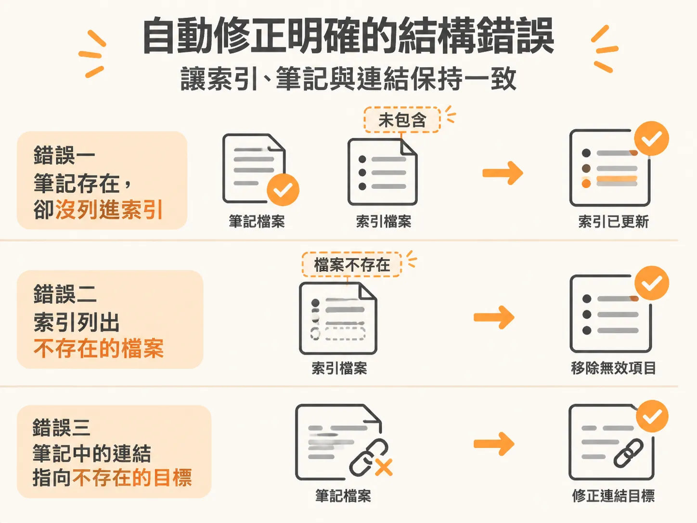
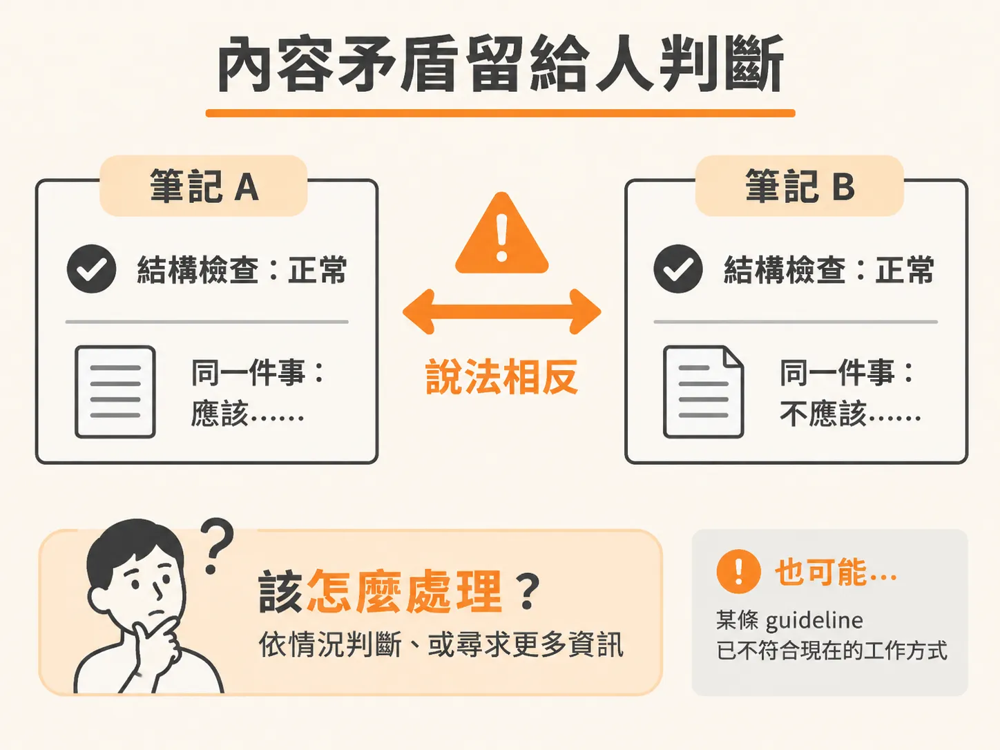
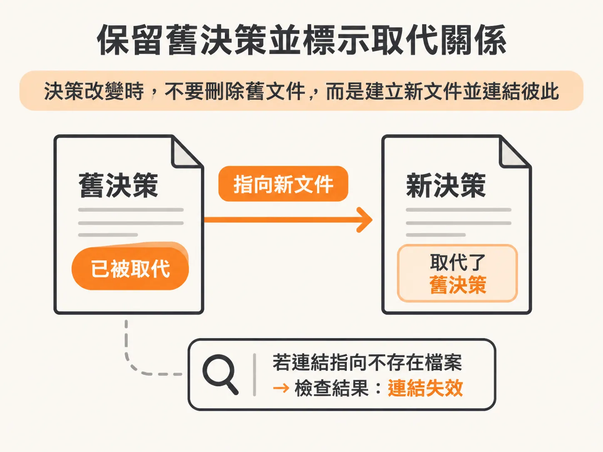

# 為大腦做 lint

整理好的筆記也可能過期。伺服器搬了位置，筆記裡的連結還指著舊地址；工作方式改了，舊 guideline 卻還被當成現行規則。AI agent 讀到這些內容，可能會把過期資訊當真。

為大腦做 lint，就是定期檢查筆記庫的結構與內容。規則明確的問題可以自動修正；遇到矛盾或過時指引等需要判斷的情況，則提出警告，不擅自改變筆記原意。

## 自動修正明確的問題

lint 會檢查索引與連結是否對得上。像是筆記明明存在、索引卻漏掉它，索引裡列著根本不存在的檔案，或筆記中的連結早就失效。這些問題都有明確的修正方向，適合交給工具處理。

死鏈不一定能直接修好。目標檔案可能只是搬了位置，也可能真的不再需要。找到新位置，就更新連結；如果目標已不存在，就移除失效連結。索引若自動新增待補摘要的項目，也要替那份筆記補上一行說明。

檢查也可以找出缺少來源、決策沒有日期，或已被取代的決策沒有標明新文件等問題。有些修正需要補充資料，不能只改索引。反覆檢查並處理剩下的問題，直到工具不再回報待解項目。

## 矛盾與過時指引，交由人判斷

結構檢查正常，不代表筆記內容一定正確。兩份筆記可能各自完整，卻對同一件事有相反說法；某條 guideline 也可能已不符合現在的工作方式。

遇到這些情況，lint 應提出警告，讓人檢查近期變更過的筆記與指引，而不是自行判定哪一份才正確。兩份筆記互相矛盾時，應在兩邊都加上警告，並指出另一份筆記的位置；不要替使用者決定要保留哪一份，也不要改寫筆記原意。

這條界線值得說清楚：修正失效連結或漏掉的索引項目，通常是在修復筆記庫的結構；判斷哪條規則符合現況，則是在做決策。lint 可以指出後者有問題，但不該代替使用者作決定。

## 保留舊決策，標明它已被取代

決策改變時，不要直接刪除舊決策。新決定應另寫成一份文件，再在新舊文件之間建立關聯：舊文件標示已被取代，並指向新文件；新文件則記錄它取代了哪份舊決策。

agent 讀到舊決策時，也能看出後續發生了什麼。lint 還可以檢查被取代的決策是否指向確實存在的文件。

做好 lint，就是把能明確修正的筆記問題交給工具，把矛盾、是否過時這類判斷留給人。工具整理路徑、索引和文件關係；哪些說法還適用，由人決定。
