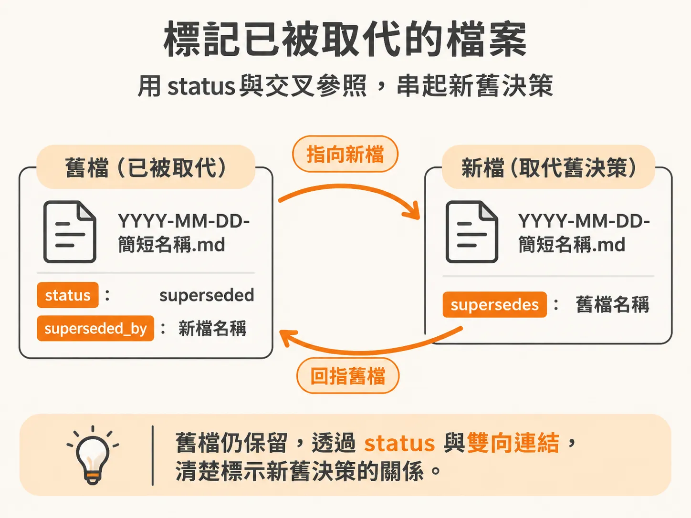
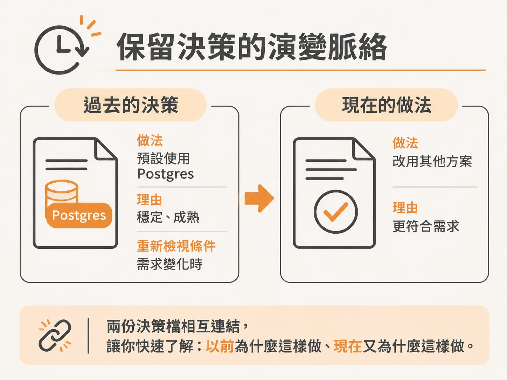
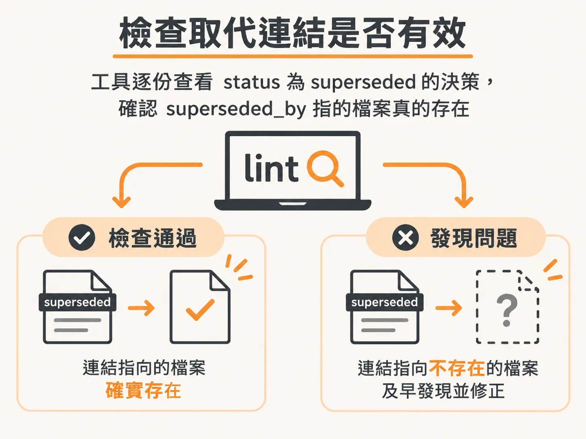

# 被取代，不刪除

上一節提到，決策改變時要標明被取代，而不是直接刪除。這裡把實際做法說清楚。

團隊原本決定所有新專案都使用 Postgres。後來需求改變，選擇也跟著換。若直接刪除舊決策，接手的人或 AI 助理就無法知道當初為什麼這樣選，也看不出決策何時改變。

較可靠的做法是保留舊決策，另建一份新決策，再用欄位將兩者連結起來。

## 在舊檔標示「已被取代」

決策檔可以加上狀態標示。每個決策各自存成一個檔案，檔名通常以日期開頭，例如 `YYYY-MM-DD-簡短名稱.md`。決策改變時，舊檔留著，在裡面註明它已被取代，並指向新檔：

- `status: superseded`：表示這份決策已被取代。
- `superseded_by: decisions/<新檔名>.md`：指出取代它的新決策檔。

新檔則加入 `supersedes: decisions/<舊檔名>.md`，連回原本的決策。從舊檔找得到新決策，從新檔也能追溯回舊決策。

## 保留決策脈絡

決策檔記的不只是當時採用的做法。例如，原決策寫明新專案預設使用 Postgres，也記下選擇理由和重新檢視的條件。日後若決策改變，就另建一份新檔，說明新的決定與理由，再用上述方式連結新舊檔。

舊檔雖然不再代表目前採用的做法，仍保留當時的判斷。讀者因此能分清「現在怎麼做」和「以前為什麼那樣做」，避免把歷史決策誤當成現行規則。

## 讓檢查工具找出失效連結

這件事可以交給工具。`lint` 是檢查筆記是否有問題的工具。它會逐份看標示為 `superseded` 的決策，確認 `superseded_by` 指向的檔案確實存在。若連結指向不存在的檔案，就能及早發現並修正。

建立檔案時也要更新索引，讓新決策能被找到。舊決策留著，索引跟著更新，雙向連結補齊，日後就查得到決策是怎麼變的。
