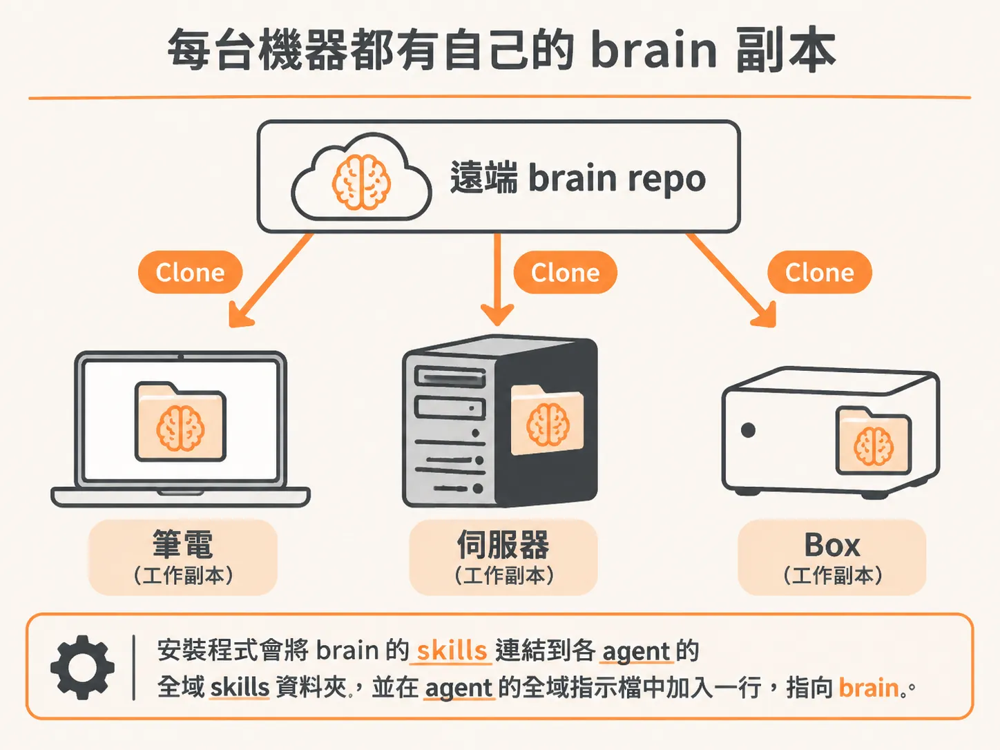
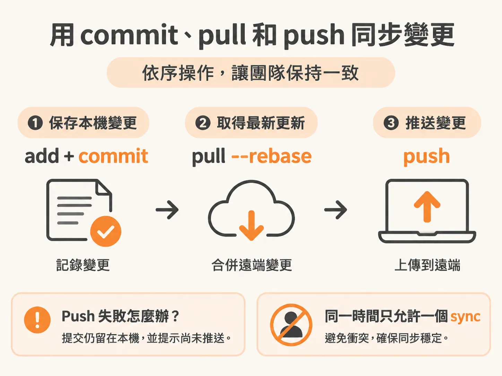
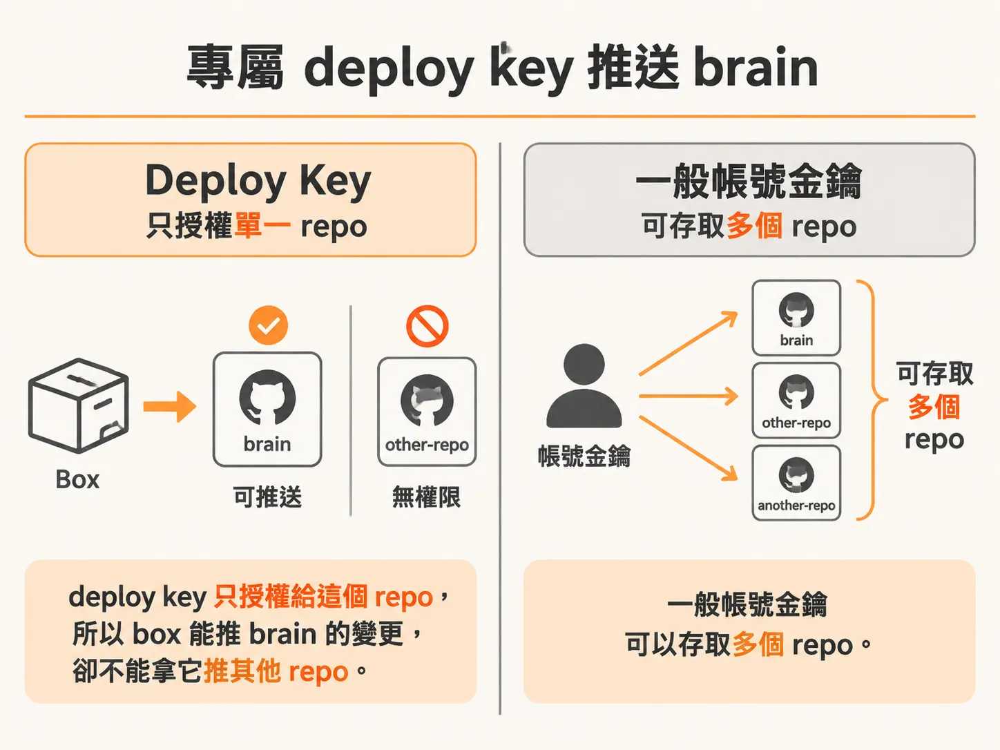

# 每個 agent 都讀最新版本

你在筆電上修改了一條工作規則，伺服器上的 agent 卻還是照舊執行。其他開發環境也可能留著舊副本。

要讓每個地方都讀到同一份內容，不必共用同一個資料夾。讓每台機器各自 clone 同一個 Git repo，並定期同步即可。

## 先把 brain 放進 Git

在 GitHub 建立私有的 brain repo，然後在每台要使用 brain 的機器上 clone。把 repo 放在容易找到的資料夾，例如 `~/brain`，再執行 `node install.mjs`。

安裝程式會把 brain 裡的 skills 連結到各 agent 的全域 skills 資料夾，並在 agent 的全域指示檔中加入一行，指向 brain。



這個資料夾不要設成隱藏，因為 Claude Code 用的搜尋工具預設會略過隱藏資料夾。

brain 不要存放金鑰、token、密碼或他人的個人資料，因為內容會提交到 Git repo。

## 修改後同步：commit、pull、push

每次 agent 修改 brain 後，都執行：

`node sync.mjs`

這個同步腳本會先提交本機變更，再從遠端以 rebase 方式取得其他副本的更新，最後推送本機提交。

順序是先收下別處的更新、再送出自己這邊的修改，本機副本才會一直跟上遠端。

把這項規則寫進 brain 的 `AGENTS.md`，各個 agent 修改後就能照著執行。



<!-- source: sources/ai-agent-engineer/20261103/resources/repos/brain-template/sync.mjs#L1-L89 -->

```javascript
#!/usr/bin/env node
// Commit whatever changed, take the latest from the remote, push. Safe to run from cron.
// Run: node sync.mjs (Node 18+, no dependencies, needs git).
// On a machine without your git login (a dev container), set BRAIN_SSH_KEY to a deploy key that
// can write only this repo: the sync script uses it for its own git commands, never in any git config.
import { spawn } from "node:child_process";
import fs from "node:fs";
import os from "node:os";
import path from "node:path";
import { fileURLToPath } from "node:url";

const brain = fs.realpathSync(path.dirname(fileURLToPath(import.meta.url)));
process.chdir(brain);

// A folder mounted from another machine belongs to another user: trust it for this run only.
const git = ["-c", `safe.directory=${brain.replaceAll("\\", "/")}`];
const env = { ...process.env };
if (env.BRAIN_SSH_KEY) {
  env.GIT_SSH_COMMAND = `ssh -i "${env.BRAIN_SSH_KEY}" -o IdentitiesOnly=yes -o StrictHostKeyChecking=accept-new`;
}

const fail = (msg, code = 1) => {
  if (msg) console.error(msg);
  process.exit(code);
};

// Stopped (Ctrl-C, kill, cron timeout): stop git too, free the lock, exit 128 + signal number.
let child = null;
for (const signal of ["SIGINT", "SIGTERM", "SIGHUP"]) {
  process.on(signal, () => {
    child?.kill(signal);
    process.exit(128 + os.constants.signals[signal]);
  });
}

// runGit(): git's output goes to the terminal unless captured; resolves to { status, out }.
const runGit = (args, { capture = false, quiet = false } = {}) =>
  new Promise((resolve) => {
    child = spawn("git", [...git, ...args], { env, stdio: ["ignore", capture ? "pipe" : "inherit", quiet ? "ignore" : "inherit"] });
    let out = "";
    child.stdout?.on("data", (d) => (out += d));
    child.on("error", (err) => fail(`could not run git: ${err.message}`));
    child.on("close", (code) => {
      child = null;
      resolve({ status: code ?? 1, out: out.trim() });
    });
  });
const run = async (...args) => (await runGit(args)).status;
const mustRun = async (...args) => {
  const status = await run(...args);
  if (status) fail("", status);
};

// A machine with no git identity (a fresh container) still commits, as "brain sync".
if (!(await runGit(["config", "user.email"], { capture: true })).out) {
  git.push("-c", "user.name=brain sync", "-c", "user.email=brain-sync@localhost");
}

// An agent and a cron job can run it at the same time: one sync at a time.
const gitDir = await runGit(["rev-parse", "--git-dir"], { capture: true });
if (gitDir.status) fail("", gitDir.status);
const lock = path.resolve(brain, gitDir.out, "brain-sync.lock");
try {
  fs.mkdirSync(lock);
} catch {
  fail(`another sync is running (or one crashed: remove ${lock} and run again)`);
}
process.on("exit", () => {
  try {
    fs.rmdirSync(lock);
  } catch {}
});

await mustRun("add", "-A");
if (await run("diff", "--cached", "--quiet")) {
  const stamp = new Date().toISOString().slice(0, 16);
  await mustRun("commit", "-q", "-m", `brain: sync ${stamp}Z`);
}
if (!(await runGit(["remote", "get-url", "origin"], { capture: true, quiet: true })).status) {
  if ((await run("pull", "-q", "--rebase", "--autostash")) || (await run("push", "-q"))) {
    console.error("brain committed here, but NOT pushed (see the error above).");
    const rebase = await runGit(["rev-parse", "--git-path", "rebase-merge"], { capture: true });
    if (rebase.out && fs.existsSync(path.resolve(brain, rebase.out))) {
      console.error("a rebase stopped on a conflict: fix it (git status), or undo it with git rebase --abort");
    }
    fail();
  }
}
console.log("brain synced");
```

如果遠端同步失敗，腳本會提示變更尚未推送，並以錯誤狀態結束。

本機提交仍會保留，下次執行時可以繼續嘗試推送。

如果 rebase 遇到衝突，先檢查 Git 狀態並處理衝突，或取消這次 rebase，再重新同步。

## 伺服器和 box 都要有自己的副本

伺服器上的 AI agent 也要從 brain repo clone 一份。

幫伺服器安排定期同步，伺服器下次 pull 就會拿到筆電上的更新。

使用 cron 時，要填入 Node.js 的完整路徑，因為 cron 通常看不到一般終端機的 PATH。

例如，每 15 分鐘在 `~/brain` 執行一次 `sync.mjs`。

開發用的 box 也要有自己的副本，不是掛載筆電上的 brain 資料夾。

box 第一次啟動時會 clone repo，之後每次啟動都會 pull 最新內容，再執行 `node install.mjs`，讓 box 裡的 Claude Code 取得 brain 的指示與 skills。

這樣 box 不會直接動到筆電正在使用的檔案。box 的修改會推回 repo，筆電下次同步就取得。

## 讓 box 用專屬 deploy key 推送

box 沒有你的 GitHub 登入時，可以替 box 建立一組專用 SSH 金鑰，並把公鑰加入 brain repo 的 GitHub **Settings → Deploy keys**，同時開啟 **Allow write access**。

deploy key 只授權給這個 repo，所以 box 能推送 brain 的變更，卻不能拿它推其他 repo。



私鑰要留在 box 的設定資料夾，不要放進 brain repo。

`sync.mjs` 可透過 `BRAIN_SSH_KEY` 在自己的 Git 操作中使用這把 key，而不必把它寫進 Git 設定。

如果 box 已經在跑，加完設定後要重新建立或啟動 box，它才讀得到新的設定。
