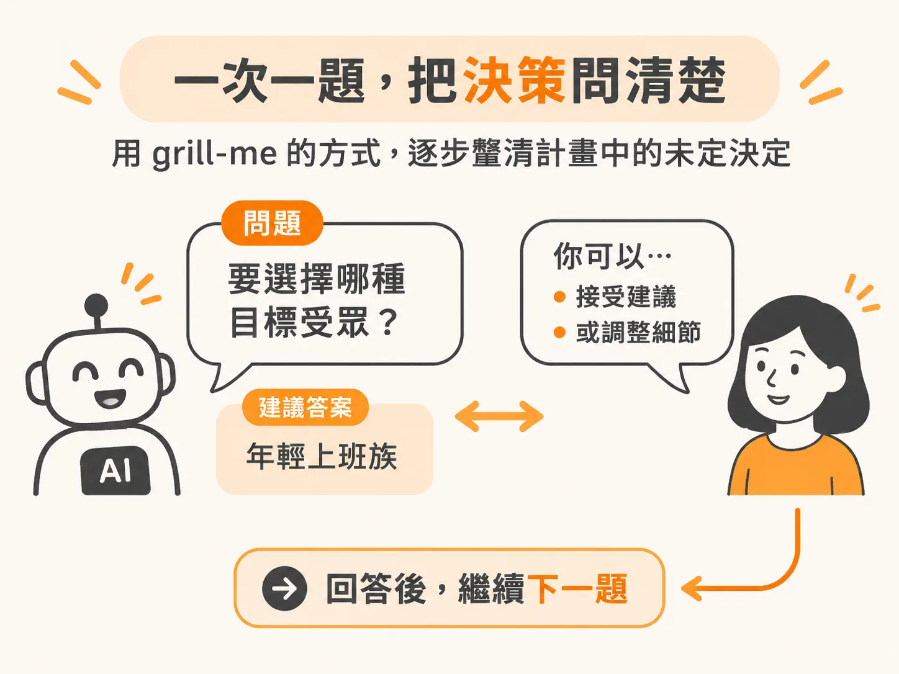
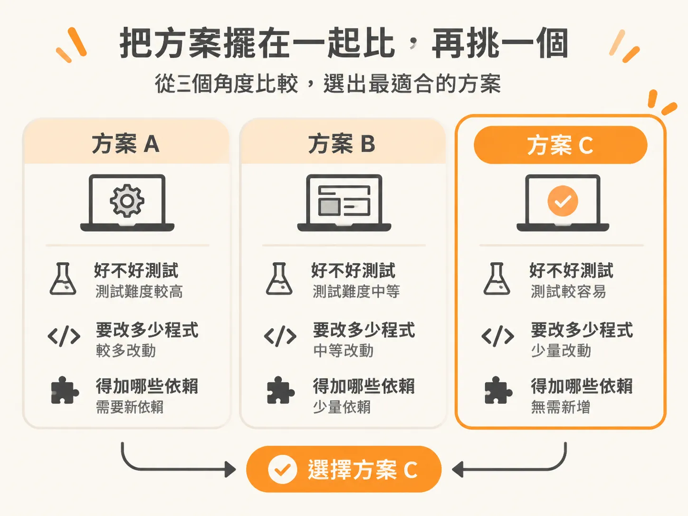
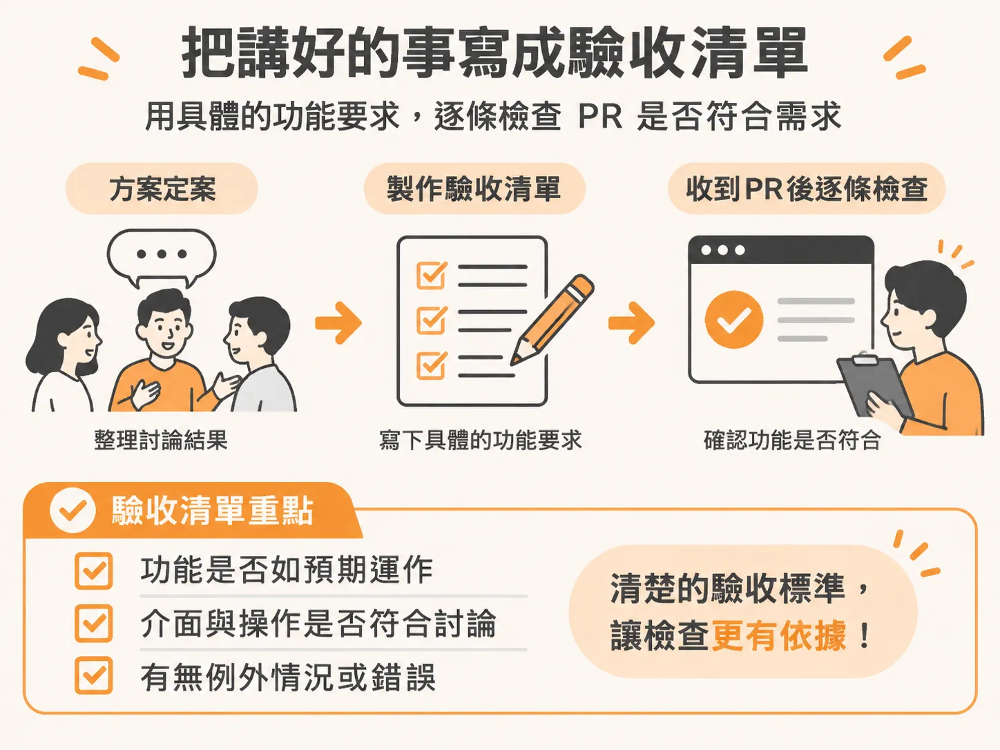

# 先逼問計畫

上一節的三個問題，是在程式碼寫好之後才決定要讀多少；但有些誤會可以更早避免。你請 AI 幫忙做一項功能，結果它寫了好幾百行，你才發現彼此想的不一樣。這時才靠 code review 找問題，修正成本已經很高。不如在寫 code 前先把計畫問清楚。

## 一次問一個問題，逐步補齊決策

可以先請 AI 用「grill-me」的方式檢視計畫：一次提出一個關鍵問題，並附上建議答案。你可以接受建議，也可以調整細節，再回答下一題。

例如，需求是「讓顧客可以取消部分票券」，還需要釐清幾件事：活動開始後能不能取消？退款失敗時怎麼處理？取消後，座位如何重新上架？這些決定都會影響功能行為，不能只靠一句模糊的需求帶過。

如果答案能從現有程式碼找到，就先查程式碼，不必把問題丟回給你。這樣討論就會只圍繞還沒決定的部分，不必再問程式庫已經交代過的事。

不要一次說「所有建議都同意」。逐題回答，尤其要親自確認會改變功能行為的決定。每種情況都聊過一遍，你和 AI 想的才會一致。

## 先比較方案，再挑一個

決策補齊後，請 AI 提出兩到三種做法，再從三個角度比較：

- **好不好測試**：能不能清楚驗證行為是否正確？
- **改動範圍大不大**：需要修改多少程式？
- **依賴多不多**：是否得新增其他套件或服務？

比較不是為了找看起來最厲害的方案，而是確認哪個方案更符合需求，也更容易驗收。選定方案以前，先不要開始寫 code。

## 把共識寫成白話驗收準則

方案選定後，把討論結果整理成簡短的驗收準則，也就是功能必須做到什麼。準則寫得越具體，收到程式碼後就越能逐條檢查，不必猜當初的需求是什麼。

以票券取消為例，準則可以寫成：

1. 活動開始前，顧客可以取消任意數量的票券，也可以分多次取消。活動開始後，拒絕部分取消；全部取消則維持目前的行為。
2. 不論取消分幾次，退款總額和退款手續費都要與一次取消相同票券的結果一致。退款總額不能超過購票金額。
3. 每次取消都要退回該批票券實際對應的金額，不追回折扣，並把相同數量的座位重新上架。

這份清單應該能讓人看懂「做對了是什麼樣子」。先問清楚、比較方案，再訂下驗收準則。等 AI 開始寫 code 後，就能照著清單逐項確認。
