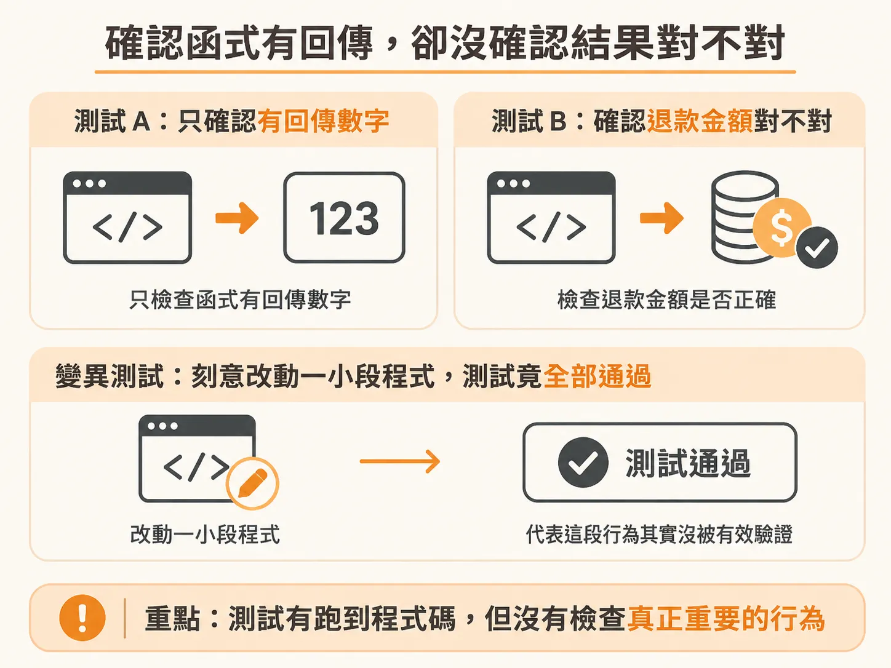
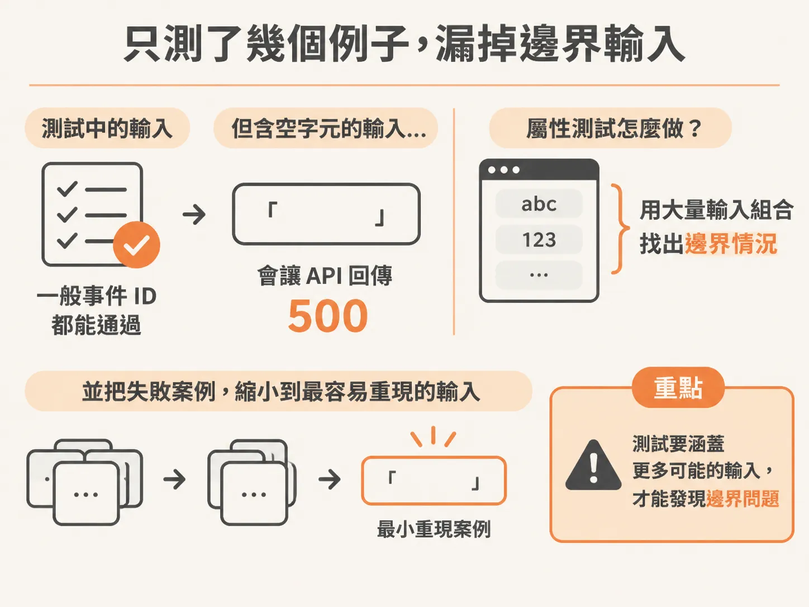
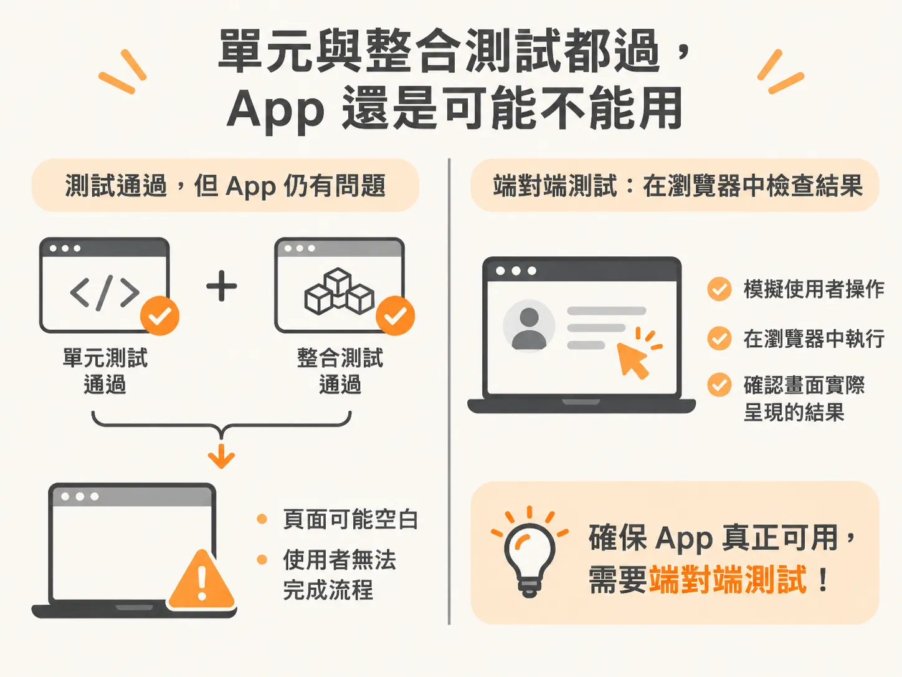

# 測試全綠卻在說謊的三種方式

你讓程式代理人完成一項功能，測試全部通過，打開 App 卻發現頁面一片空白、按鈕沒有反應，或退款金額算錯。這未必是測試工具失靈，有時候是測試根本沒檢查到問題。

測試全綠，常見有三種盲點，而且每一種都得靠不同的測試才找得出來。

## 只確認有回應，沒確認結果正確

第一種情況是，測試有跑到程式碼，卻沒有檢查真正重要的行為。

例如，退款測試只確認函式有回傳數字。即使退款計算方式完全錯了，測試仍可能通過。

這只能證明函式有回應，不能證明退款金額正確。

這時可以用**變異測試**。它會刻意小幅修改程式，再執行測試。

如果修改後測試失敗，代表測試真的抓到了這個行為。如果測試照樣通過，可能是少了測試案例，或缺少關鍵的檢查條件。

程式碼覆蓋率無法回答「測試有沒有驗證結果」。它只表示測試執行過哪些程式碼。

即使測試完全沒有斷言，覆蓋率也可能達到 100%。因此，覆蓋率可以指出哪些地方沒被執行，卻不能證明執行過的地方有被仔細檢查。

## 只測了幾個例子，漏掉重要輸入

第二種情況是，測試只涵蓋作者想到的幾種輸入。一般事件 ID 都能通過，不代表特殊輸入也安全。

例如，TicketBay API 收到含有空字元的事件 ID 時，資料庫可能拋出錯誤，API 也可能回傳 500。

如果測試案例裡沒有這種輸入，就可能一路全綠。

**屬性測試**適合找出這類邊界情況和輸入組合。它不靠一兩個手寫例子，而是把商業規則寫成程式必須一直遵守的性質，再用不同輸入去測。

示範測試送出 52 次請求後找到失敗，並把問題縮小到只含一個空字元的事件 ID。

## 每個零件都正常，整個 App 卻不能用

第三種情況是，單元測試和整合測試都通過，但沒有測試真正打開 App。某個頁面因此變成空白，或使用者根本無法完成操作流程。

這時需要**端對端測試**（end-to-end test，簡稱 E2E）。它會在真實瀏覽器中模擬使用者操作，並檢查使用者看得到的結果。

例如，完成訂票後是否出現確認頁，或訂單是否顯示在「我的訂單」裡。

E2E 測試會啟動瀏覽器，適合用在訂票、付款、退款等關鍵流程。不必把每個細節都做成瀏覽器測試。

檢查重點應放在使用者看得到的行為，而不是資料庫內容或程式內部狀態。

測試全綠但功能仍有問題時，可以先找出是哪一種盲點：行為沒被驗證，就用變異測試找；重要輸入沒被測到，就用屬性測試找；各部分都正常但 App 流程出問題，就用端對端測試找。
