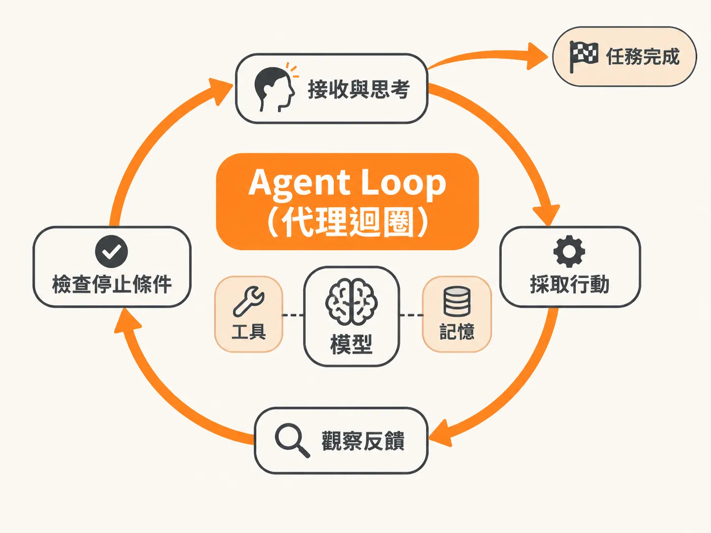

# Agent Loop（代理迴圈）

## 定義

Agent Loop（代理迴圈）是 AI 代理（Agent）系統的核心控制機制。

它是一個不斷重複「思考、行動、再思考」的程式迴圈。這就像寫程式時常見的 `for` 迴圈或遞迴函式，會持續執行直到符合停止條件為止。

## 為什麼重要

大型語言模型（LLM）本身常被誤認為是 Agent。

單純的模型只負責接收文字輸入並產生文字輸出。真正的 Agent，是包在模型外層的這套控制迴圈。

少了 Agent Loop，模型就只能做單次問答。它無法接收環境反饋來修正動作，也無法自主處理複雜任務。

## 如何運作

Agent Loop 的基本運作流程如下：

1. **接收與思考**：模型依據當前任務目標與上下文資訊，規劃下一步該做什麼。
2. **採取行動**：呼叫外部工具（Tool Call）或產生輸出，改變外部環境。
3. **觀察反饋**：將工具執行的結果或環境變化，寫回上下文視窗（Context Window）當作記憶。
4. **檢查停止條件**：確認任務是否完成，或是達到設定的結束條件；若還沒完成，就帶著新記憶進入下一輪。

模型、工具、記憶、規劃與反思，都是放在這個迴圈裡運作的元件。

## 例子

以要求 Agent 查詢資料庫並產出報告為例：

- **第一輪**：Agent 思考後，呼叫搜尋工具查詢資料庫。
- **第二輪**：Agent 取得搜尋結果，發現資料不夠，決定呼叫另一個 API 補充資訊。
- **第三輪**：Agent 整合兩次結果，確認內容完整，結束迴圈並輸出最終報告。

每一次「行動、觀察、再行動」的過程，就是迴圈的一次迭代（iteration）。

## 邊界與常見誤解

- **誤解：模型等於 Agent**：模型只是迴圈裡負責生成文字與給出建議的大腦；負責發動呼叫、接收回傳資料並推動流程的迴圈結構，才是真正的 Agent。
- **邊界：沒有終止條件的風險**：如同一般的 `for` 或 `while` 迴圈，若未設定停止條件或上限次數，Agent 就可能卡在無限迴圈裡，不斷重複無效動作。

## 進階

在複雜的單代理或多代理架構中，Agent Loop 內部會加入自我反思（Reflection）與動態規劃（Planning）。

每跑完一輪，Agent 除了記錄工具回傳的結果，也會比對目前進度與目標的差距，即時調整下一步的策略。
