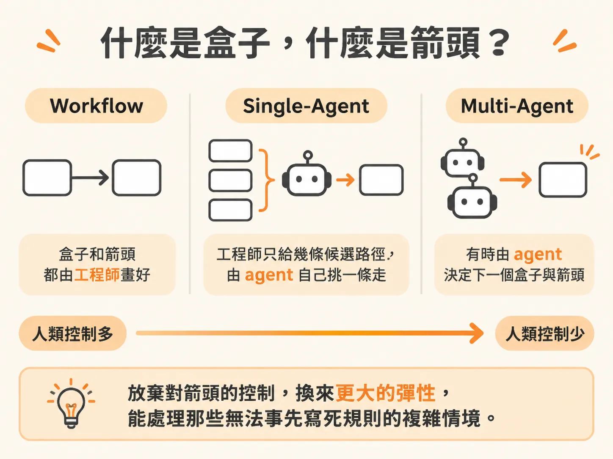
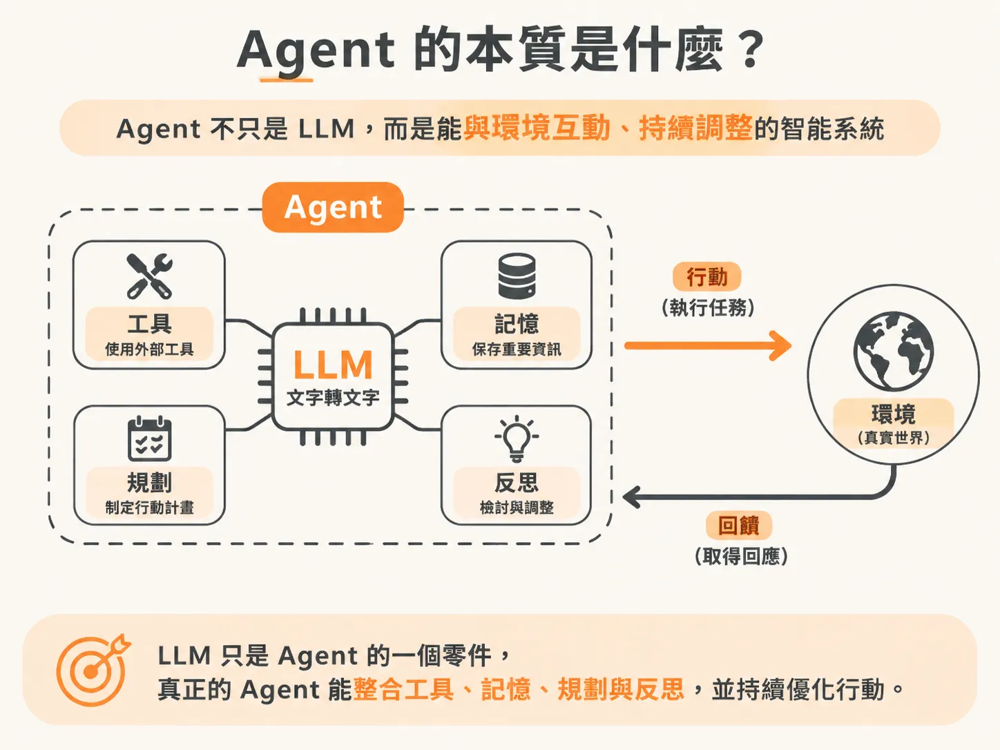
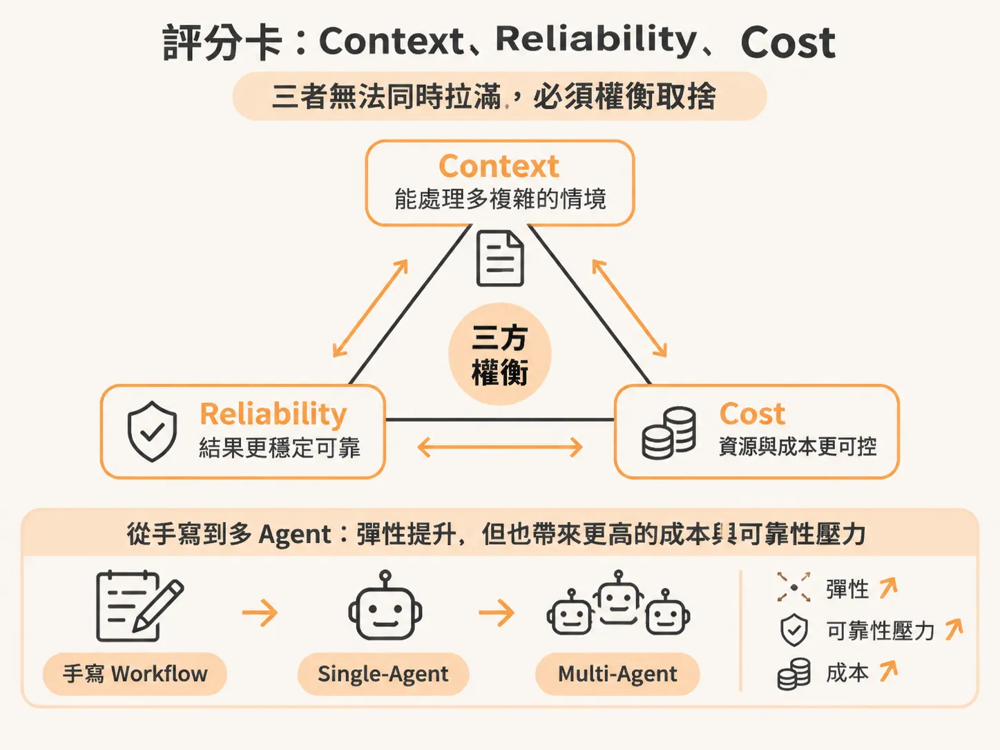

# 用盒子與箭頭思考 agent

現在大家談到 AI，幾乎言必稱 agent，好像所有東西只要掛上 agent 就自動變高級。但把所有任務都交給 agent，真的是最好的選擇嗎？很多時候，我們其實只需要一個用程式碼寫好流程、中間塞進一個大型語言模型（LLM）的 workflow 就夠了：既便宜、大部分時間結果可預期（deterministic），而且能夠穩定運作。

要弄清楚自己到底需要哪種架構，可以把整個系統想像成「盒子」與「箭頭」。

## 什麼是盒子，什麼是箭頭？

在系統架構裡，每一個步驟都是一個**盒子**。你寫的一段函式、一個 API 呼叫、或者一個 LLM，都裝在各自的盒子裡。

連接這些盒子的線，就是**箭頭**。

當你寫一般的程式碼時，盒子是你寫的（例如各個函式），箭頭也是你寫的——由你明確決定 A 函式呼叫 B 函式，或是透過 `if/else` 條件分支走向哪一條路徑。

但在探討 LLM 與 agent 時，核心差異就在於：**你對這些箭頭究竟保留了多少控制權？**

- **Workflow（工作流程）**：箭頭依然由你決定。程式邏輯完全由工程師掌控，LLM 只是其中某些盒子裡的運算工具。
- **Single-agent（單一 agent）**：你為系統提供幾條可能的路徑，接著把選擇權交給 agent，讓它自行決定接下來要走哪一個箭頭。
- **Multi-agent（多 agent 系統）**：控制權會變得非常混雜。有時候是你寫箭頭，有時候是 agent 自己連箭頭，甚至有時候連下一個盒子要放什麼，都是由 agent 自己產生出來的。

失去對箭頭的控制看似令人不安，但放棄控制權的同時，系統換來的是前所未有的彈性，能去處理那些無法事先寫死規則的複雜情境。

## Agent 的本質是什麼？

在經典教材《人工智慧：現代方法》（Artificial Intelligence: A Modern Approach，作者為 Stuart Russell 與 Peter Norvig）中，對 agent 有一個非常精確的定義：

> Agent 是一種能夠透過「感測器」（sensors）感知環境，並透過「致動器」（actuators）對該環境採取行動的實體。

換成白話來說，agent 能夠接觸外部環境、取得回饋，並根據回饋做出調整。在現代 LLM 的架構下，這代表它不只是一個會回答問題的模型，而是結合了四項關鍵能力：

- **工具（Tools）**：能呼叫外部 API、搜尋網路或執行程式碼，作為對外的致動手段。
- **記憶（Memory）**：能記住過往互動與環境狀態。
- **規劃（Planning）**：能把大目標拆解成步驟並決定先後順序。
- **反思（Reflection）**：能檢視自己的執行結果，發現錯誤時主動修正。

## 評分卡：Context、Reliability、Cost 的三方權衡

就像分散式系統設計中有 CAP 定理（Consistency 一致性、Availability 可用性、Partition Tolerance 分區容忍度），實務上很難同時把三者做到極致，必須有所取捨。

設計 LLM 系統時，也有一張包含三個維度的評分卡：

- **Context（上下文環境）**：系統需要帶入多少資訊、能理解多複雜的背景。
- **Reliability（可靠性）**：輸出有多穩定、多可預期，會不會失控走偏。
- **Cost（成本）**：包含 API 呼叫次數、運算花費與延遲時間。

每當你從手寫的 workflow 往單一 agent、再往多 agent 邁進一步，交出對箭頭的控制權時，這張評分卡上的數字就會跟著跳動。你可能換取了極高的彈性，但同時在 reliability 上打了折扣，或在 cost 上付出倍數級的代價。軟體工程的本質就是權衡，清楚知道自己放棄了什麼、買到了什麼，才不會盲目跟風。

## 為什麼必須設好護欄？

交出控制權並非毫無風險。回顧 2025 年，就曾發生過早期的 agent 在正式環境中誤刪 Replit 資料庫的慘劇。

要安全地使用這些工具，除了學會建構 agent，更重要的是學會設下邊界：
- 在使用第三方工具或程式碼時保持謹慎，限制執行權限。
- 嚴格設置護欄（guardrails）。
- 務必加上明確的終止條件（stop conditions），避免 agent 陷入無窮迴圈，在不知不覺中燒掉成千上萬美元的 API 費用。

在開發實務上，可以運用像 VS Code 的 Copilot 這類工具來輔助建構 workflow 與 agent 系統，透過聊天介面觀察模型背後的思考脈絡與推論過程。但在動手寫程式之前，先問自己一句：這件事真的需要讓 agent 自己畫箭頭嗎？還是用最單純、最便宜的 workflow 就能搞定？
