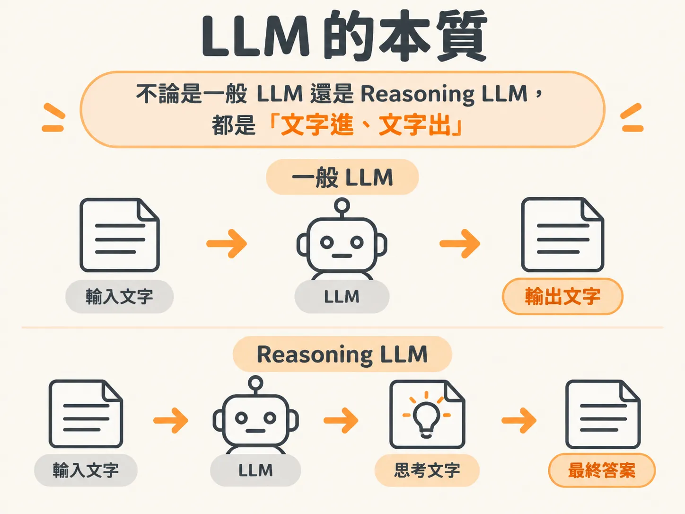
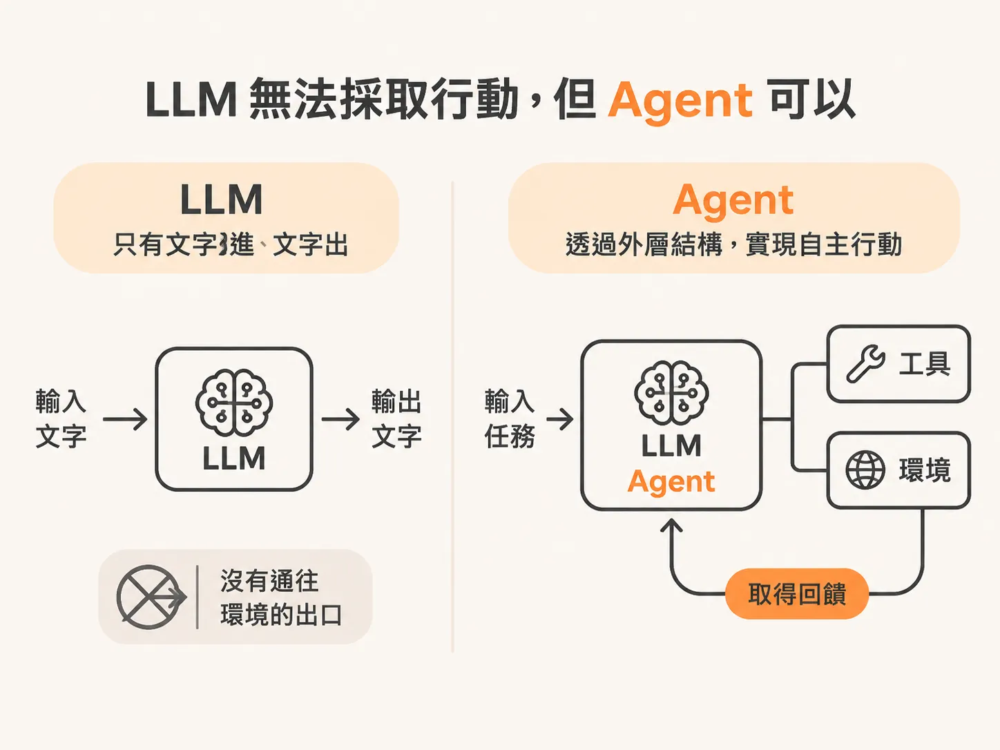
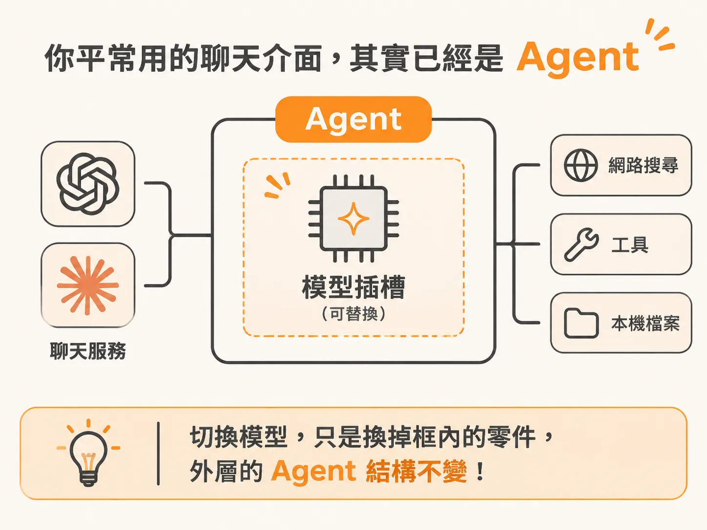

# LLM 只是 agent 的零件

上一段留下的問題是：箭頭該由誰來畫。要回答它，得先認清拿著筆的那個零件。當我們在討論 AI 時，經常會把大型語言模型（LLM）、推理解題模型（Reasoning LLM）、工作流程（Workflow）與代理人（Agent）混在一起談。很多人打開 ChatGPT 或 Claude 聊天，就直覺地說「我在用 LLM」。

但在著手設計工作流程、單一代理人甚至多代理人系統之前，我們需要先退一步，從最底層釐清這兩者的界線：LLM 究竟扮演什麼角色？它和 Agent 真正的差別在哪裡？

## LLM 的本質，與 Reasoning LLM 的誕生

LLM 的運作本質其實非常單純：**輸入文字，然後輸出文字**。

雖然它產生的內容讀起來很像人類的語言，但對模型本體來說，它處理與思考的全都是數字機率。它自己並沒辦法對真實世界產生任何動作。

那麼，大家常聽到的 Reasoning LLM（推理模型）又是什麼？

它依然遵循「文字進、文字出」的規則，只是在輸出最終答案之前，先被訓練去輸出一段推理過程。這項技術源自大家熟悉的「思維鏈提示」（Chain-of-Thought Prompting）。研究人員最初發現，只要在提示詞裡加上一句「請一步一步思考」，模型的幻覺現象就會大幅減少，得出正確答案的機率明顯提高。

AI 研發團隊看到這個效果後，決定不讓使用者每次手動輸入提示，而是直接把這套思考流程訓練進模型內部。這就是推理模型的由來。

## 畫面上的「Thinking」，只是思考的摘要

舉個實際操作的例子：如果你打開 GitHub Copilot 或 Claude 等工具，貼上一段程式碼問它：「可以幫我看一下這段程式碼有沒有問題嗎？」

這時畫面上會跳出「Thinking（思考中）」或「Read（讀取中）」的狀態，接著陸續浮現一段段分析文字。

這些正在浮現的文字，並不是最後要給你的答案，而是推理模型在產生最終輸出前，展示給你看的思考歷程。更準確地說，**它只是模型思考過程的「摘要」**，不一定完全等同於模型內部底層運算的所有細節。

推理模型的價值，在於它能在後台先替自己整理思路、逐步推理，再產出成果，省去了由人類催促它「一步步想」的過程。

## LLM 無法採取行動，但 Agent 可以

釐清了推理模型，就能更清楚地看出它與 Agent 的本質差異：**LLM 只是 Agent 架構裡的一個零件、一個節點（node）。**

兩者最核心的分水嶺在於「自主行動能力」：
- **LLM**：只能接受文字、吐出文字，完全無法直接對它所處的環境做出任何操作。
- **Agent**：具備一定的自主性，能夠根據環境給予的反饋，去執行具體任務並調整下一步。

在理論上，即便完全不使用 LLM，只要具備感知環境與採取行動的循環架構，也能做成一個 Agent。只是在現代的 AI 開發中，我們幾乎都把 LLM 當作 Agent 的決策中樞。

## 你平常用的聊天介面，其實已經是 Agent

很多人常說「Claude 是一個 LLM」，但嚴格來說，當你打開 claude.ai 網站或 ChatGPT 應用程式時，你面對的已經是一個被包裝好的 Agent，而不單純只是模型。

在這個介面裡，Claude 可以連上網路搜尋最新資訊、執行特定工具，甚至讀取你電腦中的檔案來獲取上下文。能主動向外探索外部世界並取得反饋，這就是 Agent 的特徵。

這也解釋了為什麼你在 claude.ai 上聊天時，可以隨時在下拉選單裡切換背後的模型版本。外層的 Agent 骨架沒有變，改變的只是它內部調用的語言模型。

不管是使用現成服務，還是未來要自己動手寫程式建立自動化流程，只要記住一件事：LLM 負責的是文字理解與推理運算，但賦予它眼睛、雙手並讓它能與環境互動的，是包在它外面的 Agent 系統。
