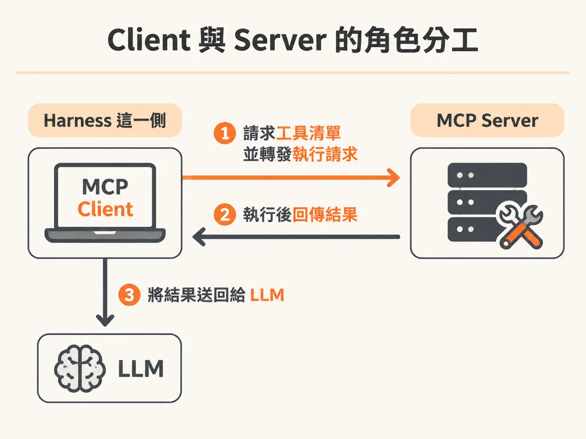
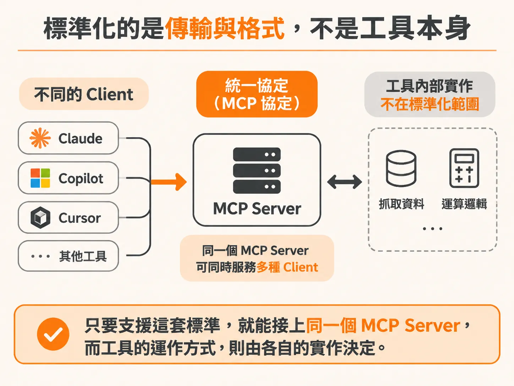
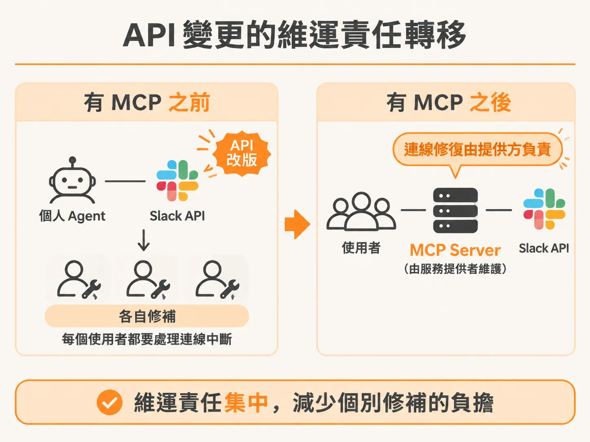

# MCP 標準化傳輸與格式，不標準化工具本身

單一工具接得起來，換成十家服務就會撞上連接方式各異的問題。當你試著讓大型語言模型（LLM）去呼叫外部服務時，很快就會遇到一個現實問題：每一家服務的 API 連接方式都不一樣，只要服務商稍微調整介面，你寫在 Agent 裡的串接程式碼就會直接壞掉。

為了解決連接混亂的問題，Anthropic 於 2024 年推出了 MCP（Model Context Protocol，模型上下文協定），目前它已納入 Linux Foundation 旗下的 AI Foundation。正如網際網路需要統一的標準來傳輸請求，進而催生出 HTTPS 一樣，AI 領域也需要一種標準，來規範工具（tools）、API 與 LLM 之間的連接方式。MCP 正是這套用來把工具與 API 連接到 LLM 的標準化通訊協定。

### Client 與 Server 的角色分工

在 MCP 架構中，系統主要切分為 Client 與 Server 兩個角色：

* **MCP Server**：依照 MCP 標準提供可用的工具清單。例如 Slack 可以有一個專門的 MCP Server，裡面列出讀取訊息、發送訊息等工具。
* **MCP Client**：負責與 MCP Server 通訊並觸發工具執行。常見的 MCP Client 包括 Copilot、Cursor，或是提供給模型執行的 harness 介面。

當模型決定使用工具時，MCP Client 會向 MCP Server 發出請求；Server 執行完畢後把資料回傳給 Client，Client 再把結果送回給 LLM。

### 標準化的是傳輸與格式，不是工具本身

理解 MCP 的關鍵在於：它標準化的是「傳輸方式」與「資料格式」，而不是工具本身的邏輯，MCP 本身也不是工具。

這意味著無論你前端使用哪一種 Client——不管是 Claude、Copilot、Cursor 還是其他工具——只要支援這套標準，就能通通接上同一個 MCP Server。至於工具底層如何抓取資料、內部怎麼運算，MCP 協定並不干涉。

### API 變更的維運責任轉移

在 MCP 出現之前，如果你想讓 Agent 讀取 Slack 訊息，通常得自己寫程式碼去接 Slack 的 API。一旦 Slack 改動了 API 規格，你端點的連線就會中斷，整個 Agent 隨之停擺。這導致成千上萬、甚至數百萬名軟體工程師，必須在每次第三方 API 改版時各自修補程式。

改用 MCP 之後，維運的責任就發生了轉變。當 GitHub、Datadog 或 Slack 等企業發布了自己的 MCP Server，確保這個連線與工具正常運作，就成了這些企業本身的責任。

### 實際運作流程

結合 MCP 之後，整體工作流程會依照以下步驟進行：

1. **取得工具清單**：GitHub、Datadog、Slack 等服務連接各自的 API 端點，其 MCP Server 整理出一份可用的工具清單，並回傳給 MCP Client。
2. **交由 LLM 決策**：MCP Client 把這份清單交給 LLM，例如讓 Copilot 知道現在擁有讀取 Slack 訊息或檢視 Datadog 儀表板的權限。
3. **發送呼叫請求**：LLM 本身無法直接碰觸外部世界，必須依賴中介者。如果模型決定呼叫某個工具（例如讀取特定使用者的 Slack 訊息），MCP Client 就會擔任中介，向對應的 MCP Server 發送執行請求。
4. **執行與回傳**：MCP Server 執行背後的 API 呼叫，就像一般程式碼執行一樣，再把抓取到的資訊回傳給 MCP Client。
5. **餵回上下文**：MCP Client 收到資料後，將內容餵回給 LLM，模型便能依據最新資訊繼續進行接下來的工作流程。

MCP 透過統一的通訊與格式規範，解決了模型與多樣化工具之間的接軌難題，也讓軟體開發者不必再為了第三方服務的介面更動而疲於奔命。
