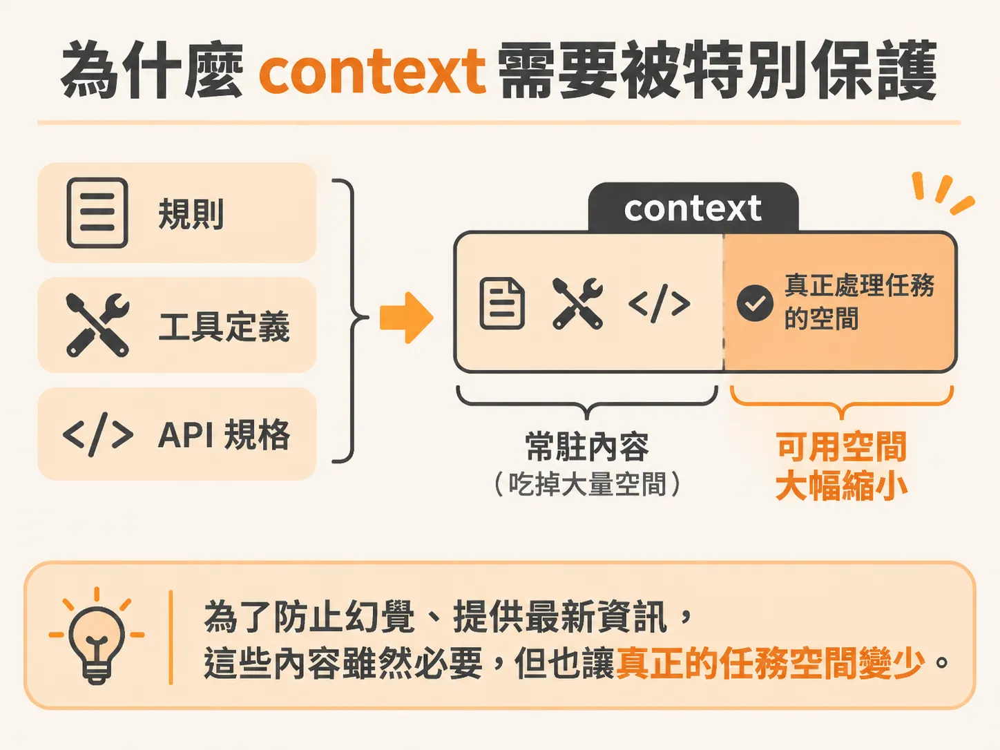
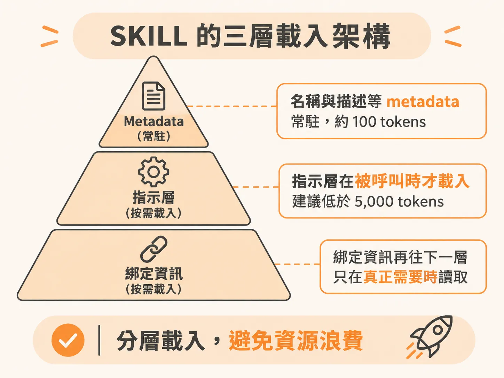

# skill 的 metadata 常駐，指示只在被呼叫時載入

MCP 解決了「怎麼連」，卻沒有解決「什麼時候該把指示放進 context」。在開發 AI Agent 時，我們經常透過 MCP 與工具（tools）讓模型向外調用功能來解決問題。但更多時候，我們需要的是直接向模型傳遞專案規範或偏好資訊。

比方說，你可能希望模型優先使用特定的套件或框架；在某個專案裡強制一律使用 class 語法而非 function 語法；或者在寫前端時，要求它只能使用團隊指定的元件庫，絕不能碰專案中還殘留的舊版廢棄元件。這些情境需要的不是外部 API，而是清楚的行為準則。

Anthropic 提出的 skill 機制正是為了解決這個需求。這套機制現在已經不限於 Anthropic 的模型，在各種工作流程中都能廣泛採用。Skill 的本質非常單純：它就是給 Agent 的具體指示（instructions）。而它最關鍵的設計，在於載入這份指示的方式能大幅保護模型的上下文視窗（context window）。

## 為什麼 context 需要被特別保護

在構建 Agent 時，上下文是我們手中最寶貴的資源。即使頂級大模型的 context 可以達到百萬 tokens，許多輕量或小型 Agent 的 context 往往只有二、三十萬 tokens，甚至更少。

如果把所有規則、工具定義和 API 規格全都塞進每次對話的 prompt 裡，context 很快就會被消耗殆盡。這形成了一個矛盾：為了防止模型產生幻覺、提供最新資訊，我們接入了各種工具與規範；但這些內容全時段常駐，反而讓真正處理任務所需的可用空間大幅縮水。

## SKILL.md 的三層載入架構

要定義一個 skill，只需要一個 `skill.md` 檔案。每個 skill 會包含四個基本元素：

1. 名稱（name）
2. 描述（description）
3. 具體指示（instructions）
4. 綁定資訊（bundled information），例如關聯的文件、其他工具或外部參考資料

如果把這整份檔案隨時掛在 prompt 裡，會造成嚴重的資源浪費。Skill 採取了分層的延遲載入（lazy loading）策略：

- **Metadata 常駐層**：包含名稱與簡短描述。根據 Anthropic 的估算，每個 skill 的 metadata 大約只佔用 100 個 tokens。即使掛載幾十個 skills，對 context 的負擔依然微乎其微。
- **指示層（Instructions）**：具體的步驟與規範通常建議控制在 5,000 個 tokens 以內。這層內容平常不會進入 context，只有當 Agent 判斷任務需要、主動呼叫該 skill 時，指示才會被載入。
- **綁定資訊層（Bundled information）**：指示中引用的深入文件或巢狀資料，可以一層疊一層。更厲害的是，即使 Agent 啟動了該 skill，綁定資訊也只有在真正需要那一小塊時才會載入。

舉例來說，假設你寫了一個涵蓋全端開發規範的 skill，裡面同時包含前端指引與後端指引的綁定資訊。當 Agent 正在處理前端工作並呼叫此 skill 時，後端規範的那部分檔案依然不會被載入，完全不佔用任何 context。這意味著多層結構的關聯文件在被讀取之前，消耗的 token 成本完全是零。

## 用確定性腳本取代模型猜測

除了純文字指示，skill 還有一個強大的功能：它可以直接綁定實際的程式腳本（scripts）。

當 Agent 執行這些腳本時，只有腳本的「輸出結果」會進入 context，腳本本身的執行過程並不會污染對話紀錄。這非常適合處理具備確定性（deterministic）的任務，例如表單欄位驗證、檔案格式轉換或資料清理。

與其每次都在 prompt 裡苦苦指導模型、賭它這一次會不會猜對格式，不如將確定性邏輯寫成一段程式碼讓它呼叫。這樣不僅能確保每次執行的產出百分之百穩定正確，也徹底省下了模型反覆推敲時浪費的 context 與運算資源。
