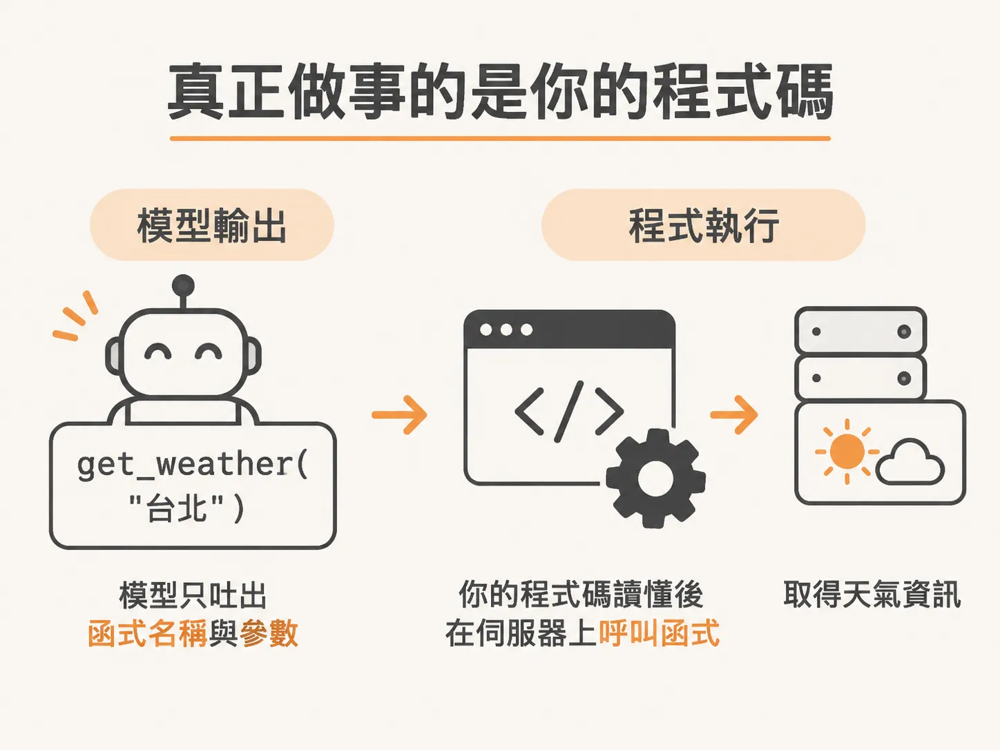
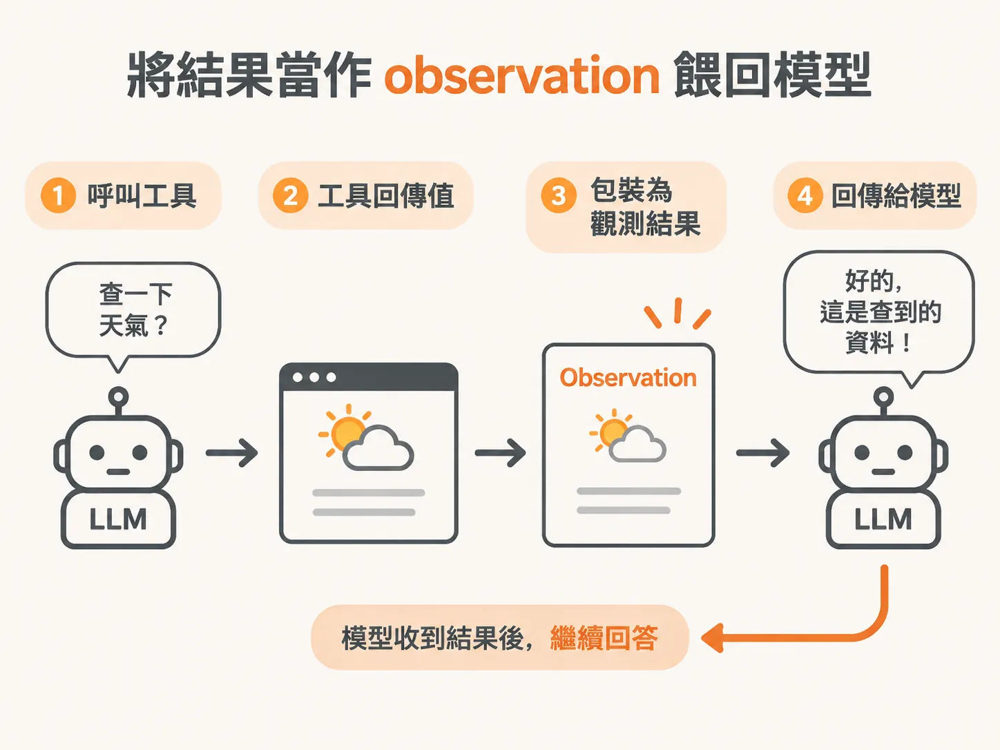
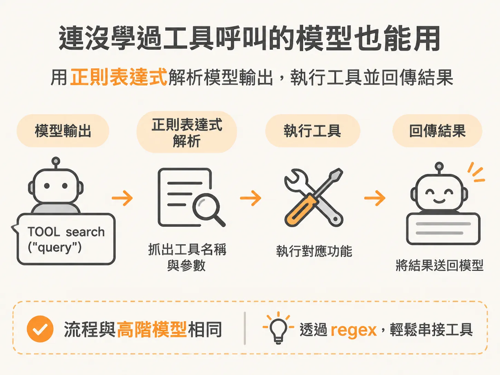

# LLM 只是輸出一段字串

名稱與描述寫得再清楚，模型本身仍然不會執行程式；真正動手的另有其人。當你看到 AI Agent 能夠自動查詢天氣、搜尋網路或串接資料庫時，很容易產生一種錯覺，以為大型語言模型（LLM）真的自己伸出手去執行了外部程式。

但實際上，LLM 本身完全不會執行任何工具。

## 真正做事的是你的程式碼

在背後默默運作的，其實是一套自動化流程。這段程式碼可能是你自己寫的，也可能是讓 Copilot 或 Claude 幫忙寫出來的。這套串接程式（harness）才是構成 Agent 的核心，也是真正負責呼叫工具的角色。

LLM 做的事情非常單純：它只是輸出一段字串。

舉例來說，當需要查詢天氣時，模型輸出的可能就只是函式名稱 `get_weather`，加上括號裡的參數。接著，是我們的程式碼讀懂了這段字串，並在伺服器上實際執行這個函式。

## 將結果當作 observation 餵回模型

當工具執行完畢後，回傳的結果是回到我們的程式碼手中，而不是直接跑到 LLM 裡面。

就像我們平時寫程式呼叫函式時，函式會透過 `return` 把天氣資料交還給呼叫者一樣。我們的程式碼拿到這個結果後，必須主動把這份資料包裝成觀測結果（observation），再次傳給 LLM，跟它說：「你要的答案查到了，資料在這裡。」

模型收到這條新的訊息後，才會理解狀況，接著回答：「好的，我收到資料了，現在為你解答。」

Agent 之所以讓人覺得神奇，讓人驚呼「Claude 居然可以自己去查資料並回答問題」，背後的秘密就在這裡。一切都是你的程式碼在默默跑腿，把查詢結果悄悄塞回對話歷史中，模型才得以繼續生成下一步的回應。

## 連沒學過工具呼叫的模型也能用

這套機制最有趣的地方在於：即使是完全沒有受過「工具呼叫（tool use）」專門訓練的 LLM，只要透過適當的提示詞（prompting），一樣能使用工具。

這在多 Agent 系統（multi-agent systems）中特別重要。為了控制成本，我們在搭建多 Agent 架構時往往會選用小型模型；如果大量使用頂級的大模型，費用會迅速飆高。

然而，較小的模型通常沒有受過工具呼叫的微調。這時只要在系統提示詞（system prompt）中清楚規範格式即可。例如告訴模型：「當你想呼叫工具時，請印出大寫的 `TOOL`，後面接函式名稱與參數。」

接著，我們只需要用簡單的正則表達式（regex）去解析模型輸出的字串，抓出需要的工具名稱與參數，丟進程式裡執行，最後再把產生的輸出結果傳回給模型。整個運作流程跟高階模型完全相同。

既然一般模型也能做到，為什麼大家還要用專門受過工具訓練的模型？

主要的原因只有一個：穩定度。受過專門訓練的模型在呼叫工具時極度可靠，它們絕大多數時候都不會看錯情境，也更清楚在什麼時機該挑選哪一個工具來用。如果使用未受訓的小模型，開發者就必須在提示詞裡花費更多心力防呆與引導。

不過，單純在系統提示詞裡多寫幾行文字，就能讓一個本來不懂工具的模型動手調用外部程式，這本身就是非常強大且靈活的技巧。
