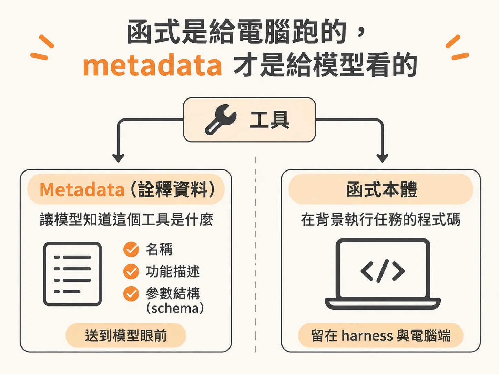

# 模型只看得到工具的 metadata

工具讓模型能動手，但模型看不到你寫的程式碼，只看得到你附上的說明。如果你已經會寫程式，其實你早就知道怎麼做 AI Agent 的工具（tool）了。一個簡單的工具本質上就是一個函式，負責呼叫外部 API 取得資料。例如寫一段程式去呼叫外部 API，抓取使用者最近發送的所有 Slack 訊息，這就是一個工具。你替函式寫好邏輯，給它一個像是 `get_all_slack_messages_from_user` 的名稱，再補上一些 metadata，工具就完成了。

但很多人剛接觸 Agent 時會誤會：以為模型是直接去「看」你寫的那幾行程式碼來決定怎麼執行。事實上，大型語言模型（LLM）完全看不到函式內部的程式碼。

## 函式是給電腦跑的，metadata 才是給模型看的

一個工具主要由兩部分組成：
1. **Metadata（詮釋資料）**：包含工具名稱、功能描述，以及參數結構（schema）。
2. **函式本體**：實際在背景執行任務的程式碼。

函式是寫給電腦、自動化系統，或是圍繞著 Agent 建構的後端程式碼執行的。模型根本不在乎裡面怎麼實作，它只在乎一件事：它需要輸出什麼結構的文字，才能讓外部系統成功跑起這個工具。

呼叫工具的流程其實非常單純：模型輸出一段符合規格的字串，由我們的程式接收並執行對應的函式，最後再把執行結果傳回給模型。因此，模型決定「要不要呼叫這個工具」以及「傳入什麼參數」的唯一依據，就只有你提供的 metadata。

## 模糊的參數定義是工具出錯的主因

既然模型只看得到 metadata，參數定義如果不夠明確，工具就一定會出問題。

舉個例子，如果今天有一個查詢天氣的工具 `get_weather`，裡面的參數只寫了簡簡單單的 `city`，模型就必須開始猜測：
- 這裡是要填郵遞區號（ZIP code）？
- 還是要同時填城市名稱加郵遞區號？
- 填城市字串的話，應該是「Chicago, Illinois」還是只要「Chicago」就好？

只要模型猜錯，工具呼叫就會中斷。這不是因為 Agent 不會用工具，而是因為你給的參數說明太模糊。

在開發 Agent 工具時，大多數的錯誤與 bug，都不是程式寫錯，而是工具裡的文字描述不夠精準。人類看到曖昧不明的說明都會猶豫，對模型來說只會困難一千倍。LLM 並不像人類一樣真正擁有思考能力，它只是在龐大的 context 資訊中預測下一個 token。如果連你自己讀這份工具文件都覺得有點難懂、搞不清楚該傳什麼，模型就更不可能用得好。

## 如何寫出讓模型看懂的工具說明

要讓 Agent 穩定呼叫工具，撰寫 metadata 時有幾個具體原則：

- **提供清楚的名稱與描述**：讓模型一目了然這個工具的作用，以及它跟其他工具的區別。
- **參數說明務必精確**：清楚標明每個參數接收的型態、格式與要求，例如是否需要包含州名或國別。
- **附上範例（Examples）**：在 metadata 中放入使用範例。模型在提示詞看過具體範例後，會更容易產出正確格式。
- **不要設計太寬泛或太繁雜的參數**：如果一個工具塞了太多非必填的參數與選項，小型模型（smaller models）尤其容易混淆，判斷不出何時該用哪一個。

## 工具數量不是越多越好

在工具剛開始流行時，常見的現象是團隊一口氣寫了 50 個工具，全部塞給同一個 Agent。結果往往非常糟糕，因為很多工具的功能互相重疊，模型根本分不清該在什麼時機呼叫哪一個。

別忘了，每一個工具的 metadata 都會持續佔用模型的 context 視窗。給的工具越多，context 負擔越重，模型出錯的機率也越高。確保工具職責分明、說明具體清楚，永遠比塞進一堆功能龐雜的工具更有效。
