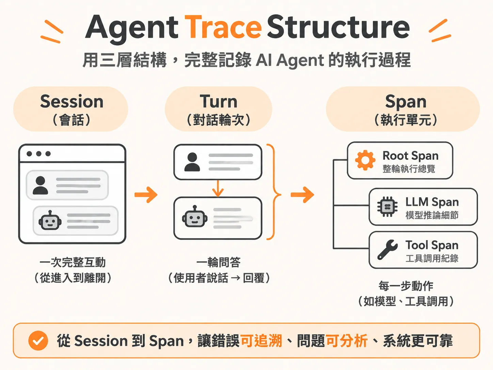

# Agent Trace Structure



## 定義

Agent Trace Structure 是一種把 AI Agent 每次執行過程完整記錄下來的三層資料模型：**Session（會話）→ Turn（對話輪次）→ Span（執行單元）**。

先解釋幾個名詞。Agent 是能幫使用者做事的 AI，例如客服 AI 會查訂單、辦退款。Trace 就像「行車紀錄器」，把 Agent 從收到問題到回覆答案的每一步都錄下來。

想像你在看一部電影：

- **Session** 是整部電影：使用者從進來到離開的完整互動，有唯一的 `session_id`。例如使用者進客服中心問「如何重設密碼」，到問題解決離開，都算同一個 Session。
- **Turn** 是電影裡的每一幕：一次「使用者說話 → Agent 回覆」的完整往返。使用者看完說明後接著說「我還是看不懂」，就進入第二個 Turn。多輪對話的歷史會在 Turn 之間累積。
- **Span** 是每一幕裡的每個動作：系統經歷的每一步運算，呈現為樹狀結構。

## 為什麼重要

當客服 AI Agent 做出錯誤決策時，工程團隊最常遇到的困境是打開傳統日誌（Logs）卻一無所獲。

傳統日誌只呈現時間戳記和函式呼叫順序：

<!-- derived -->
```text
10:32:52 INFO  received user message
10:32:52 INFO  tool: refund called
10:32:55 WARN  policy version mismatch (soft)
10:32:56 INFO  tool: refund returned
10:33:01 INFO  response sent (9s total)
```

它完全遺漏了關鍵的「語意層」：模型當下看到了什麼提示詞與上下文？檢索模組拿回了哪一段退款規定？模型為何引用已廢棄的政策而多收顧客款項？日誌無法重現推論過程，除錯就像在盲飛（flying blind）。

因為 Session→Turn→Span 忠實記錄了推論與工具調用的階層關係，所以失敗的情境可以被完整回放，團隊才能真正看清錯誤發生的核心原因。

## 如何運作

Span 在單一 Turn 內部，是一個具階層性的樹狀結構：

<!-- derived -->
```text
Session (使用者整場互動階段，包含共用上下文與 Session ID)
  └── Turn (單次對話輪次：使用者 Utterance ──> Agent 最終回覆)
        └── Span (執行階段單位)
              ├── Root Span (該輪執行的進入點)
              ├── Tool Span (如 lookup_policy, issue_refund)
              └── LLM Span (Prompt、Reasoning、Token 與耗時)
```

三種 Span 各自記錄不同的事：

- **Root Span**：最頂層，記錄整個 Turn 的總耗時與最終狀態。
- **LLM Span**：記錄模型呼叫的細節。不只記模型名稱，還包含送入的完整 Prompt、模型的推論邏輯（Reasoning）、產出文字、首字生成時間（TTFT）、總耗時，以及輸入與輸出的 Token 數。評估延遲與成本時，這些都是不可或缺的指標。
- **Tool Span**：記錄各項工具的執行狀況。例如呼叫 `get_order_status` 時傳入哪個訂單編號、工具實際回傳什麼資料；呼叫 `issue_refund` 時退款金額是否違反規則。

要讓 Trace 真正可用，必須把它**持久化**。Span 與推論路徑原生存在應用程式記憶體中，若沒有寫入外部系統，快取往往在數小時內就消失，事後無法追溯。實作上透過觀測工具（如 LangSmith、Braintrust 或 TraceWeaver 等開源／自建工具）進行三步：

1. **埋設追蹤**：在 Agent 的核心執行函式（如 `run()`）和所有工具函式加上追蹤裝飾器（Decorator），讓每次進入與回傳自動打包成 Span。
2. **匯出資料**：設定平台的 API Key，把含階層關係的 JSON 或 YAML Trace 上傳；或透過 OpenTelemetry 格式導出本地檔案，供離線檢視器載入。
3. **回放與審查**：在視覺化介面中展開失敗的 Turn，從 Root Span 一路往下看 Tool Span 的輸入輸出是否正確、LLM Span 內的推論是否偏離系統提示。

## 例子

以虛構的 30 分鐘生鮮外送平台「Pronto」為例。系統規定：超過 50 美元的退款必須轉交真人審查，Agent 絕對不可自行核准。

一筆被標記為「超額退款（over-refund）」的 Trace 展開後，可以看到：系統直接核准了 85 美元的退款，中間完全沒有請求人工核准。對照業務規則「超過 50 美元就不能直接退款」，這筆就不能只看「有退款給客人」就給過，人工必須標記為 Fail，並寫下理由：「此筆退款不該直接核准；超過 50 美元時依規定需經人工核准。」

常見的 Trace 檢視工具採三欄式介面：左側看整體對話流程與時間戳記（Root Session），中間列出各個 Span，右側展開特定 Span 的詳細屬性。分析的核心就是比對「進去了什麼輸入」與「模型生成了什麼輸出」，確認中間每一步有沒有走偏。

## 邊界與常見誤解

**只看最終回覆就當作正常**：如果模型最後的回覆看起來客氣通順，容易誤以為系統運作正常。實際上底層可能調用了錯誤的工具、略過了必要的安全規則，甚至在背後默默失敗。必須從頭讀完整條 Trace。

**只確認資料有沒有存進去**：建立 Trace 之後，還要真的坐下來逐筆標註 pass/fail 與具體理由，而不是只看 log 或最終答案。

**以為需要很複雜的工具**：工具的本質是為了方便視覺化。早期流程甚至只用 Excel 試算表就能標註；如果現成工具不合用，可以用簡單的提示詞請 LLM 在十分鐘內寫一個 HTML 頁面，能上傳 JSON trace、匯出結果即可。

**第一天就想全靠 LLM 自動分類錯誤**：如果連人都不清楚每一步為什麼對、為什麼錯，直接把評估全丟給 AI，產品只會離真實使用者情境越來越遠。手工標註是鍛鍊判讀能力的必經過程。

## 進階

Trace 支撐一個持續循環的錯誤分析流程：

1. **建立追蹤基礎**：在 Runtime 記錄完整的推論與工具調用過程，並持久化存入觀測平台。
2. **篩選與標註（Annotation）**：從實際運行資料中找出異常個案，人工檢視並歸類錯誤原因。實務上無法看完每一筆 Trace，最有效的切入點是收集使用者的明確評估——介面上的按讚與按倒讚。例如 Agent 處理了 100 場對話、12 場被倒讚，就直接聚焦這 12 筆 Trace，分桶歸類：多少是工具呼叫錯誤？多少是幻覺（hallucinations）？多少是檢索遺漏？
3. **回饋至評估與 CI/CD**：把標註完成的失敗個案轉化為評估資料集，甚至用來校準作為裁判的評估模型（LLM-as-a-judge），防止回歸錯誤。

抽樣方面，面對動輒一萬筆的線上會話，業界最佳實踐建議先挑 **40 到 50 筆會話** 開始手工標註。標註時不用糾結評估標準是否百分之百完美，核心目的是鍛鍊手感與判讀能力。

多輪對話則要「逐輪」與「整體」一起看：逐輪判定（Turn level）檢視 Agent 當下反應是否合乎業務流程——例如使用者抱怨被重複收費，Agent 先反問訂單編號，這是敏感動作前的合理確認，該輪記為 Pass；最終判定（Session level）則看使用者的終極目標是否確實被解決。
