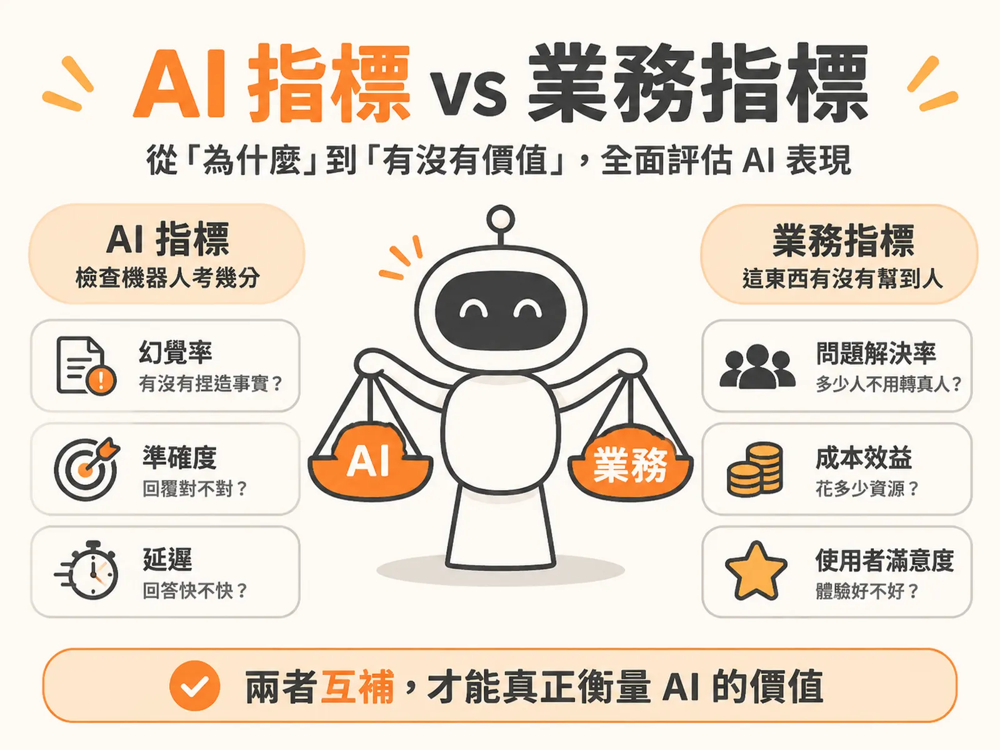

# AI vs Business Metrics

## A 是什麼

**A 是 AI 指標（AI Metrics）**：衡量 AI 本身做得好不好的數字。

用白話說，就是「檢查機器人考試考幾分」。AI 在幕後會經歷一連串過程：它在想什麼、呼叫了哪些工具、存取了什麼資料。現在我們能看到這些內部細節（追蹤紀錄 Traces），所以能訂出很細的檢查項目。

常見的 AI 指標有：

- **幻覺率（Hallucination Rate）**：模型有沒有捏造事實？
- **準確度與脈絡掌握**：例如 Context Precision、召回率（Recall）、Grounding（是否有根據事實發言）、F1 Score。
- **錯誤率與工具呼叫**：API 呼叫有沒有失敗、權限缺漏時處理得如何。
- **延遲（Latency）**：回答的速度夠不夠快。

因為這些指標是給工程團隊看的代理指標（Proxy Metrics），目的是抓出問題根因，所以使用者或主管其實不在乎 F1 Score 是多少。

## B 是什麼

**B 是業務與使用者指標（Business / User Metrics）**：衡量這項產品有沒有替公司和使用者帶來實質價值。

用白話說，就是「這東西有沒有真的幫到人」。主管看儀表板時，通常關心三個問題：

1. 這東西安全可靠嗎？品質對不對？
2. 花了多少成本？（例如消耗多少 Token，財務主管最在意）
3. 得到了什麼價值？

以外部客服 Agent 為例，常見的業務與使用者指標有：

- **問題解決率（Resolution Rate / Deflection Rate）**：多少使用者的問題由 Agent 成功解決，不用轉真人？
- **轉接真人率（Escalation to Human Rate）**：Agent 撐不住、最後轉給真人的比例有多高？團隊通常想壓低這個數字。
- **使用者滿意度（CSAT）**：使用者跟 Agent 互動後的體驗如何？

## 關鍵差異

兩者分工回答截然不同的問題：

- **AI 指標回答「為什麼（Why）」**：幫我們看清模型內部表現，找出問題出在哪裡。
- **業務指標回答「有沒有產生價值（Whether it mattered）」**：看這些回答對真實業務有沒有影響。

因為兩者問的問題不同，所以它們**不是互相取代，而是互補**。

一個 92% 準確率、儀表板全綠的客服 Agent，轉接真人的升級率卻可能翻倍（2×）。為什麼？因為準確率只衡量模型本身的品質（quality），對產品行為（behavior）與可靠度（reliability）完全盲目。單一回覆在事實上可以完全正確，但整體對話行為卻讓人沮喪——答非所問、無法推進流程，使用者最終還是得求助真人。

## 何時用哪個

兩類都要用，但依情境調整側重點。

業務指標高度取決於 Agent 的應用場景：

- **外部客服 Agent**：看使用人數、問題解決率、轉接真人次數與 CSAT。
- **寫程式 Agent**：看程式碼採納率、功能開發時間縮短了多少。
- **內部工作流程 Agent**：看能不能幫後勤團隊省下人工處理時間。

門檻也要依業務風險訂：

- **內部問答 Agent**：不涉及外部資料或高風險操作，可以用較寬鬆的門檻（例如 50%），快速上線迭代。
- **法律或金融 Agent**：犯錯代價極高，門檻要拉到 90% 以上，還要搭配引用來源檢查（citations）與確定性規則檢查（deterministic checks）。

還有一個常見錯誤要避開：很多團隊做概念驗證（POC）時只盯著 AI 品質與準確度，把成本與業務成效留到以後。但建構企業級 Agent 時，成本、用量與商業價值必須在最一開始就納入規劃。

## 進階

當業務指標亮紅燈但 AI 指標全綠時，怎麼找出問題？

1. **從被升級的完整對話著手**：轉接真人是「對話層級（session-level）」的結果，單一回合的問答往往看不出破綻。要抓出所有轉接真人的完整對話紀錄來檢視。
2. **標註與分類失敗原因**：人工檢視 Agent 為何放棄或激怒用戶，建立錯誤分類體系（failure taxonomy），例如檢查「理解意圖錯誤（Wrong Intent）」這類錯誤代碼是否顯著增加。
3. **把新場景納入回歸測試**：找出先前未涵蓋的場景後，補進未來的回歸測試（regression test cycles），避免同樣問題重演。

兩個自檢問題，寫 PRD 或做評測驅動開發（Eval-Driven Development）時隨時拿來問自己：這項指標是在衡量 AI 本身為什麼這樣回答，還是在衡量這項回答對真實業務有沒有產生影響？

最後，預設指標不夠用時怎麼辦？多數評測平台都支援自訂評分器（Custom Scorers）。當預設指標不符合你的業務定義，直接打造自己的指標就好。名詞各家不同——有的叫 Metric、Score，有的叫 Measure 或 KPI——但本質上都是同一件事：你到底要從哪些維度來衡量產品。
