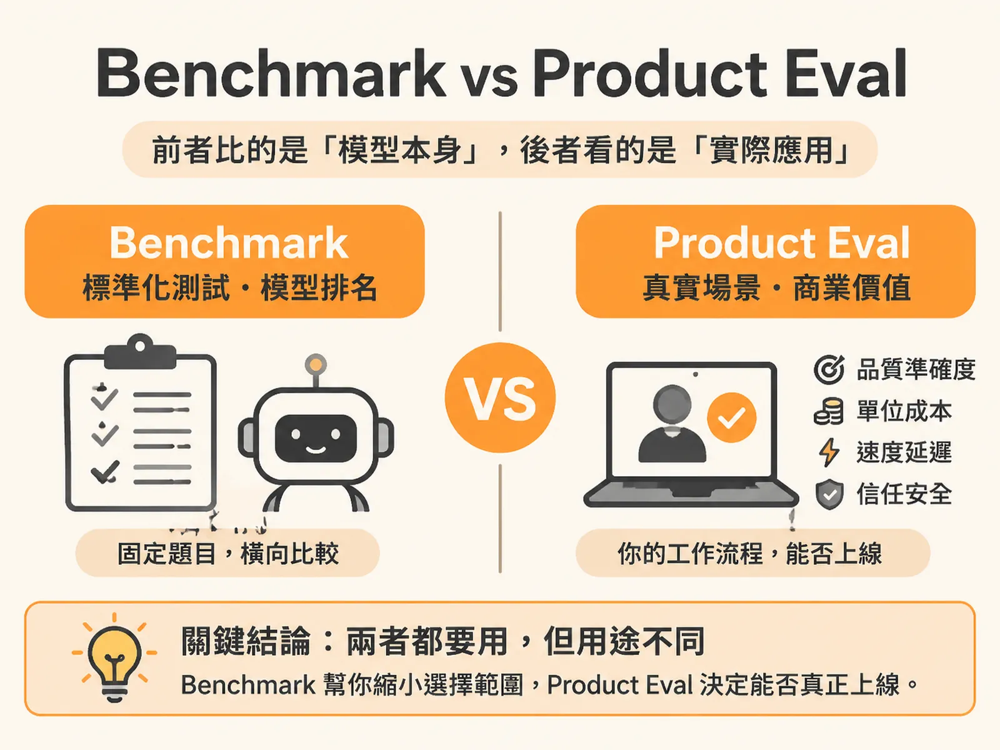

# Benchmark vs Product Eval

每幾天就有一家 AI 公司宣布新模型拿下排行榜第一。很多團隊看到高分，就以為「選最強的模型，上線一定順利」。這篇文章要說明：公開 benchmark 和你產品裡做的 eval，其實是在量兩件完全不同的事。

## A 是什麼

Benchmark 就是公開的標準基準測試。可以把它想成一場全國統一的模擬考：所有模型都做同一套固定題目，分數拿來排名。

它的最大價值，是讓你在「固定題目」下，橫向比較各家模型本身的純效能（model performance）。新模型發表時，各大公司幾乎都拿 benchmark 當主要宣傳工具，分數競賽甚至變成一種刷榜遊戲。

但要注意：benchmark 量的是「模型」這個零件本身。它沒有測你的資料管線，也沒有驗證你的真實工作流程。

## B 是什麼

Product eval 是把候選模型放進「你自己的流程管線」裡驗證，看它在你的實際場景下能不能完成任務。

為什麼需要它？因為在真實商業場景中，模型只是系統的其中一個零件。真正決定成敗的，是端到端的工作流程（end-to-end workflow）、核心要解決的待辦任務（jobs to be done），以及最終的商業價值——這些 benchmark 完全沒有碰。

舉個例子：一個模型在排行榜上數學考滿分、長文本推理拿高分，技術上很厲害。但如果你做的是 CRM（客戶關係管理）產品，這些分數完全無法告訴你：

- 業務代表要打外撥銷售電話（outbound sales call）時，它能不能給出正確引導？
- 顧客進線諮詢（inbound sales queries）時，它能不能依公司業務規則精準回覆？
- 它能不能承接真實客服，不給出偏離事實的解答？

所以 product eval 不能只看單一準確度，還要綜合量四個維度：

- **品質與準確度**：在你的業務資料與邊界案例中，產出是否合格。
- **單位成本**：只看榜單挑最強、最貴的模型，推論成本可能高到無法規模化，跑大量評測或量產時就把預算燒光。
- **速度與延遲**：能否滿足即時互動或背景任務的時效。
- **信任與安全**：面對真實客戶互動時，防護機制夠不夠穩。

實務做法是把業務拆成具體使用情境，例如「客服業務代表（customer service agent）」和「行銷場景（marketing use cases）」，再透過自動化評測管線，持續比對不同模型在各情境下的這些子指標。

## 關鍵差異

兩者量的對象不同：

| | Benchmark | Product Eval |
|---|---|---|
| 量什麼 | 純模型本身的通用能力 | 你的端到端工作流與商業結果 |
| 題目 | 固定的公開題目 | 你的業務資料與真實情境 |
| 用途 | 各家模型橫向排名 | 決定你的產品能不能上線 |
| 商業關聯 | 非常低 | 直接反映投資報酬率 |

一句話總結：benchmark 測的是「這個學生統一模擬考考幾分」，product eval 測的是「這個學生來你的店裡實際上班，表現如何」。

Product eval 還有一個 benchmark 給不了的功能：回答「現在能不能 ship（上線）」。這不能靠榜單上的單一數字，而要看：

- 應該發生什麼事、絕對不能發生什麼事。
- 系統有沒有解決使用者真正的需求。
- 還殘留哪些風險（例如幻覺率還有 20%）。
- 動作的可逆性（Reversibility）：像 Gmail Agent 的「草擬郵件（draft email）」是雙向門，寫壞了能改；「直接寄出郵件（send email）」是單向門，發了收不回來。
- 爆炸半徑（Blast Radius）：出事時會波及多少使用者、惡化得多快。

## 何時用哪個

兩種都要用，但用途不同：

- **挑模型時**：benchmark 可以當起點，讓你快速縮小候選範圍。但不能停在這裡——下一步一定得把模型放進自己的管線跑 product eval。
- **決定上線時**：只看 product eval。門檻設多少，取決於錯誤的代價：
  - 內部員工專用的問答 Agent：只有 50% 正確率也可以先上，因為範圍可控、可以做受控發布（controlled launch），而且一開始沒有呼叫外部資料或執行高風險操作的能力。
  - 法律或金融場景：一旦出錯代價極高，門檻要拉到 90% 以上，還要加上引用來源驗證（citations）與決定性檢查（deterministic checks）等硬性防護。

判斷原則很簡單：操作越不可逆、爆炸半徑越大，評估關卡（eval gates）就要越嚴。風險受控且屬於可逆的雙向門，50% 也能先交付；牽涉不可逆操作與高爆炸半徑，就絕不能倉促上線。

## 進階

- **自動化評測管線**：把情境拆細（例如客服、行銷分開評），持續比對各模型的準確度、成本、速度、安全子指標，而不是靠一次性的單一跑分。
- **高風險場景的額外投資**：對不可逆、高爆炸半徑的功能，只跑標準資料集評分不夠，必須做紅隊測試（red teaming）。許多大型企業甚至投入數百萬美元聘請外部駭客做滲透測試，找出漏洞與提示詞注入（prompt injections）弱點。
- **攻擊以機器速度進行**：曾有測試人員發現漏洞、取得原始碼放上 GitHub，短時間內在 Twitter（現為 X）擴散到 200 萬次下載。防禦與偵測機制的反應速度也必須跟上這個節奏。

看懂這個差異，你就不會再被模型發表會的刷榜數字牽著走，而是能依據真實產品的工作流程與投資報酬率，做出合理的技術決策。
