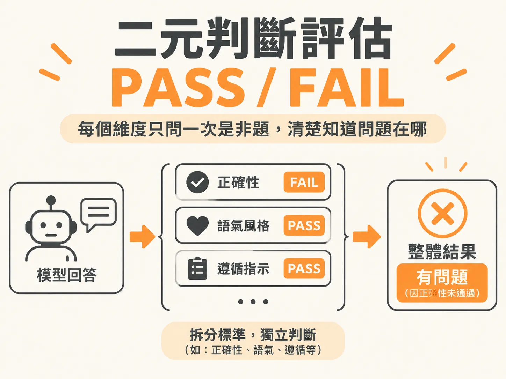

# Binary PASS/FAIL Judging

## 主張

評估大型語言模型（LLM）的回答品質時，應該放棄 1 到 5 分的量表，改用單一判準的二元判斷（PASS 或 FAIL）。每一個裁判模型（LLM Judge）只負責回答一個是非題，不把多個標準混在一起評分。

## 為什麼成立

傳統 1 到 5 分的李克特量表看似精細，實際上卻常造成失敗難以追查：

- **分數擠壓與模糊中間值**：人類評估者猶豫不決時往往偷懶給 3 分；LLM 的評分則容易集中在 4 到 5 分。平均 4.2 分看起來很優秀，實際上卻可能掩蓋了致命的事實錯誤。
- **標準互相污染**：如果一個提示詞同時要求評估正確性、實用性與語氣，拿到 3 分時，團隊完全無法分辨究竟是內容捏造，還是單純語氣不夠客氣。
- **缺乏及格標準**：1 到 5 分沒有界定什麼情況算及格。向團隊報告時，大家依然需要轉換成通過率才看得懂。

改用二元判斷並將標準拆開後，每個 Judge 只對應一個失敗代碼。若「正確性」FAIL 而「語氣」PASS，開發團隊就能立刻知道問題出在資料檢索或幻覺，而不是提示詞的風格設定。

## 適用範圍

這個原則適用於所有需要語意理解、主觀審查的大型語言模型輸出評估，主要涵蓋四種任務類型：

- **語氣與風格**：檢查表達是否清晰、冗長，或面對沮喪使用者時是否具備同理心。
- **事實正確性**：檢查回答是否真實、完整，且與參考資料一致。
- **遵循指示**：檢查輸出結構是否正確，並符合安全準則與優先政策。
- **任務完成度**：檢查工具呼叫（tool calls）與流程步驟是否確實完成。

如果檢查項目有死板明確的規則（例如欄位是否存在、字串是否精準匹配），請優先使用程式碼評估器（Code Evaluator），不要使用 LLM Judge，這樣成本極低且不會產生模型漂移。

## 反例

最典型的反模式，是要求模型同時為多種維度打出 1 到 5 分：

> 「請根據這則回答的實用性、正確性與語氣，給出 1 到 5 分。」

這種做法會讓多個標準互相污染，扣掉的分數無法歸因。另一個反例是沒有提供具體的及格與邊界標準，導致人類標註員或 LLM 面對灰色地帶時，給分如同擲硬幣一樣不穩定。

## 進階

要寫出穩定可靠的二元 LLM Judge，提示詞需要具備五大要素：

1. **稽核員角色**：宣告模型是在進行客觀稽核，而不是輔助對話的助理。
2. **單一二元問題**：只問一個非黑即白的是非題。
3. **具體的 PASS/FAIL 標準**：明確寫出通過與失敗的成立條件。
4. **邊界範例**：清楚定義最容易混淆的極限情境（例如補救措施不能抵消前一輪的遺漏）。
5. **指定輸出格式與推理依據**：要求模型先寫一到兩句判斷理由（rationale），最後再輸出 PASS 或 FAIL。要求先寫理由能讓評估透明化，不再是黑盒子。

如果專案或利害關係人堅持要看 1 到 5 分的細粒度分數，可以在後台設定明確的及格門檻（例如 4 分以上判定為 PASS，低於 4 分判定為 FAIL），既能保留數值，又能清楚掌握及格率。最後，所有 LLM Judge 上線前都必須由人類專家的標註資料進行一致性驗證，絕不能盲目信任未經校準的裁判模型。
