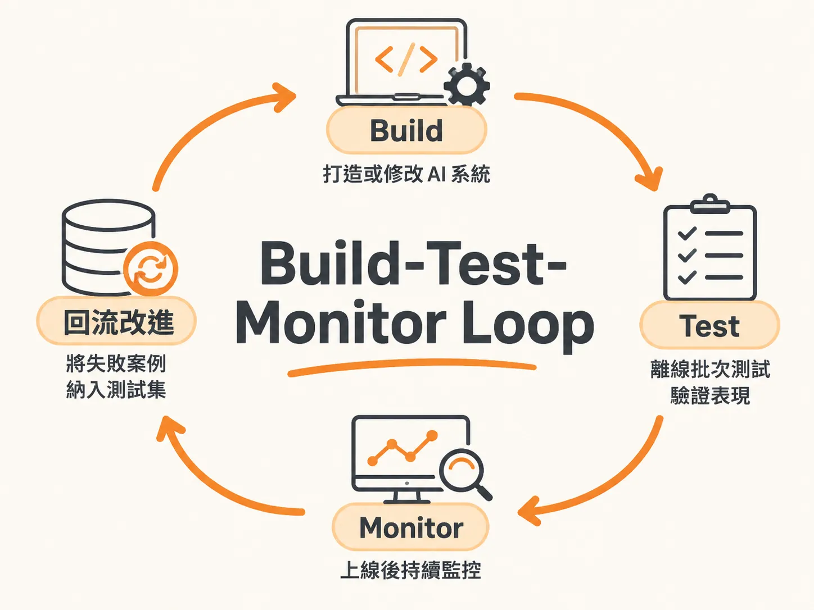

# Build-Test-Monitor Loop

## 定義

Build-Test-Monitor Loop 是打造 AI 應用時的一套持續循環流程：

1. **Build**：打造或修改你的 AI 系統（例如調整 Prompt、換模型）。
2. **Test**：上線前，用離線批次測試跑過大量測試情境。
3. **Monitor**：上線後，持續監控系統面對真實使用者的表現。
4. 線上抓到的失敗案例，回流變成新的測試案例，再回到 Build——如此不斷循環。

打個比方：這就像小孩學騎腳踏車。先試著騎（Build），在家裡空地練習直線轉彎（Test），真正騎上路後才發現路上的坑洞和石頭（Monitor）。這些「路上踩到的坑」記下來，下次練習時就特別注意（回到 Test），然後再上路。一路循環，越騎越穩。

## 為什麼重要

因為傳統軟體測試的思維在 AI 時代會全面失效。

傳統測試的邏輯是：給定一個輸入，比對輸出是否完全等於預期值。例如點擊按鈕要跳轉到正確頁面，通過就是通過。這叫做**決定性（deterministic）**——同樣的輸入永遠得到同樣的輸出。

但 AI 不同。除了「今天是幾號」這類單純提取資料的問題，只要牽涉到多步驟推理與複雜任務，AI 的輸出本質上是一種機率分佈。給定相同的 Prompt，每次產出的內容可能落在分佈的頂端、底部或中間，每次都有些許差異。

所以評測的目的不是消除波動，而是回答核心問題：**你的 AI 方案有沒有達到使用者預期？它是否在安全、值得信任的前提下完成任務？** 若沿用舊測試思維，開發團隊很快就會寸步難行。

面對這種不確定性，傳統測試有四個地方需要轉向：

| 破裂的傳統假設 | 傳統作法 | 新思維 |
| :--- | :--- | :--- |
| 決定性 | 檢查輸出是否等於預期 | 衡量多次執行下的整體成功率 |
| 單一裁決 | 每個測試只有 Pass / Fail | 針對多個品質維度分別評定 |
| 靜態測試 | 寫一次就永久運行 | 持續演進的活體裁判與動態資料集 |
| 建構後才測 | 開發尾聲才交由 QA 驗證 | 從第一天起就展開錯誤分析 |

## 如何運作

迴圈分為兩大階段，彼此互通。

**第一階段：離線批次測試（Offline Eval，Test 階段）**

在正式上線或部署前執行。以批次方式跑過大量測試情境，確認模型沒有產生嚴重的幻覺或邏輯偏誤。這是軟體交付前最重要的「Go / No-go」門檻判斷點。

因為批次實驗很耗時，工程實務上通常把它安排成 CI/CD Pipeline 的一環，排定在資源閒置的離峰時段（例如深夜）自動觸發，隔天一早檢視報告。

**第二階段：線上即時監控（Online Eval，Monitor 階段）**

系統正式面對終端使用者後，執行選擇性的檢查。需要觀察資料漂移（Drift）、幻覺傾向以及回應是否有偏見。評估時要兼顧兩類指標：

- **AI 指標**：例如幻覺率、指令遵循度。告訴我們系統「為什麼」出問題。
- **業務指標**：例如顧客滿意度（CSAT）、自主解決率。告訴我們問題「有沒有造成實質影響」。

**關鍵連接：失敗回流**

兩個階段並非各自獨立。線上記錄下來的使用者互動歷程（Traces）如果只放在記憶體中，幾小時後就會隨快取消失，所以必須妥善持久化記錄。這些真實流量中的失敗歷程，正是整個循環中最具價值的資產。

處理流程是三步：

1. **捕獲失敗軌跡**：檢視包含多次對話與工具呼叫的軌跡。既看最終目標是否達成（例如機票有沒有訂對），也要逐步驗證中間的軌跡評測——檢查工具呼叫順序、輸入輸出參數，以及是否有權限違規。
2. **清洗並收錄至測試集**：把真實世界暴露出的新穎情境、邊緣案例或攻擊手法，提取出輸入與預期條件，直接擴充到離線評測資料集。
3. **建立防護網並自動化防禦**：下次團隊修改系統、Prompt 或切換底層模型時，這批先前在線上踩雷的案例，就會在離線批次測試中自動執行。

## 例子

想像你在打造一個處理顧客退換貨請求的客服 Agent。

- **Build**：你寫好 Prompt、接上查詢系統記錄的工具，能確認商品是否符合退貨條件、驗證處置流程是否安全合規。
- **Test**：上線前，你以批次方式跑過一大組測試情境——正規案例、邊緣狀況、紅隊對抗情境——確認它不會胡亂答應退款或違規。通過了，才放行上線。
- **Monitor**：上線後，你追蹤幻覺率與 CSAT。某天發現 Agent 在一次多步驟工具呼叫中嘗試越權存取資料。
- **回流**：你把這次失敗的軌跡清洗成一個測試案例，加進離線資料集。之後每次改 Prompt、換模型，離線測試都會自動重跑這個案例，確保這個坑不會再踩一次。

每一輪循環都讓測試集更厚、防護網更密。

## 邊界與常見誤解

**誤解一：評測是一次性的驗收活動。**
不對。評測是持續循環的生命週期，不是上線前蓋章交貨的那一下。

**誤解二：非決定性是要拔除的 Bug。**
不對。非決定性是評測時必須圍繞測量的本質特徵。當模型需要發揮創造力時，往往會調高 Temperature，非決定性的範圍隨之拉大。只跑一兩次測試遠遠不夠，要在多次重複執行中觀察整體表現，甚至結合單一指標與綜合分數（例如達成 60% 的加權門檻）來衡量。

**誤解三：沒有標準答案（Ground Truth）就沒辦法開始。**
不對。可以從小規模資料起步，後續再從真實軌跡中逐步豐富，擴展成黃金測試集。

**誤解四：線上的失敗紀錄放著就好。**
不對。Traces 若只放在記憶體，幾小時就隨快取消失。失敗歷程必須被持久化記錄並轉成測試案例，否則迴路就斷了。

**誤解五：只盯 AI 指標或只盯業務指標。**
兩類指標要一起看——AI 指標解釋為什麼出錯，業務指標說明影響有多大。

## 進階

當失敗案例被持續匯入測試集，系統便具備了**遞迴自我改進（Recursive Self-Improvement, RSI）的基礎設施**：不斷在線上發現漏洞、轉為離線黃金測試案例、修復並重測，AI 系統就能像**登山演算法（Hill climbing）**一樣，一步步朝更高的自主解決率穩定邁進。

另外兩個值得留意的工程現實：

- **評測能力的保鮮期遠長於 Prompt 技巧。** 隨著模型能力提升，冗長精巧的提示詞技術生命週期愈來愈短；相對地，系統化評測的能力具備極長的保鮮期。
- **在不同層級的思考深度（Effort level）之間取捨。** 現代模型多半支援不同層級的思考深度，簡單的摘要任務若開啟頂級模式，只會平白拉長等待時間並消耗昂貴的 Token。工程師必須依任務類型在成本、速度與品質之間取得平衡。

無論系統規模是單純的 Prompt、獨立模型、單一 Agent 還是多 Agent 系統，這個迴圈都適用——每次評測都由三個核心元件組成：**任務（Task，AI 要解決的問題）、資料集（Dataset，涵蓋正規案例、邊緣狀況、紅隊情境與正式流量的測試情境）、評分器（Scorer / Judge，可以是確定性程式碼、LLM-as-a-judge 或人工審查）**。三者跑完產出分數，團隊據此判斷是否達標，再決定是否調整系統、回到迴圈的起點。
