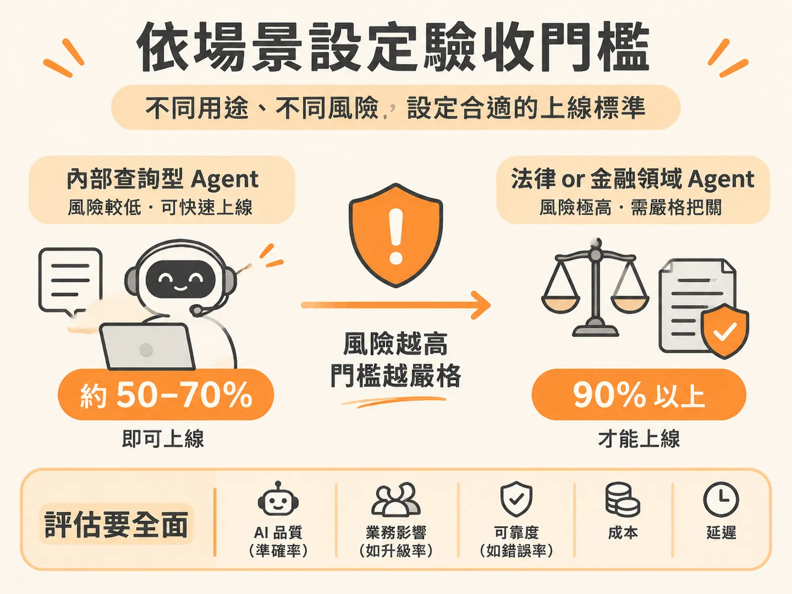

# Contextual Eval Thresholds

## 主張

驗收門檻要依用途與犯錯成本設定，而不是所有場景共用一個數字。

白話說：你要求 AI「考幾分才能上線」，不能一體適用。用在公司內部查資料的機器人，60 分就能先出發、邊跑邊改；用在法律或金融的機器人，犯一個錯可能造成大損失，就要考到 90 分以上才能出發。

就像：小孩在家後院騎腳踏車，不用戴全套護具；但在大馬路上騎，就必須戴安全帽。場景不同，安全標準就不同。

## 為什麼成立

因為門檻的本質是「風險控制」，不是「分數好看」。錯誤帶來的業務衝擊不同，合理的驗收標準（acceptance criteria）就不同。

來源中給了兩個對照的情境：

- **內部員工使用的問答 Agent**：不涉及外部資料或高風險操作。即使回答不夠完美，影響也有限，所以可以採用較寬鬆的門檻（例如 50%），在受控環境下快速上線、快速迭代，避免為了追求完美拖慢團隊步調。
- **法律或金融領域的 Agent**：犯錯代價極高，門檻必須拉到 90% 以上，而且不能只看模型分數，還要搭配引用來源檢查（citations）與最上層的確定性規則檢查（deterministic checks）。

同一個「上線標準」，答案可以是 50%、70% 或 90%——取決於產品用途與犯錯成本。

## 適用範圍

這個原則適用於所有要決定「AI 什麼程度才能上線」的場合。落地時要注意兩件事：

**第一，AI 指標和業務指標要放在一起看。**
- **AI 指標**：衡量模型本身的品質，例如品質分數、準確率。
- **業務指標**：衡量對使用者與營運的實際影響，例如轉真人客服的升級率（escalations）、使用者滿意度或倒讚數。

門檻訂得再精確，如果只盯著 AI 指標，也可能出現「儀表板全綠、用戶氣炸」的狀況。

**第二，門檻只是起點，出錯要有後續流程接住。** 來源中給了三步：
1. 抓出轉接真人的**完整對話**來檢視——因為升級率是「對話層級（session-level）」的結果，單一回闤的問答往往看不出破綻。
2. 人工標註 Agent 為何放棄或激怒用戶，建立錯誤分類體系（failure taxonomy），例如檢查「理解意圖錯誤（Wrong Intent）」這類錯誤代碼是否顯著增加。
3. 把先前未涵蓋的場景補進未來的回歸測試（regression test cycles），避免同樣問題重演。

## 反例

單一準確率的盲點：來源中有一個客服 Agent 的實際案例。

- **模型準確率**：達到 92%，儀表板全綠。
- **業務結果**：轉接真人客服的升級率翻了一倍（2×）。

為什麼 92% 的高分攔不住翻倍的客訴？因為準確率只衡量了模型的品質（quality），對產品行為（behavior）與可靠度（reliability）完全盲目。

一個 Agent 可以有 92% 的單次回覆在事實上完全正確，但整體對話行為讓人沮喪——答非所問、無法推進流程，或是在錯誤的時間點放棄對話——使用者最終還是得求助真人。

如果這時團隊共用一個「92% 就合格」的門檻，就會誤判產品已經沒問題，實際上客訴正在暴增。

## 進階

把品質當成「分佈」，而不是一個「斷言（assertion）」。除了模型準確性之外，還要兼顧行為、可靠度、安全性、成本與延遲等維度，才能避免指標漂亮、使用者卻不買單的困境。
