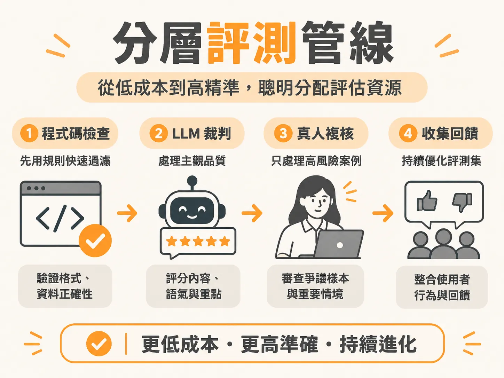

# Cost-Tiered Eval Pipeline

## 問題

當人工智慧系統每天產生數千甚至數萬筆互動紀錄時，全部靠人工逐筆檢查速度太慢，人力成本也無法負擔；但如果把所有輸出都丟給大型語言模型（LLM）當裁判打分，每次評估可能耗費數美元，評測的成本甚至會遠遠超過運行系統本身。

## 前置條件

- 已經收集真實系統軌跡，並列出具體的失敗模式（例如格式錯誤、資料未寫入、語氣不專業）。
- 準備好少量的基準資料，包含已確認的良好產出與不良產出範例。
- 清楚區分哪些驗證是寫死規則就能確認的「確定性檢查」，哪些是需要語意理解的「主觀判斷」。

## 步驟

1. **第一層：執行零成本的程式碼檢查**  
   先用程式碼驗證確定性規則。例如嘗試解析輸出是否為合法 JSON、用正規表達式檢查欄位是否存在，或直接查詢資料庫確認外部動作（如更新資料表）是否確實執行。一旦規則不符直接判定失敗，完全不消耗任何模型額度。
2. **第二層：必要時才調用 LLM 裁判**  
   只有通過程式碼檢查、且涉及主觀品質（例如長文摘要是否抓到重點、客服語氣是否得體）的內容，才送交 LLM 裁判，並依據明確的評分規準（例如 1 到 5 分的定義）進行打分。
3. **第三層：將真人複核保留給高風險邊界案例**  
   真人專家成本最高、速度最慢，不能拿來做例行審查。管線中應讓真人抽離常規流程，只在爭議樣本、評分處於及格邊界，或極高風險的情境下進行人工複核。
4. **第四層：持續串接線上使用者回饋**  
   產品上線後，持續收集使用者的顯性回饋（如按讚、倒讚）與隱性回饋（如連續詢問相同問題、接受或捨棄建議產出），將真實失敗案例回饋進評測集。

## 例子

在業務銷售代理人（SDR Agent）寄發客戶信件並更新資料庫的流程中：

- **第一層（程式碼）**：先檢查系統是否真的有寫入 CRM 資料庫（戳破代理人謊稱已更新的幻覺），並確認輸出為標準 JSON。這一步只需幾毫秒且成本接近零。
- **第二層（LLM 裁判）**：通過格式檢查後，由 LLM 裁判評估信件內文是否通順、是否符合專業語氣。
- **第三層（真人複核）**：若是針對重要大型企業客戶的信件，或裁判評分處於邊界，才交由業務主管快速審核。

## 失敗模式

- **拿 LLM 當萬能檢查工具**：連文字格式或資料庫欄位變更都交給 LLM 判斷，不僅每次呼叫浪費推論成本，還會面臨模型輸出漂移、正確率不如程式碼解析的問題。
- **未校準裁判便直接放行**：沒有預先用人工標註資料確認 LLM 裁判的一致性，產生「錯誤通過」（把實際上不良的產出判為合格），直接將有問題的回應送給終端使用者。
- **讓真人成為發布瓶頸**：要求所有案例都必須經過人工審查，導致評測管線無法融入自動化的持續整合流程（CI/CD），拖慢產品交付速度。

## 進階

在正式環境部署時，這套分層架構會進一步拆分為「線上即時」與「離線評估」：

- **線上即時（Online Runtime）**：在使用者等待回應的當下執行，只保留低延遲的保護措施，例如安全防護欄（Guardrails）與個人隱私資料遮罩（PII Masking）。
- **離線評估（Offline Eval）**：在背景或程式碼簽入（Git push）時的 CI/CD 管線中自動觸發，從容執行完整的程式碼規格過濾、深度 LLM 裁判打分與爭議案例抽檢。
