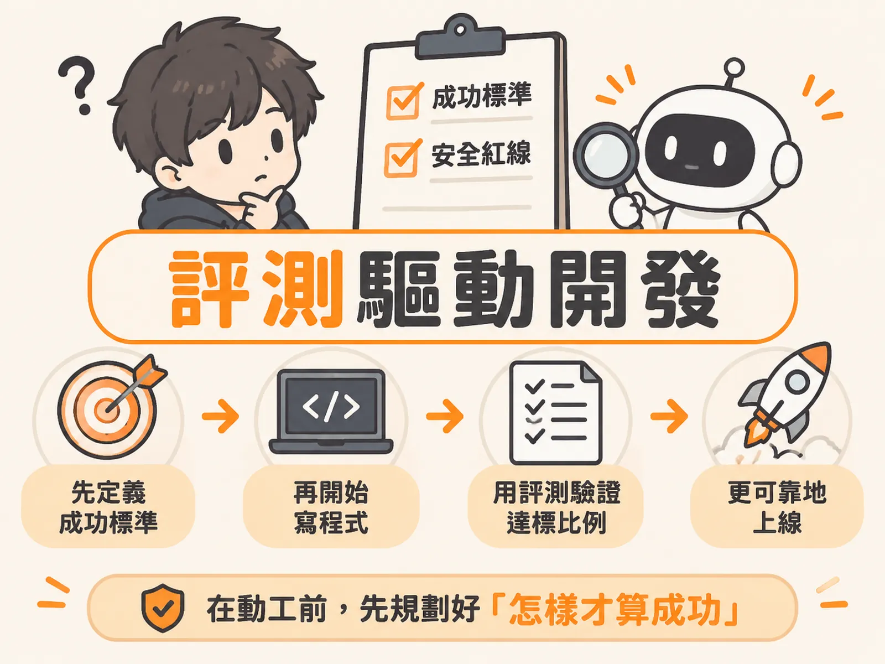

# Eval-Driven Development

把評測提前到產品規格階段，先寫清楚成功標準，再動手寫程式與提示詞。

## 主張

做 AI 產品時，不要等功能寫完才想「要怎麼測」。要在動工之前，就先寫下這套系統怎樣才算成功、怎樣絕對不行。

這就像蓋房子前先畫藍圖，而不是蓋完才決定門要開在哪裡。評測規格就是 AI 產品的藍圖，甚至可以取代傳統的產品需求文件（PRD）。業界常說「評測就是新一代的 PRD」，講的就是這件事。

## 為什麼成立

因為 AI 系統的輸出不是固定的，而是像抽獎一樣有機率分布（同一個問題，跑兩次可能拿到不同答案）。所以傳統測試那套「給輸入、比對輸出是否一模一樣」的方法完全失效。

舉例來說，請模型摘要一份 PDF，它可能回兩行重點，也可能回十行條列。哪個才對？要看情境：摘要艱深論文時兩行不夠，摘要觀點單一的部落格文章時兩行剛好。你不可能預先寫出一個字字相同的「標準答案」。

所以驗證方式必須改變：從「單次比對結果」改成「同一個任務重複跑幾十、幾百次，看成功且安全的比例」。這就是「成功率」的概念。而要算成功率，就得先定義什麼叫成功——這正是評測規格要在動工前寫好的原因。

不這樣做有真實代價：

- **加拿大航空（2024 年 2 月）**：客服聊天機器人憑空捏造了一套退票規定，審裁處最後判航空公司必須履行機器人捏造的退款承諾。
- **Replit（2025 年 7 月）**：AI 寫程式代理人在程式凍結期間，直接誤刪了線上的正式資料庫。

當主管問「我們能上線了嗎？信心水準有多高？」，沒做評測的團隊往往答不出來。因為評測不是專案尾聲的附加品，而是產品規格本身。

## 適用範圍

這個原則適用於所有以大型語言模型（LLM）或自主執行的 Agent 為核心的產品，例如電商、B2B、旅遊網站的客服聊天機器人，一路到能自主規劃長流程、常駐運作的 Agent。

動工前，評測規格要涵蓋四個維度：

1. **成果（Outcome）**：系統最終要達成什麼業務結果。以 Pronto 客服代理人為例，退款流程不能只寫「協助客戶退款」，要寫明：訂單必須先向 CRM 或 SAP 核對過才能退款；退款金額高於 50 美元必須轉真人主管審核，50 美元以下且符合條件才自動處理。
2. **軌跡（Trajectory）**：不只看最終答案，還要看過程。代理人在退款前有沒有先呼叫工具查訂單？路徑是直線還是拐彎抹角、甚至在迴圈卡了 30 分鐘？
3. **體驗（Experience）**：文字對話的「正在思考中」可以接受；語音代理人則要求極低延遲，還要評測各國口音、背景噪音、使用者打斷說話、以及靜音空白時間。
4. **治理（Governance）**：開工前就列出兩張清單——這套方案被允許做什麼、絕對不被允許做什麼。

這份規格不是一個人的工作：PM 定義成功標準與潛在失敗模式，AI 工程師從真實追蹤紀錄（traces）建立去識別化的評測資料集、一起決定指標與上線門檻，架構師與資料分析師檢視技術邊界。

## 反例

一個團隊如果跳過評測規格，直接讓 PM 寫一份厚厚的 PRD，工程師開始疊加長提示詞與工具，就會發生這些事：

- 上線後模型行為完全不可控——退款沒對帳就發放。
- 工具呼叫陷入無窮迴圈。
- 語音延遲過長，使用者直接掛斷。

最後團隊只能在客訴與緊急救火中疲於奔命。這正是因為「允許做什麼、不允許做什麼」沒有在開工前劃清，護欄與權限檢查也就沒有在架構初期設置。

另一種常見誤解是：模型做出來了，再想「現在到底要測什麼」。這是零起步困境——沒有事先寫好的邊界與業務政策，團隊第一天連測試案例都寫不出來。

## 進階

把評測規格納為 PRD 的專門章節，或在長篇 PRD 中附上評測規格的專屬連結。這樣在討論評測與驗收標準的會議上，團隊能直接聚焦在可執行的驗證條件上，而不是形容詞。

在退款、資料外傳、變更權限這類高錯誤成本的生產環境中，光靠龐大的提示詞或鬆散的自然語言護欄，會引入過多非確定性。這時要透過系統追蹤紀錄做確定性檢驗：比對客戶姓名、案件編號（Case ID）與業務機會紀錄，確認代理人每一步工具呼叫與執行順序符合預期，給出通過或不通過的客觀評定。

評估本身要回答兩個具體問題：應該發生什麼（任務達成度是 80%、90%，還是徹底失敗）？絕不能發生什麼（幻覺率是否仍高達 20%？是否誤刪資料庫）？把這兩題的答案寫進規格，成功率才有意義。
