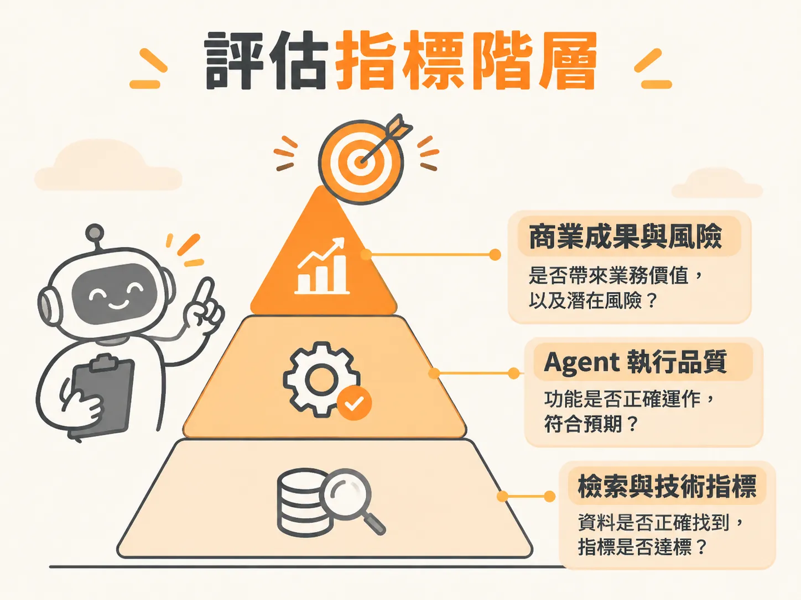

# Eval Metric Hierarchy

## 定義

評估指標階層（Eval Metric Hierarchy）是一種把人工智慧系統評估數字分成三個層級的架構。它將指標由上而下劃分為：頂層的商業成果與風險、中層的代理人（Agent）執行品質，以及底層的技術檢索指標。

這個架構讓不同角色在看系統表現時，能找到對應自己職責的數字，避免把工程細節與商業成敗混為一談。

## 為什麼重要

當團隊打造出 AI 應用時，工程師常習慣拿出「F1 分數達到 0.92」或「BLEU 分數提升」這類傳統機器學習指標來報告。但主管與經營團隊往往聽不懂，只想知道：「這有沒有幫公司賺錢或省時間？上線會不會有風險？」

因為傳統指標在自由文本生成上容易失靈，高分不等於內容正確。如果直接把底層技術數字端上管理層會議，溝通很容易失焦。建立指標階層，才能讓技術團隊專注調校系統，同時讓決策者清楚掌握產品的商業價值與風險。

## 如何運作

評估指標階層由上至下分為三個層層相扣的層級：

1. **第一層：商業成果與風險（Leadership 層級）**  
   這是決策層與產品負責人最關心的層面。評估產品是否達成預期的業務目標、整體算不算成功，以及系統上線後是否存在法規、資安或企業聲譽上的風險。
2. **第二層：Agent 執行與功能品質（執行層級）**  
   這是衡量系統功能運作是否健全的中間層。主要檢查 Agent 有沒有做出正確的外部工具呼叫（tool call）、執行時是否存取了正確的資料庫或欄位，以及整個工作流程是否符合預期的功能品質。
3. **第三層：底層檢索與技術運作指標（工程層級）**  
   傳統機器學習指標就落在這個位置。它們用來監控管線中的特定模組，特別是資料檢索（retrieval）階段的精確率（Precision）、召回率（Recall）與 F1 分數。

## 例子

以一個業務銷售代理人（SDR Agent）為例，各層指標的呈現方式如下：

* **商業成果與風險（第一層）**：業務代理人是否成功帶來更多有效客戶名單？有沒有向客戶發出違反公司隱私政策的信件？
* **Agent 執行品質（第二層）**：代理人宣稱「已更新 Salesforce 銷售機會資料表」時，系統用程式碼檢查資料庫，確認該欄位是否真的有被正確變更，而不是 Agent 出現幻覺隨口胡說。
* **底層檢索指標（第三層）**：代理人在生成業務信件前，從內部知識庫搜尋客戶過往紀錄時，檢索模組抓取相關資料片段的召回率與 F1 分數是否達標。

## 邊界與常見誤解

常見的誤解是「大型語言模型出現後，傳統技術指標就完全沒用了」。事實上，F1 或精確率並非失去價值，問題在於它們被擺錯了層級。

這些指標如果拿去評估最終的自由文字生成，會漏看關鍵問題——例如「營收成長 15%」被寫成「營收衰退 15%」，文字相似度很高，事實卻完全顛倒。但如果把傳統指標放回第三層，用來衡量底層文件「有沒有檢索正確」，它們依然是非常優秀的工具。

## 進階

在實務中，各層指標通常會對應不同型態的評測工具。第三層的底層檢索偏向確定性比對，多由程式碼規則自動計算；第二層的工具呼叫與外部動作，可透過程式碼直接比對資料庫真實狀態；而第一層與第二層牽涉到非結構化文字品質或語氣時，則需要設計明確評分規準的 LLM 裁判、內部專家的黃金標註，並結合終端使用者的顯性回饋（如按讚倒讚）與隱性回饋（如接受或修改建議），共同維護整個指標階層的健康度。
