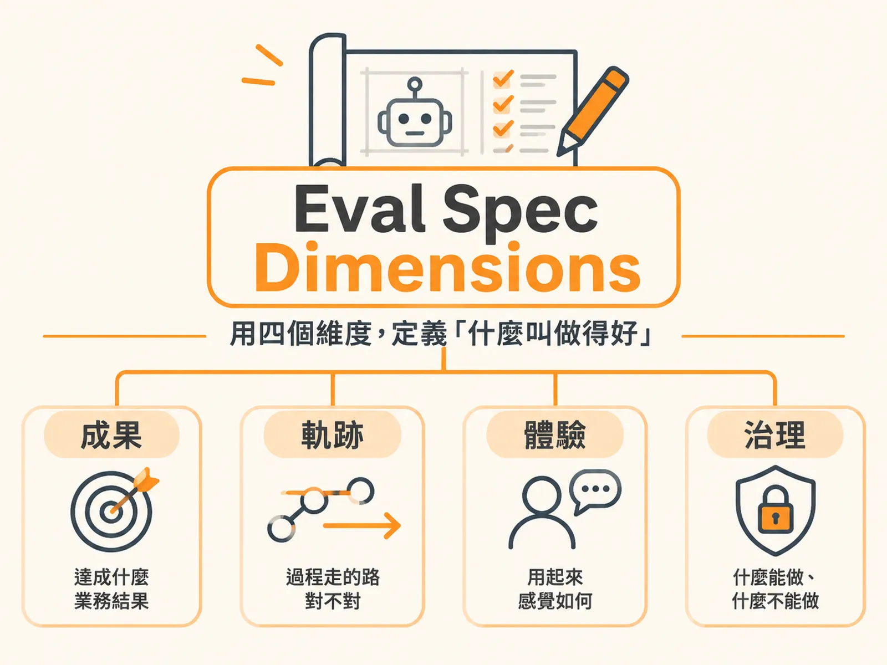

# Eval Spec Dimensions

## 定義

Eval Spec Dimensions（評測規格的四個維度）是指在動工打造 AI 產品之前，先把「什麼叫做得好」寫成一份可驗收的規格，而這份規格要涵蓋四個面向：

1. **成果（Outcome）**：系統最終要達成什麼實質業務結果。
2. **軌跡（Trajectory）**：系統在過程中呼叫工具的路徑對不對。
3. **體驗（Experience）**：使用者互動起來感覺如何。
4. **治理（Governance）**：什麼行為被允許、什麼絕對不被允許。

打個比方：這就像蓋房子之前先畫好藍圖。如果只在會議上說「要蓋一棟好房子」，每個人心中的「好」都不一樣。但有了藍圖，大家就知道幾層樓、幾扇窗、電線怎麼走。評測規格就是 AI 產品的藍圖。

業界把這個做法稱為「評測就是新一代的 PRD」（evals are the new PRD），或「評測驗動開發」。PRD 是產品需求文件，也就是產品經理寫的規格書。這句話的意思不是用零散測試取代規格，而是把模糊的願景，轉化為動工前就能定義清楚、可驗證的評測評分規準（eval rubric）。

## 為什麼重要

因為沒有規格，AI 產品上線後行為完全不可控。

常見的困境是這樣：產品經理寫了一份厚厚的 PRD，工程師開始疊加很長的提示詞（prompt，給模型的指令）與工具，上線後才發現問題——退款沒對帳就發放、工具呼叫陷入無窮迴圈、語音延遲過長讓使用者直接掛斷。最後團隊只能疲於奔命地救火、處理客訴。

如果反過來，在寫程式碼與提示詞之前，就把四個維度的評測標準定案，效果完全不同。團隊不會陷入「模型已經做出來了，現在到底要測什麼」的零起步困境，而是第一天就具備測試案例與良好行為的標準。工程實作也有了清楚對齊的驗收依據。

另外，這件事不是單一角色能完成的，而是一場團隊合作：

* **產品經理（PM）**：定義成功標準，主動發展假設——這款產品有哪些潛在失敗模式（failure modes）？使用者會怎麼把它玩壞？提早歸類成指標。
* **AI 工程師**：從真實追蹤紀錄（traces，系統執行過程的完整紀錄）中撈資料、清理並去除個人可識別資訊（PII），建立去識別化的評測資料集；並與 PM 一起決定關鍵指標、量測門檻與上線評估（go/no-go）的決策標準。
* **架構師與資料分析師**：檢視技術邊界與指標合理性。

過往「PM 寫 PRD、工程師照著做」的界線正在模糊。理想做法是把評測規準納為 PRD 的專門章節，或在長篇 PRD 中附上評測規格的專屬連結，讓討論驗收標準的會議能直接聚焦在可執行的驗證條件上。

## 如何運作

四個維度各自回答一個不同的問題，動工前逐一寫清楚：

**第一步：成果（Outcome）——「最終要做到什麼？」**

由 PM 與 AI 工程師共同定義。一開始不必追求完美，先挑兩三個真實情境作為起點。關鍵是不能只寫模糊的目標，必須寫出明確的業務規則與邊界。

**第二步：軌跡（Trajectory）——「過程走的路對不對？」**

當代理人（agent，能自動呼叫工具完成任務的 AI）需要呼叫外部工具時，只看最終輸出不夠。因為它可能答案正確，卻在迴圈中卡了 30 分鐘、耗費大量 Token；或者根本跳過查詢工具，直接憑空捏造（hallucinate）資訊。所以要驗證兩件事：

* **工具呼叫順序**：核發退款前，有沒有先呼叫工具查詢訂單編號？
* **路徑最佳化**：這是最短的直線路徑，還是拐彎抹角的無效路徑？

在退款、資料外傳、變更權限這類高錯誤成本的場景，光靠龐大的提示詞或鬆散的自然語言護欄（guardrails，限制系統行為的規則）會引入太多非確定性（non-determinism，同樣輸入可能產出不同結果）。必須透過 traces 做確定性檢驗，比對客戶姓名、案件編號與業務機會紀錄，給出通過或不通過的客觀評定。

**第三步：體驗（Experience）——「用起來感覺如何？」**

由 PM 主導（有設計師可協助）。重點是不同互動媒介，標準完全不同：

* **文字對話代理人**：背景思考時顯示「正在思考中」可以接受，使用者對延遲容忍度高。
* **語音代理人**：延遲必須極低，要像真人視訊通話一樣即時。評測難度大增：要模擬各國語言與口音、吵雜環境噪音、使用者打斷代理人說話，還要評測「靜音空白時間」（dead air time）——使用者提問後沉默兩三分鐘，系統該如何反應。

**第四步：治理（Governance）——「什麼絕對不能做？」**

這是整份規格中最關鍵、也最能節省後續維護成本的維度。開工前明確列出兩個清單：

* 這套解決方案被**允許**做什麼。
* 這套解決方案**絕對不被允許**做什麼。

因為先把界線劃清楚，團隊在架構初期就能設置對應的護欄與權限檢查。如果上線後才觸發未曾設想的行為，就會演變成緊急救火與客訴升級。

## 例子

以 Pronto 客服代理人為例，看每個維度怎麼落成具體規格。

**成果維度**：退款流程的成功條件不能只寫「協助客戶退款」，必須包含明確業務規則：

* 只有在訂單經過完整驗證後，才能發起退款。這意味著背後必須有一步是向系統紀錄（如 CRM 或 SAP）核對該筆訂單。
* 如果退款金額高於 50 美元，必須轉交真人主管審核；若是 50 美元以下且符合其他條件，才允許自動處理。

**軌跡維度**：針對同一個退款流程，規格會驗證——代理人在核發退款前，究竟有沒有先呼叫工具查詢訂單編號？還是跳過查驗直接執行？如果發現路徑拐彎抹角，就修正指令，明確告知模型可以直接呼叫特定工具。

**體驗維度**：文字客服代理人可以讓使用者等「正在思考中」；語音代理人則必須即時反應，而且要預先定義好各國口音、背景噪音、被打斷、以及使用者沉默兩三分鐘時系統的表現標準。

**治理維度**：在開工前就寫下——這個客服代理人被允許做什麼、絕對不被允許做什麼。例如「未對帳就發放退款」就該出現在不允許清單裡，於是架構初期就會加上權限檢查，而不是上線後才發現。

## 邊界與常見誤解

**誤解一：「評測就是新一代 PRD」意思是用測試取代規格書。**

不對。它的意思是把過去模糊的願景，轉化為動工前就能定義清楚、可驗證的評測評分規準。規格本身還是要寫，只是裡面要包含可驗收的評測標準。

**誤解二：一開始就要定義完美的成果標準。**

不必。成果維度一開始先挑兩三個真實情境作為起點就好，之後再擴充。

**誤解三：模型答案正確就代表沒問題。**

不夠。模型可能給出正確答案，但過程在迴圈中卡了 30 分鐘、耗費大量 Token，或跳過查詢工具直接捏造資訊。這就是為什麼需要軌跡維度，不只看結果，還要看過程。

**誤解四：靠龐大的提示詞就能管住行為。**

在高錯誤成本的生產環境（退款、資料外傳、變更權限），鬆散的自然語言護欄會引入過多非確定性。必須用 traces 做確定性檢驗，比對具體欄位後給出客觀的通過或不通過。

**誤解五：體驗標準只有一套。**

文字與語音的體驗標準有本質上的不同。文字對話容忍延遲，語音必須極低延遲、還要處理噪音與打斷。用同一套標準衡量兩者會失真。

## 進階

**治理維度的成本效益。** 在任何新專案開工前，花時間明確劃分「允許做什麼」與「絕對不允許做什麼」兩個清單，是整個評測規格中最能節省後續維護成本的一步。因為這兩個區塊定義得越清楚，架構初期的護欄與權限檢查就越完整，避免上線後的救火與客訴升級。

**用 traces 做確定性檢驗的具體做法。** 比對客戶姓名、案件編號（Case ID）與業務機會紀錄，確認代理人每一步工具呼叫與執行順序是否符合預期，並給出通過或不通過的客觀評定。這比靠自然語言判斷「表現好像不錯」嚴謹得多。

**評測資料集的準備。** AI 工程師的角色不只寫程式，還包括從真實追蹤紀錄中撈取資料、清理並去除個人可識別資訊（PII），建立去識別化的評測資料集。這讓評測建立在真實使用情境上，而不是憑空設想。

**把評測規格接上組織流程。** 在 PRD 中附上評測規格的專屬連結，讓專門討論評測與驗收標準的會議，能直接聚焦在可執行的驗證條件上，而不是重新爭論「什麼叫好」。
