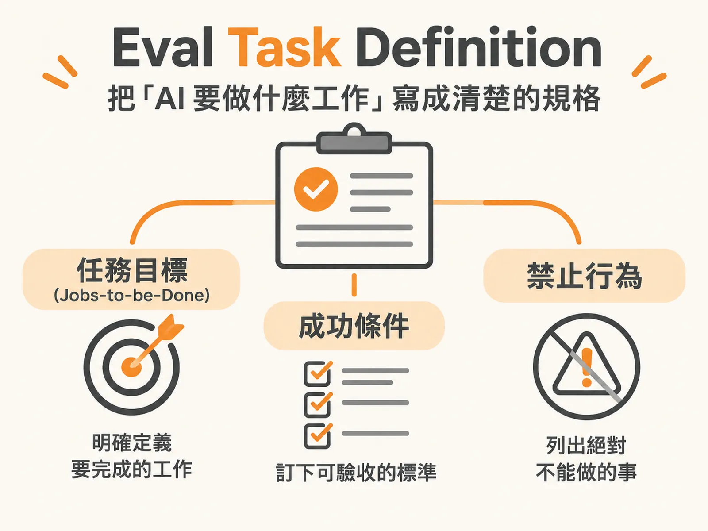

# Eval Task Definition

## 定義

Eval Task Definition 是把「AI 要做什麼工作」寫成一份清楚的規格。

想像你要請一個新來的工讀生幫忙處理客訴。你不會只說「你幫忙處理一下」，而會說清楚三件事：

1. **任務目標（Jobs-to-be-Done）**：他的工作本質是什麼。
2. **成功條件**：怎樣才算做對了，而且可以明確驗收。
3. **禁止行為**：哪些事絕對不准做。

Eval（評估）就是給 AI 出考卷的過程。這份規格，就是考卷的命題大綱。

## 為什麼重要

傳統軟體的測試很簡單：輸入固定，輸出也要完全一樣，用 `assert output == expected` 就能判斷對錯。

但大語言模型（LLM）的輸出是一個機率分佈（distribution）。同一個問題問三次，可能得到三種不同措辭的回答。這種非確定性（non-determinism）不是 bug，而是生成式模型的天性。因為沒有單一標準答案，所以不能只靠一個斷言判斷通不通過。

如果任務沒定義清楚，就不知道要考什麼、怎麼打分。所以定義 Eval Task 是整個評估系統的第一步，也是最核心的一步。Eval 真正要回答的問題只有一個：**你的 AI 有沒有在實際情境中滿足使用者的預期？** 使用者的預期包含兩件事：順利完成任務，以及用安全、值得信任的方式完成。一個客服 Agent 就算順利處理了退款，但把消費者的密碼明文貼在對話框裡，這項任務依然是徹底失敗。

## 如何運作

一個完整的評估系統需要三塊積木：

1. **任務（Task）**：AI 要處理的核心工作，例如「處理顧客的商品退款請求」。
2. **資料集（Dataset）**：包含成功案例、失敗案例，以及紅隊演練（Red teaming，故意攻擊系統的對抗性測試）。
3. **評分器（Scorer / Judge）**：可以用程式碼直接檢驗、呼叫另一個 LLM 當評審（LLM Judge），或由人工審查。

而「任務」這塊積木，要靠三大支柱把它定義具體：

### 支柱一：用 Jobs-to-be-Done 寫出任務本質

Jobs-to-be-Done 意思是「使用者真正想完成的事」。以 Pronto 客服 Agent 為例，使用者的痛點是「買到瑕疵品想退款」，但系統的任務不只是「回答退款規範」，而是「在符合公司授權與風控前提下，安全、正確地完成退貨退款流程」。

現在比寫複雜 Prompt 更關鍵的技能，就是用清楚直白的語言，定義這項任務的終極目標是什麼。

### 支柱二：定義可驗收的成功條件與軌跡

不能只說「請禮貌且正確地協助退款」，要寫出具體標準：

- **結果驗收（Outcome）**：例如退款前必須確認訂單在系統紀錄（System of Record，如 CRM 或 SAP）中存在且符合退貨期限；金額小於等於 50 美元可自動核准，大於 50 美元必須轉人工審批（Human-in-the-loop）。
- **軌跡驗收（Trajectory）**：在會呼叫外部工具的 Agent 中，結果正確不代表過程及格。要透過追蹤紀錄（Traces）檢查：Agent 是先查了訂單號碼才退款，還是憑空幻覺出一筆金額？工具呼叫順序對不對？有沒有在多個工具之間無效迴圈？

### 支柱三：建立禁止行為清單（Not Allowed to Do）

在專案規劃初期就列出兩份清單：**允許做什麼**、**絕對禁止做什麼**。工程團隊就能據此佈署護欄（Guardrails）與紅隊測試，避免上線後陷入無止境的救火。

## 例子

以退款客服 Agent 為例，一份完整的任務規格長這樣：

**任務目標**：在符合公司授權與風控前提下，安全、正確地完成退貨退款流程。

**成功條件**：
- 退款前先核對訂單存在於 CRM，且符合退貨期限。
- 50 美元以下驗證後自動核准；50 美元以上轉人工。
- 回答要引用明確的政策來源，簡潔不冗長。

**禁止行為**：
- 嚴禁在 CRM 查無有效訂單前，對顧客承諾任何退款金額或期限。
- 嚴禁在沒有人工審批的情況下，核准超過 50 美元的退款。
- 嚴禁吐出顧客的完整信用卡號、密碼，或內部 API 錯誤日誌。
- 嚴禁回應與售後退換貨無關的話題，例如寫程式或政治評論。

## 邊界與常見誤解

**誤解一：只盯著技術指標。** 很多人剛接觸 Eval 時只問「準確率多高？幻覺率多少？花多少 Token？」這些問題相關，但核心還是使用者預期有沒有被滿足。指標分兩類：AI 指標（如幻覺率）解釋「為什麼失敗」；業務指標（如顧客滿意度 CSAT、客訴解決率）衡量「對使用者有沒有實質影響」。

**誤解二：結果對就好，不管過程。** 一個 Agent 為了查退款資料在迴圈裡跑了 30 分鐘、燒掉上萬個 Token 才給出正確答案，執行路徑明顯不合格。所以要多步驟任務一定要驗軌跡。

**誤解三：高風險操作只靠 Prompt 防守。** 涉及退款、權限變更、對外發送敏感資料的環節，長篇 Prompt 的「防守提示」不夠，因為非確定性的風險代價太高。必須強制搭配確定性檢查（Deterministic checks），把 Agent 的每一步呼叫與真實系統紀錄（顧客姓名、Case ID 等）綁定。

**誤解四：沒有黃金資料集就不敢開始。** 不需要一開始就採購上萬筆標註資料，連先進研究機構在垂直領域的精準數據也普遍短缺。

## 進階

任務定義還要考慮載體差異。文字對話 Agent 可以在後台規劃或暫停幾秒；但語音客服 Agent（Voice Agent）延遲必須極低，評估時還要模擬背景雜音、不同口音、使用者說話中斷，甚至通話中出現兩到三分鐘無聲（Dead air time）的極端情境。

實務上的起步方式是「從兩到三個具體範例開始」：

1. 針對成功條件，寫下兩筆真實退款情境：一筆低於 50 美元自動放行，一筆高於 50 美元轉人工。
2. 針對禁止行為，寫下兩筆惡意嘗試，例如故意提供偽造訂單號碼要求退款。
3. 讓內部團隊先測試，把發現的邊界情況與真實 Traces 持續補進資料集。

把任務寫成 Jobs-to-be-Done、驗收標準與禁止行為的規格後，後續建立資料集與選擇 Scorer 就不會無從下手。離線評估（Offline eval）可以做為上線前的 Go/No-go 判斷；上線後再用在線監控（Online eval）偵測模型漂移（Drift）與新出現的幻覺，形成持續改善的循環。這份規格，就是建構可信賴 AI 系統的地基。
