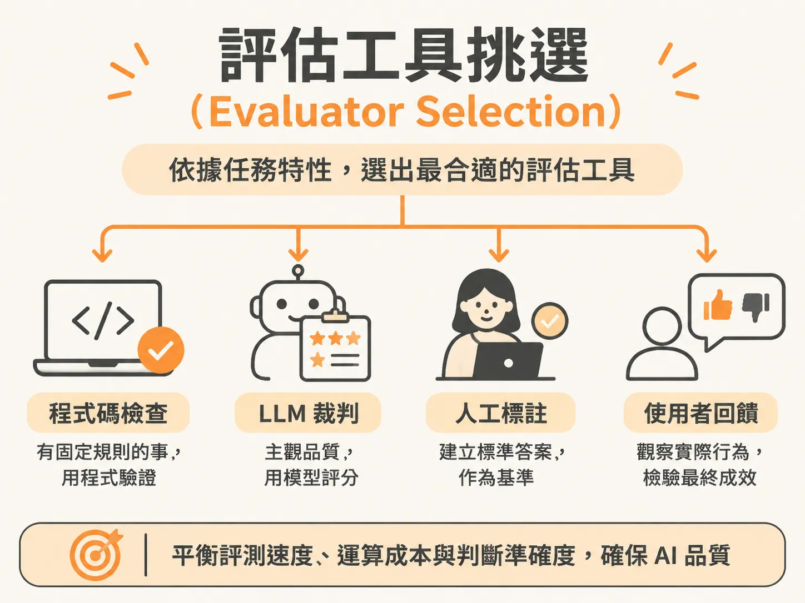

# Evaluator Selection

## 定義

評估工具挑選（Evaluator Selection）是指在檢查 AI 系統（如大型語言模型或 AI 代理人）的輸出時，依據不同的錯誤型態與檢查性質，從程式碼檢查、LLM 裁判、人工標註與使用者回饋這四種工具中，選出最合適工具的做法。

它的核心精神在於：把人類對品質的標準，依據檢查任務的難易與成本，分派給最恰當的檢查機制。

## 為什麼重要

當 AI 系統一天產生上萬筆對話紀錄時，完全依賴真人逐筆審查在規模與成本上都不可行。

然而，若把所有檢查都丟給另一個 LLM 評分，每次評測可能花費數美元，評測費用甚至會遠遠超越運行 AI 系統本身的成本。此外，LLM 裁判也可能產生幻覺或判斷漂移。選對評估工具，才能在評測速度、運算成本與判斷準確度之間取得平衡，確實把關產出品質。

## 如何運作

挑選評估工具的核心原則是：**有固定規則用程式碼、需要主觀判斷用 LLM 裁判、建立標準答案靠人工標註、最終實際成效看使用者回饋**。

1. **程式碼檢查（Code Grader）**：針對有固定規則的項目，直接用程式邏輯驗證。執行速度以秒計算、成本近乎為零，而且結果完全確定。
2. **LLM 裁判（LLM Judge）**：針對非結構化文字與主觀品質（例如摘要好壞或回覆語氣），設計 1 到 5 分的評分規準（Rubric），讓語言模型依循明確文字定義來評分。
3. **人工標註（Human Labels）**：由人類領域專家審查並建立黃金標準（Ground Truth，客觀標準答案）。這份基準用來檢驗與校準 LLM 裁判到底準不準。
4. **使用者回饋（User Feedback）**：產品上線後的最終指標，分為主動點選按讚或倒讚的「顯性回饋」，以及在使用過程中自然留下的操作行為（如接受建議或直接取消）的「隱性回饋」。

## 例子

- **檢查外部動作是否執行**：AI 代理人聲稱「已更新資料庫中的客戶資料」。此時不該叫 LLM 閱讀文字去判斷真假，而是直接用程式碼查詢資料庫欄位是否有變動，直接戳破模型說謊。
- **檢查格式正確性**：若規定系統必須回傳 JSON 資料，直接用程式碼嘗試解析即可百分之百確定；若交給 LLM 判斷，準確率反而可能只有 95%。
- **論文摘要品質**：要求 AI 摘要一百頁的研究論文，摘要是否掌握重點、邏輯是否流暢，無法寫死規則比對，此時必須交給 LLM 裁判評分。
- **編輯器程式碼採納**：在程式碼編輯工具中，開發者是選擇「按下接受」、「直接刪除」或是「送出合併請求（PR）」，這些操作行為就是最強烈的隱性使用者回饋。

## 邊界與常見誤解

- **誤以為 LLM 裁判萬能**：只要能用確定性規則比對或查資料庫說清楚的事，就絕不要召喚 LLM 介入。濫用 LLM 裁判只會徒增延遲與費用。
- **盲目信任 LLM 裁判**：LLM 裁判不能直接上線，必須先與人工標註比對校準。實務上要求兩者一致性達 85% 以上，且尤其要逐一清查「錯誤通過」（實際是不良品，裁判卻誤判為合格），避免瑕疵內容流到使用者面前。
- **誤用傳統字詞匹配指標評估自由文字**：F1、BLEU、ROUGE 等傳統機器學習指標只比對字詞重疊，完全不懂語意因果；語向量指標（如 BERTScore）甚至會把「營收成長 15%」與「營收衰退 15%」視為極度相似，從而漏掉嚴重的事實錯誤。

## 進階

在建置正式環境的評估管線時，通常會結合即時限制與三層指標進行分流：

- **線上即時檢查 vs. 離線評估**：使用者發出請求當下，只跑低延遲的防護欄（Guardrails）與個資遮罩（PII Masking）；複雜的 LLM 裁判與抽樣真人審查則移到背景的離線管線執行。
- **自動化成本控制**：先用零成本的程式碼檢查剔除格式錯誤，剩餘少數需要主觀判斷的才調用 LLM 裁判，真人複核則只保留給高風險或具爭議的邊界案例。
- **三層指標分層呈報**：對管理階層只呈報最高層的「商業成果與風險」；對產品團隊呈報中間層的「AI 代理人執行品質（如工具呼叫是否正確）」；傳統的 F1、召回率（Recall）等技術指標則退回最底層，僅用來監控檢索管線的成效，避免會議討論失焦。
